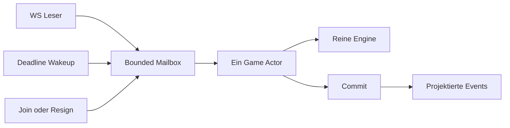

# Game Actors

[Dokumentationsindex](../INDEX.md) · [Architekturvertrag](../architecture/overview.md)

## Begriff und Motivation

Ein Actor besitzt Zustand exklusiv und verarbeitet Nachrichten nacheinander. Dadurch müssen Brett, Uhr und Versionszähler nicht unabhängig mit Mutex geschützt werden. Tokio multiplexiert viele wartende Actors auf wenigen Runtime-Threads. Nachrichten enthalten bereits einen verifizierten Principal, aber Rechte werden erneut anhand des aktuellen Aggregats geprüft.

## Bearbeitungsvertrag

Validiere Struktur und Auth-Kontext, prüfe bekannte Receipts samt Payload-Hash, dann Zustand/Rechte/expected_version. Für aktive neue Mutationen Zeit am Bearbeitungsbeginn abtasten und gegebenenfalls Timeout zuerst auflösen. Berechne Kandidat ohne Live-Zustand zu veröffentlichen; committe Version+Event+Receipt; ersetze lokalen Zustand erst bei eindeutigem Erfolg. Snapshot-Subscription wird im selben Actor-Turn mit Stream-Cursor registriert, damit kein Event zwischen Lesen und Anmelden verloren geht.

Timer-Wakeups sind Hinweise, keine unabhängigen Zustandsmutatoren. Veraltete Timer tragen einen Generation-/Versionsbezug und werden ignoriert oder an aktueller Deadline neu geprüft. Socket-Schreibvorgänge blockieren niemals Actor-Fortschritt.

## Lebensdauer und Backpressure

Ausgangswerte:256 wartende Commands pro Spiel,64 Events pro Verbindung, maximal zwei Verbindungen je seated Principal (also vier Spieler-Verbindungen insgesamt) und100 Zuschauerverbindungen pro Partie. Volle Eingangsqueue ergibt retryable busy ohne Annahme; langsame Ausgänge werden getrennt und müssen Snapshot beziehen. Nach terminalem Commit Actor erst entfernen, wenn offene Antworten geordnet abgeschlossen sind; Historie kommt aus DB. Registry-Einträge nur entfernen, wenn Generation übereinstimmt. Diese Limits durch Kapitel23 messen, nicht blind erhöhen.

Alternative Arc<Mutex<Game>> ist für einen Prototyp denkbar, verknüpft jedoch Locks, await und Timer-Races. Actor-Modell kostet Nachrichtenprotokoll und Lifecycle-Arbeit; neu bewerten, wenn Profiling echten Overhead zeigt.
