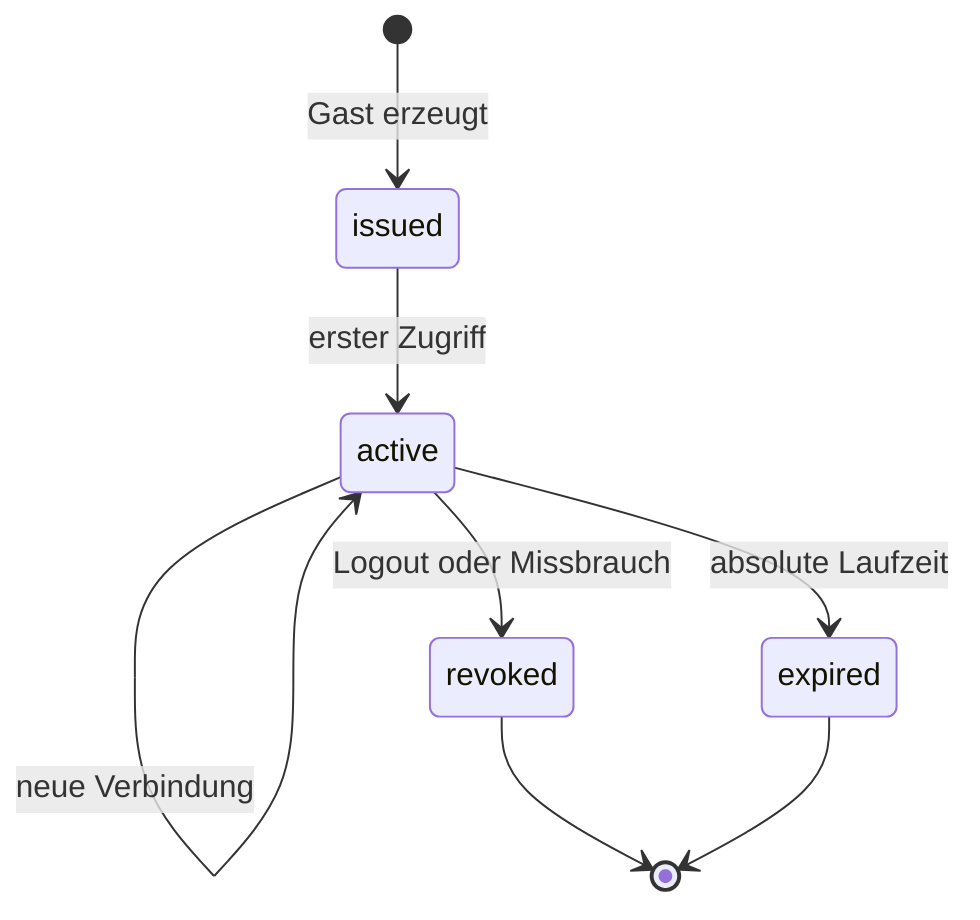

# Identität und Sessions

[Dokumentationsindex](../INDEX.md) · [Architekturvertrag](../architecture/overview.md)

Authentication beantwortet „welcher Principal?“, Authorization „darf dieser Principal diese konkrete Operation?“. Eine GameId ist keine Berechtigung; ein Anzeigename niemals Identitätsnachweis. GuestId bleibt über Verbindungen stabil und wird serverseitig erzeugt.

Session Token:256 kryptographisch zufällige Bits, einmal bei Ausgabe sichtbar; DB speichert nur SHA-256-Hash, Principal, Ablauf und revoked_at. Hohe Entropie unterscheidet Tokens von Passwörtern; schnelle Hashes sind hier vertretbar, für Passwörter später nicht. Absolute Laufzeit30Tage, keine automatische Verlängerung ohne Rotation. Native Clients speichern Token im OS Credential Store; fehlt ein sicherer Store, nur für die laufende Sitzung im Speicher behalten.

Browser verwenden same-origin HttpOnly Secure SameSite=Lax Session Cookie und keine Tokenkopie in localStorage. REST-Mutationen prüfen Origin und CSRF-Token, WS-Upgrade Origin-Allowlist. Native Requests nutzen Authorization Bearer; Tokens nie als Query-Parameter. Das erste WS-Anwendungsframe authenticate benutzt nativ Token, im Browser die beim Upgrade geprüfte Session mit leerem Payload.

Revocation muss bestehende WS-Verbindungen schließen beziehungsweise vor jeder Mutation erneut geprüft werden. Autorisierung sitzt zusätzlich im Actor. Vor Kapitel17 wird der Session-Store im Speicher gehalten und verfällt beim Neustart; danach persistent. [Session-Vertrag](../protocol/authentication.md) enthält Endpunkte und Negativtests.
