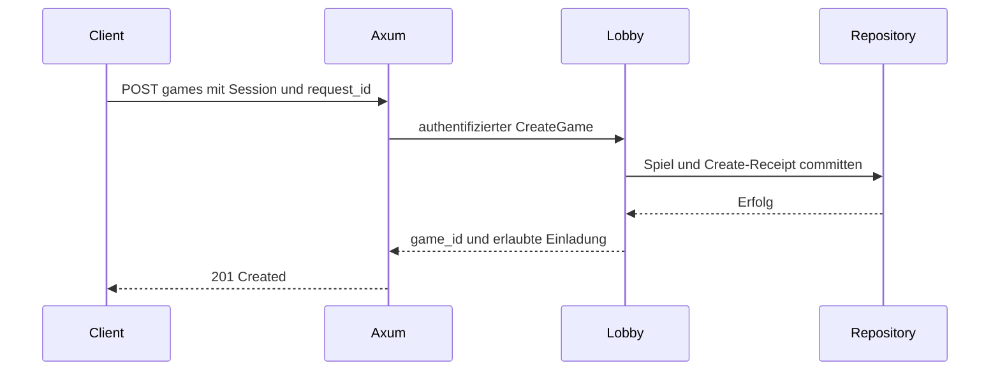
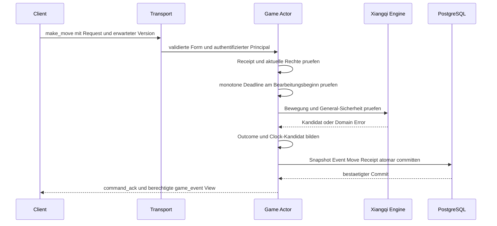

# Backend und Use Cases

[Dokumentationsindex](../INDEX.md) · [Architekturvertrag](../architecture/overview.md)

## Schichten

Axum extrahiert und begrenzt HTTP/WS-Eingaben, authentifiziert und übersetzt Errors. Application ordnet Identität und Rechte zu, routet an Lobby oder Game Actor und koordiniert Transaktionen. Die Engine beantwortet ausschließlich Regeln. SQLx-Adapter implementieren Repository-Ports. Kein Handler verändert ein Brett direkt.

Konfiguration unterscheidet bind address, public origin, DB-Verbindung, Tokenlaufzeit, Mailboxgrößen und Secrets. Fehlende Pflichtwerte verhindern Start; Debug-Ausgaben dürfen keine Zugangsdaten enthalten. Readiness benötigt initialisierte Repositories und abgeschlossene Recovery; Liveness nur einen funktionierenden Prozess, keinen erfolgreichen DB-Query.

## Ablauf Spiel erstellen

Ab Kapitel17 müssen auch REST-Mutationen retry-sicher sein. Create-Receipts verwenden Principal+request_id+Operation als Scope, weil noch keine GameId existiert. Join/Cancel laufen im Game-Scope. Request-Abbruch darf einen begonnenen DB-Commit nicht als sicheren Rollback behandeln; Ergebnis später über Receipt abfragen.

## Lern- und Betriebsgrenzen

Zunächst ein Prozess mit festem Kapazitätslimit. CPU-lastige Analysen und unbeschränktes JSON gehören nicht auf Runtime-Tasks. Skalierung über mehrere Server ist keine einfache Load-Balancer-Änderung: Actor-Ownership müsste mit Fencing und Routing neu entworfen werden. [Concurrency](concurrency.md) definiert diese Grenze.

## Autoritativer Move-Pfad ab Kapitel17

Das Diagramm zeigt den neuen legalen Move vor Deadline. Duplicate Requests enden am Receipt; Fehler enden ohne Kandidatcommit. Ist Deadline erreicht, läuft statt Engine-Move der terminale Timeoutpfad durch dieselbe Persistenzgrenze. Transport, Actor und Engine sind verschiedene Verantwortlichkeiten, keine drei Dienste.
