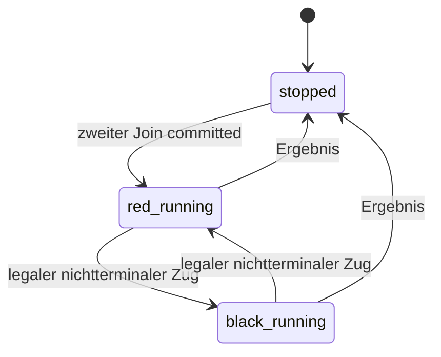
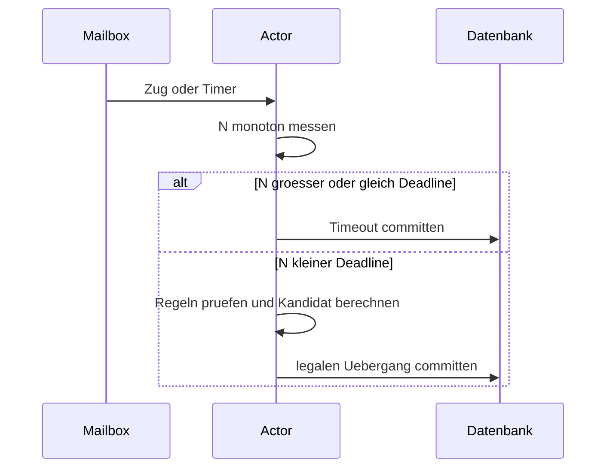

# Autoritative Schachuhren

[Dokumentationsindex](../INDEX.md) · [Architekturvertrag](../architecture/overview.md)

## Zweck, Eingaben und Invarianten

Die Clock Engine entscheidet, ob eine zeitgebundene Aktion noch angenommen werden darf. Eingaben sind aktiver Sitz, gespeicherte Restbudgets in Millisekunden, monotone Turn-Startzeit, Inkrement und injizierbares now. Ausgabe ist neue Clock State oder Timeout. Budgets werden niemals negativ veröffentlicht; im aktiven Zustand läuft genau eine Seite. Wall Clock dient nur Audit und Ablaufdaten, niemals laufender Zugmessung. std::time::Instant hat keinen portablen Persistenzwert.

Für aktive Seite mit Budget B, Start S und Bearbeitungszeit N ist elapsed=N−S und Anzeige max(0,B−elapsed). Deadline=S+B. N>=Deadline bedeutet Verlust durch Zeit, auch wenn der Zug Matt setzen würde. Alle Berechnungen verwenden geprüfte Integer-Dauern; Eingaben außerhalb Presets werden abgelehnt. Die Berechnung kostet O(1), benötigt O(1) zusätzlichen Speicher und keine Timer pro Millisekunde.

## Ereignisordnung

Der Actor misst Zeit beim Beginn der Bearbeitung jedes neuen zustandsändernden Commands. Eine bekannte Duplicate-request_id liefert zuerst das alte Receipt zurück und verändert keine Uhr. Ein neuer Zug, Resign oder anderer aktiver Command kann nach Frist keine abweichende Endursache erzwingen. Timer-Wakeup und Zug rufen dieselbe Deadline-Prüfung auf. Queue-/Netzwerklatenz zählt zur verbrauchten Zeit; Kiban kompensiert sie im MVP nicht. Das ist einfach überprüfbar, aber bei Last oder hoher Latenz unfairer als Arrival-Stamping. Solche Verbesserungen erfordern eine neue ADR und vertrauenswürdige serverseitige Reihenfolge, keine Client-Zeitstempel.

Beim gültigen nichtterminalen Zug wird das alte Budget um elapsed reduziert und genau einmal increment addiert. Die Gegenseite beginnt am gleichen gemessenen N, DB-Zeit zählt danach bereits gegen ihre Uhr. Dadurch kann eine langsame DB spürbare Zeit kosten; bei Fehlern wird abgebrochen, bei hoher Commit-Latenz muss die Partieaufnahme reduziert werden. Ein terminaler legaler Zug zieht elapsed ab, gibt kein Inkrement und stoppt beide Seiten. Ein illegaler Zug bewirkt keinen Reset des Startzeitpunkts und kein Inkrement.

## Synchronisation und Recovery

Snapshots enthalten remaining_ms je Seite, active_side, sampled_at_server_ms als Wall-Clock-Diagnosewert und turn_elapsed_ms beziehungsweise zum Snapshot berechnete Restwerte. Client projiziert ab Empfang mit lokaler monotoner Zeit und darf nie Resultate setzen. Netzwerkverzögerung erzeugt Anzeigeabweichung; nächster Snapshot korrigiert. Kein Client-Server-Wall-Clock-Abgleich entscheidet Timeout.

Persistiert werden auf den letzten Übergang bezogene Budgets, aktive Seite und auditierbare UTC-Werte. Nach Neustart wird nicht aus UTC-Differenzen weitergerechnet: aktive Partie wird neutral server_restart abgebrochen. Disconnect verändert Clock State nicht.

## Deterministische Prüfmatrix

Bei B=1000ms: N=S+999ms legal, N=S+1000ms Timeout, N=S+1001ms ebenfalls Timeout. Bei B=1000ms, elapsed400ms und increment2000ms wird nichtterminal2600ms gespeichert. Ein terminaler Zug bei gleicher Zeit speichert600ms. Zwei Timer erzeugen nur ein Ergebnis. Ein alter Timer nach Zugwechsel kann die neue Seite nicht verlieren lassen. Systemuhrsprung±1h ändert kein Ergebnis. Fake Clock wird ohne echtes Warten vorwärtsgesetzt; Rückwärtsbewegung der monotonen Abstraktion muss als Test-/Systemfehler erkannt werden.
