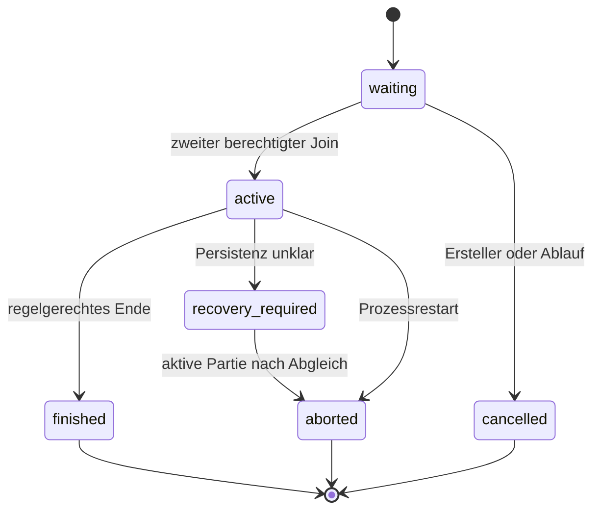

# Domain Model

[Dokumentationsindex](../INDEX.md) · [Architekturvertrag](../architecture/overview.md)

## Begriffe und Invarianten

PrincipalId identifiziert einen Menschen beziehungsweise Gast unabhängig von Credentials. GuestSession authentifiziert einen Principal; Account verknüpft später dieselbe Identität. GameId adressiert ein Aggregat mit game_kind, ruleset_id, Sichtbarkeit, zwei Sitzen, Lifecycle und state_version. Ein InvitationCode ist eine Berechtigung zum Beitritt, keine Spieleridentität. TimeControl enthält initial_ms und increment_ms; nur freigegebene Presets sind im MVP erlaubt.

GameState ist spielabhängig: XiangqiPosition mit 90 Schnittpunkten und Zugrecht; JunqiState mit Deployment, Graph, verborgenen Rängen und Offenlegungen. Ein gemeinsames untypisiertes Universalbrett würde illegale Kombinationen ermöglichen. GameResult enthält winner oder draw, reason und final_version; aborted ist ausdrücklich kein sportlicher Sieg.

finished, cancelled und aborted sind terminal. recovery_required ist ein interner Betriebszustand des Actors; der persistente öffentliche Lifecycle bleibt active, bis der Abbruch committed ist. Er ist keine freie Pause. Das Diagramm zeigt diese interne Erweiterung ausdrücklich mit. Verbindungsstatus ist außerhalb der fachlichen Spielphase: ein Offline-Spieler kann weiterhin am Zug sein. Rated ist ein späteres Matchattribut und kann nicht nach Spielbeginn geändert werden.

## Modellierungsübung

Für jeden Übergang Vorbedingungen, Akteur, Auswirkungen auf Version/Uhr und verbotene Folgeübergänge tabellarisch erfassen. Ownership hält ein Aggregat beim Actor; die Engine erhält einen geliehenen unveränderlichen Zustand und liefert validiertes Ergebnis oder Domain Error. Keine Session Tokens oder SQL-Zeilen in Engine-Typen. Prüfe als Gegenbeispiel: derselbe Principal auf beiden Sitzen, zwei Sieger, negativer Zeitrest und finished ohne Ergebnis.
