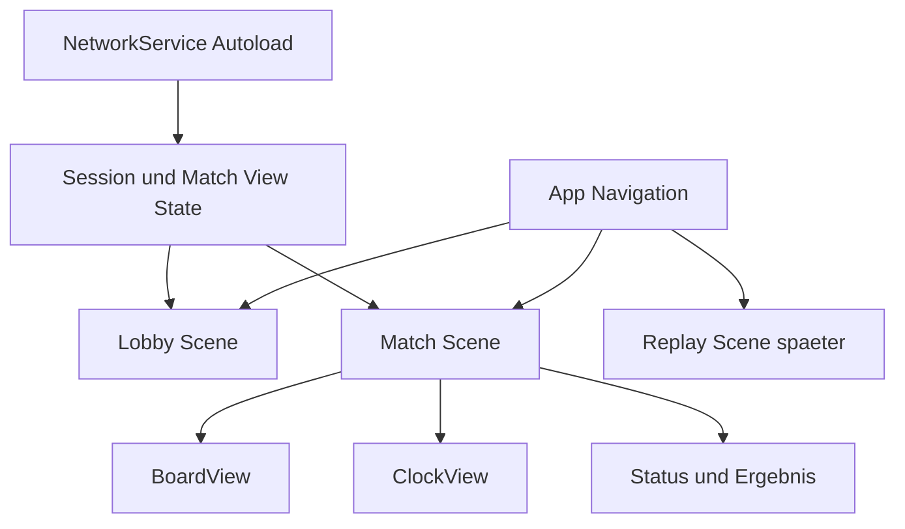

# Godot-Frontend

[Dokumentationsindex](../INDEX.md) · [Architekturvertrag](../architecture/overview.md)

## Zuständigkeiten

Eine Scene ist ein wiederverwendbarer Node-Baum. Nodes besitzen Lifecycle und UI-Verhalten; Signals transportieren entkoppelte Benachrichtigungen. Ein Autoload lebt unabhängig von wechselnden Scenes und eignet sich für NetworkService und SessionStore. Ein Autoload als globale Sammlung sämtlicher Brettdaten würde Ownership und Tests verschleiern.

NetworkService kapselt HTTPRequest, WebSocketPeer.poll, JSON, Connection State, Backoff und Limits. DTO-Validierung erzeugt ein geprüftes View Model; Scenes konsumieren Signals mit immutable Snapshot-Kopien. MatchController verwaltet pending request und Version, BoardView nur Auswahl und Darstellung. UI darf illegale Klickformen wie „außerhalb Brett“ verwerfen; sie dupliziert keine vollständige autoritative Regelengine.

## Darstellung und Eingabe

Logische Xiangqi-Koordinaten x0..8,y0..9 bleiben unabhängig von Bildschirmrotation. Red unten bedeutet y0 unten; Black-Perspektive dreht beide Achsen. Mapping muss invertierbar für Schnittpunktzentren sein und bei Resize/Margin denselben Zustand darstellen. Eingaben außerhalb eines definierten Fangradius werden verworfen. Farben und Textsymbole unterstützen Zugrecht und Fehler, ohne nur Farbwahrnehmung vorauszusetzen.

WebSocket wird im Frame-Lifecycle gepollt; niemals eine blockierende Reconnect-Schleife auf UI-Thread. Nach Disconnect bleibt letzter Stand sichtbar mit Offline-Hinweis und gesperrter Mutation. ClockView interpoliert aus Snapshot und lokaler monotoner Zeit, kann null zeigen, aber erklärt keinen Sieger. Kapitel18/19 nutzen statische Fixtures; Netzwerk folgt erst20.
