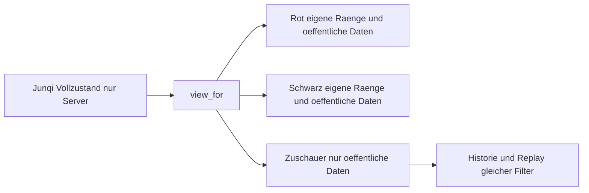

# Mehrspielplattform und Views

[Dokumentationsindex](../INDEX.md) · [Architekturvertrag](../architecture/overview.md)

## Grenze der Wiederverwendung

Gemeinsam: Principal, Session, Lobby, Sitze, Match-ID, Actor-Routing, Request-Receipt, Eventversion, Persistenz und Transport. Spielabhängig: Position, Move, Legalität, Phase, Resultat und View. Engine-Port benennt validate_action, apply_action, outcome und view_for; dies sind Verantwortlichkeiten, keine fertigen Rust-Traits.

Ein GameKind diskriminiert Xiangqi und Junqi. ruleset_id ist unveränderlich und versioniert die Fachregeln. Nicht jedes Spiel hat zwei Spieler, vollständige Information oder eine regelmäßige Brettmatrix; spätere Shogi-/Go-Erweiterung prüft diese Annahmen ausdrücklich. Xiangqi-Repetition gehört nicht in die Plattform-Actor-Basisklasse.

Projektion geschieht vor Serialization, Logging und Broadcast. Ein Broadcast-Objekt für alle Empfänger wäre bei Junqi ein Informationsleck. Command-Acks dürfen keine vollständigen internen Combat-Daten enthalten. Auch nach Ende bleiben Gegner-Ränge verborgen, soweit sie nicht öffentlich aufgedeckt wurden; keine automatische omnisciente Replay-Freigabe im ersten Profil.

## Entscheidung

Generischer Plattformrahmen plus getrennte konkrete Engines wird gegenüber einem Universalboard gewählt: weniger Wiederverwendung auf Zellebene, dafür klarere Invarianten und versteckte Information. Eine Enum-Dispatch-Integration genügt beim modularen Monolithen. Dynamische Plugins/WASM erst bei unabhängig ausgelieferten Spielen neu bewerten. [Junqi-Spezifikation](../rules/junqi-variants.md) definiert die konkrete erste Variante.

## Aktivierung bei Deployment-Spielen

Die in Kapitel11 eingeführte Regel „zweiter Join aktiviert Rot“ gilt für Xiangqi. Bei Junqi beginnt mit zweitem Seat zunächst position.phase=deployment; der öffentliche Lifecycle bleibt waiting, die Partie ist voll und wird nicht mehr als beitretbar gelistet. Der Actor besitzt sie bereits und verarbeitet submit_deployment/ready_deployment. Erst beidseitiges Ready wechselt status=active und phase=playing in einem Commit. Alle Waiting-Spiele laufen24h nach Erstellung ab, auch unvollständige Deployments; Cancel/Ready-Races werden vom selben Actor serialisiert. Untimed bedeutet keine Spieluhr, nicht unbegrenzte Reservierung einer Lobbyressource.

Junqi known_kind ist null oder einer der Werte commander,general,division,brigade,regiment,battalion,company,platoon,engineer,mine,bomb,flag. Opake piece_id codiert weder Rang noch Deploymentreihenfolge. Ein Viewer darf aus unbekannten Identifikatoren keinen Rang ableiten können.
