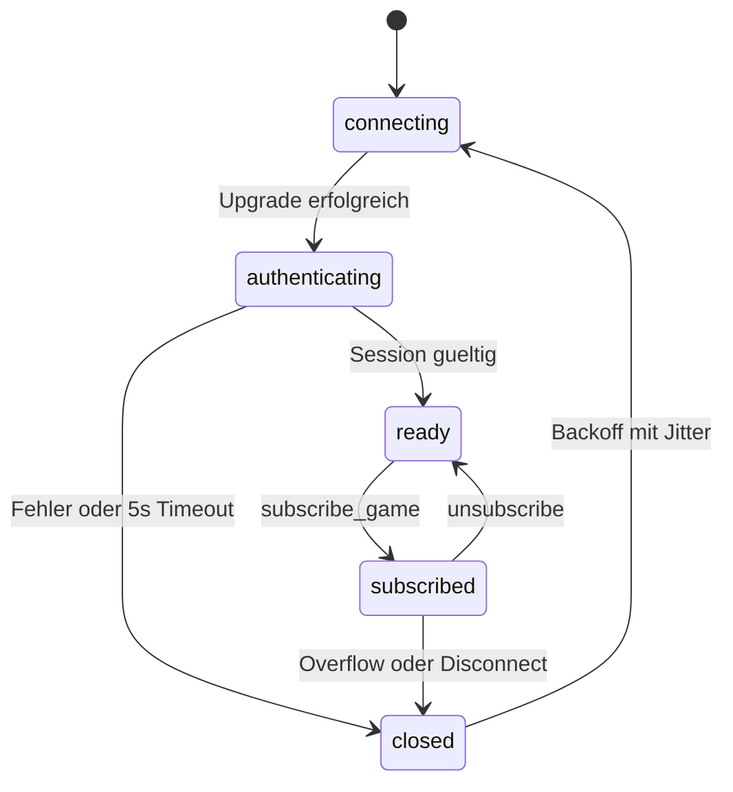

# Netzwerkgrenzen

[Dokumentationsindex](../INDEX.md) · [Architekturvertrag](../architecture/overview.md)

REST verwaltet Ressourcen und Bootstrapping; WebSocket transportiert Commands, Snapshots und laufende Events. HTTPS/WSS ist außerhalb lokaler Entwicklung Pflicht. TCP-Reihenfolge gilt nur für eine Verbindung, nicht über Reconnect oder zwei Geräte hinweg. Darum benötigt Kiban eigene Versionen und Receipts.

JSON Textframes sind im MVP die einzige Anwendungsdarstellung. Keine Domain-Serialisierung ungefiltert senden. Maximale Commandgröße16KiB, maximale projizierte Snapshotgröße64KiB; größere Ausgabe ist Serverfehler und erfordert anderes Paging/Protokolldesign. Heartbeat alle20s, Verbindung nach60s ohne Lebenszeichen schließen; Reverse-Proxy idle timeout mindestens75s. Kontroll-Ping/Pong und Anwendungs-Heartbeat dürfen nicht mit Spielzügen verwechselt werden.

HTTP-Limit16KiB für kleine Mutationen, paginierte Listen maximal50 Einträge. Reconnect nutzt exponentiellen Backoff von0.5s bis30s mit Jitter. Keine automatische Mutation mit neuer request_id nach Fehler. [Protokollspezifikation](../protocol/overview.md) definiert Details.
