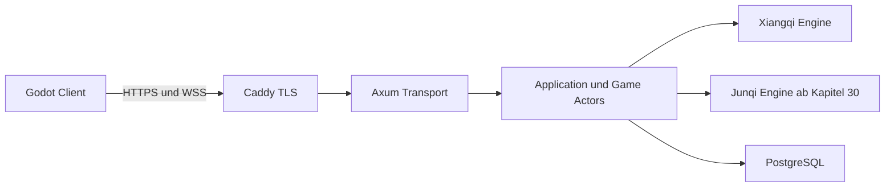

# Verbindlicher Architekturvertrag

[Dokumentationsindex](../INDEX.md) · [Architekturvertrag](../architecture/overview.md)

## System und Zuständigkeiten

Kiban ist ein modularer Monolith mit einem Serverprozess und PostgreSQL. Godot kommuniziert über HTTPS für Ressourcen und WSS für laufende Partien. Caddy terminiert TLS. Der Server besitzt Identität, Lobby, Actors, Engine-Aufrufe und Persistenz; die Engine besitzt ausschließlich deterministische Spielregeln. Ein Actor ist eine Tokio-Task, kein eigener OS-Thread.

## Einheitliche Entscheidungen

- /api/v1 ist der REST-Namespace, /api/v1/ws der WebSocket-Endpunkt. protocol_version ist1.
- request_id bezeichnet eine Mutation pro Principal und Partie; expected_version ist die zuletzt bekannte state_version. Receipt-Prüfung erfolgt vor Versionsvergleich.
- state_version zählt jede dauerhaft angenommene Zustandsänderung. Events enthalten eine vollständige berechtigte Projektion, keine Patch-Sprache.
- Ein Game Actor besitzt ein Aggregat exklusiv und serialisiert seine bounded Mailbox. Die Lobby serialisiert Sitzvergabe und übergibt die aktivierte Partie atomar an genau einen Actor.
- Uhren werden beim Bearbeitungsbeginn einer Mutation monoton gemessen. now >= deadline bedeutet Timeout vor dem Zug; Netzwerkankunft erzeugt keinen Zeitanspruch. Ein akzeptierter nichtterminaler Zug erhält Fischer-Inkrement; terminale Züge erhalten keines.
- Ab Kapitel17 werden Aggregate, Event und Receipt vor Ack/Broadcast atomar committed. Keine Bestätigung aufgrund eines bloßen Speicherupdates.
- Bei unklarem Commit-Ausgang wird die Partie recovery_required und für Mutationen gesperrt. Nach DB-Abgleich wird eine aktive betroffene Partie neutral aborted(persistence_failure); ein bereits committed terminales Ergebnis bleibt erhalten. Es gibt keinen automatischen Weiterlauf mit geratenem Zeitbudget.
- Nach Prozessrestart werden zuvor aktive Partien dauerhaft aborted(server_restart), ohne Rating. Monotone Instants werden nicht restauriert. Waiting-Partien und Sessions bleiben anhand persistierter Ablaufzeiten gültig.
- Disconnect hält Zeit nicht an. Reconnect erhält atomar Snapshot plus anschließende geordnete Events. Jeder Snapshot durchläuft View-Redaction.

## Stufen und Grenzen

Kapitel01–08 benötigen weder Tokio noch DB. Kapitel09–16 nutzen bewusst austauschbare Speicher-Repositories. Diese Stufe verliert Zustand bei Crash und darf nicht als produktionsreif bezeichnet werden. Kapitel17 führt die Durability-Grenze ein; Kapitel18–22 integrieren Godot. Accounts und weitere Spiele erweitern Application-Ports, nicht die Xiangqi-Brettstruktur.

[ADRs](../decisions/README.md) begründen diese Festlegungen. [Protokoll](../protocol/overview.md), [Transaktionen](../database/transactions.md) und [Uhren](chess-clocks.md) sind die detaillierten Verträge. Bei Widerspruch zuerst diese Verträge synchronisieren und danach Kapitel ändern; widersprüchliche Implementierungen dürfen kein Gate bestehen.
