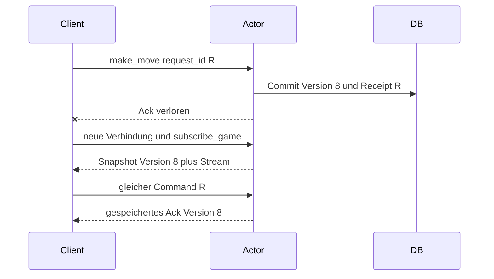

# Wiederverbindung und Idempotency

[Dokumentationsindex](../INDEX.md) · [Architekturvertrag](../architecture/overview.md)

## Problem

Eine verlorene Verbindung beweist weder Annahme noch Ablehnung des letzten Commands. TCP liefert kein exactly-once über neue Verbindungen. Kiban erreicht wiederholbare fachliche Effekte durch stabile request_id, payload_hash, durable Receipt und Versionsprüfung. Scope ist GameId+PrincipalId+request_id; dieselbe ID mit anderem kanonischen Payload ergibt request_id_conflict.

Client hält genau eine eigene offene Mutation pro Partie. Nach Disconnect bewahrt er ID und Payload. Nach Authentication und Snapshot kann derselbe Command erneut gesendet werden: Receipt gewinnt vor expected_version, daher wird ein schon angenommener Zug bestätigt, obwohl die Partie inzwischen fortgeschritten ist. Neue ID würde eine neue Absicht ausdrücken und ist kein Retry.

## Snapshot-Vertrag

Actor registriert Subscriber und erzeugt View auf Version V innerhalb eines seriellen Turns. Danach folgen ausschließlich Events >V. Snapshot vollständig ersetzen, nie Felder alter Position mischen. Events mit <=lokaler Version ignorieren; >lokal+1 lösen resync aus. Während resync Eingabe sperren und keine unbestätigten Brettänderungen als Wahrheit darstellen.

Reconnect gibt keinen neuen Sitz und keine neue GuestId. Abgelaufene Session erfordert neue Anmeldung; ein verlorener Gasttoken kann im MVP nicht über Anzeigenamen wiederhergestellt werden. Mehrere Geräte eines Principals erhalten dieselben Views, aber nur einer ihrer konkurrierenden Commands kann die erwartete Version treffen.

## Grenzen

Ein privates Spiel wird nicht allein durch Kenntnis der GameId lesbar. Einladung gilt für Join, nicht für Zuschauerzugriff. Resume nach Prozessrestart zeigt aborted(server_restart) bei aktiver Partie. Ein langsamer Subscriber wird getrennt; die durable History ermöglicht Wiederherstellung ohne unendlichen Broadcast-Puffer.
