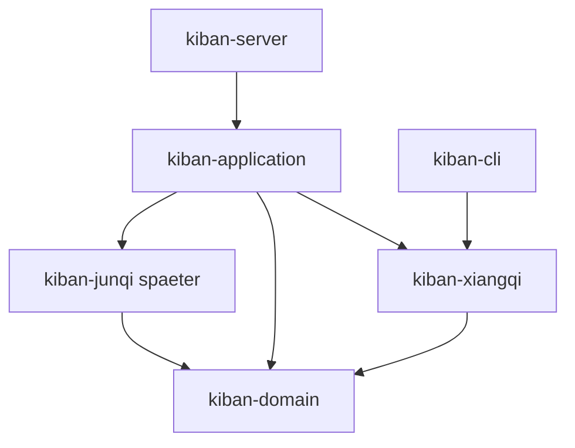
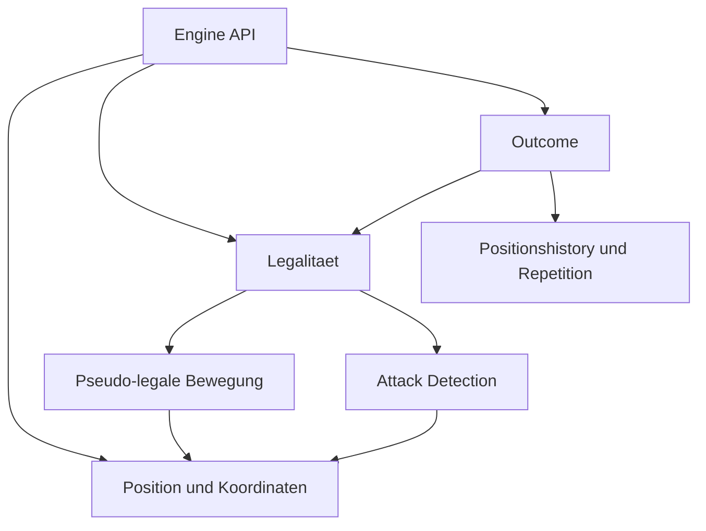

# Rust-Workspace und Abhängigkeiten

[Dokumentationsindex](../INDEX.md) · [Architekturvertrag](../architecture/overview.md)

## Geplante Struktur, keine initialisierten Projekte

Die spätere Workspace-Wurzel heißt kiban. Geplante Crates: kiban-domain (IDs und Plattformverträge), kiban-xiangqi (Regeln), kiban-application (Use Cases/Actors und Repository-Ports), kiban-server (Axum, SQLx, Konfiguration), kiban-cli (lokaler/Terminaladapter). kiban-junqi folgt erst in Kapitel30. Godot lebt später separat unter client/; Dokumente bleiben unter docs/.

Pfeile bedeuten Compile-Abhängigkeiten. Kein Engine-Modul importiert Axum, SQLx oder Godot. Repository-Ports gehören zur Application, konkrete SQLx-Adapter zum Server. Serialization-DTOs liegen an Adaptergrenzen; Domain Types müssen nicht ungeprüft wire-deserialisierbar sein.

## Entscheidung und Nachweis

Ein einzelnes Crate wäre am Anfang einfacher, erzwingt aber Grenzen nur durch Konvention. Zu viele Crates erhöhen Lernlast und Build-Konfiguration. Diese kleine Aufteilung macht verbotene Rückabhängigkeiten sichtbar. Erst bei tatsächlichen Build-/Teamproblemen aufteilen. Der Lernende prüft Cargo dependency graph, testet Engine ohne Netzwerk und hält gemeinsame Dependency-Versionen fest. Keine automatische Initialisierung ist Bestandteil dieses Handbuchs.

## Interne Xiangqi-Grenzen

Attack Detection importiert keine vollständige Legal-Move-Generation und verhindert so rekursive Zyklen. Outcome fragt mögliche Antworten und Repetition ab, entscheidet aber keine Netzwerkzeit. Clock und Authorization liegen ausschließlich in Application.
