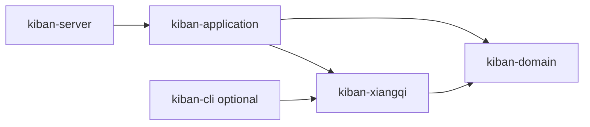

# 01 — Rust Tooling, Git, Cargo Workspaces und CI

[Dokumentationsindex](../INDEX.md) · [Fortschritt](../checklists/project-progress.md)

## 1. Chapter Overview

Dieses Kapitel schafft die reproduzierbare Arbeitsumgebung für Kiban. Das Ergebnis deiner späteren Eigenimplementierung ist ein kleiner, überprüfbarer Rust Workspace mit getrennten Verantwortlichkeiten und einer CI, die dieselben Prüfungen wie lokal ausführt. Es entsteht noch kein HTTP-Server und keine Godot-Anwendung. Die vorliegenden Dokumente führen selbst keinerlei Initialisierung aus.

Plane zwei bis vier Lerneinheiten für Tooling und einen eigenen Block für das Verstehen von Compilerdiagnosen ein. Ein erfolgreicher Build allein beweist noch keine fachliche Richtigkeit; er schafft die Grundlage für die folgenden Kapitel.

## 2. Prerequisites

- Allgemeine Programmierkenntnisse, Terminalbedienung und Dateisystemgrundlagen.
- Git-Grundbegriffe: Working Tree, Staging Area, Commit und Branch. Lies die unten genannten Kapitel vor dem ersten Commit, falls diese Begriffe neu sind.
- Ein Editor und eine lokal installierbare stabile Rust Toolchain; für dieses Kapitel sind weder PostgreSQL noch Godot erforderlich.
- Lies [Lernleitfaden](../LEARNING_GUIDE.md), [Workspace-Architektur](../architecture/rust-workspace.md) und die NO-AI-CODING-Regel in der Projektvorgabe.

## 3. Learning Objectives

- Du kannst Package, Crate, Module und Workspace anhand des geplanten Kiban-Aufbaus unterscheiden.
- Du kannst einen Compilerfehler auf die verursachende Quellstelle zurückführen und eine minimale Korrektur begründen.
- Du kannst lokale Formatierung, Lints und Tests reproduzierbar ausführen.
- Du kannst zeigen, dass `kiban-xiangqi` ohne Server, Netzwerk und Datenbank gebaut und getestet wird.

## 4. Concepts and Theory

### Toolchain und Edition

Die Toolchain umfasst Compiler, Cargo und Werkzeuge. Eine Edition ist ein expliziter Sprachkompatibilitätsmodus; sie ist weder Compiler-Patchversion noch eine Bibliotheksversion. Für Kiban verwendest du Rust stable und Edition 2024, hältst die konkret getestete Toolchain fest und aktualisierst sie bewusst. Das verhindert Unterschiede zwischen Rechner und CI. Ein häufiger Fehler ist, „stable“ mit einer unveränderlichen Version gleichzusetzen. Lies im Rust Book „Installation“ und „Editions“, bevor du Toolchain und Edition dokumentierst.

### Package, Crate und Workspace

Ein Package wird durch ein Manifest beschrieben; seine Bibliothek oder ausführbare Einheit ist eine Crate. Ein Workspace verwaltet mehrere Packages gemeinsam und teilt unter anderem den Lockfile. Kiban benötigt getrennte Bibliotheksgrenzen für Domain, Regeln und Anwendung, obwohl später ein einziger Serverprozess ausgeliefert wird. Verwende nicht für jeden kleinen Typ eine eigene Crate: Module reichen innerhalb einer Verantwortung. Der Cargo Book erläutert „Workspaces“ und „Package Layout“.

### Dependency Graph und Sichtbarkeit

Ein Dependency Graph beschreibt, wer wen verwenden darf. Eine öffentliche API ist eine langfristige Verpflichtung; interne Details bleiben privat. Der Regelkern darf keine HTTP-Typen kennen, damit Unit-Tests schnell und deterministisch bleiben. Zirkuläre Abhängigkeiten sind ein Hinweis auf vermischte Verantwortlichkeiten. Diese Trennung ist jetzt sinnvoll, bevor Netzwerkadapter den Kern beeinflussen. Lies im Rust Book „Packages, Crates, and Modules“.

### Compiler, Formatter und Linter

Der Compiler prüft unter anderem Typen und Ownership. `rustfmt` vereinheitlicht Darstellung; Clippy erkennt zusätzliche verdächtige Muster. Keines der Werkzeuge kann fehlende Xiangqi-Regeln beweisen. In Kiban laufen alle drei mit Tests als Quality Gate. Ein häufiger Fehler ist, Warnungen pauschal auszuschalten, statt ihren Grund zu verstehen. Werkzeuge sind besonders nützlich bei kleinen Änderungen, weil die Ursache dann überschaubar bleibt.

### Versionskontrolle und CI

Ein Commit ist eine nachvollziehbare Änderung, keine Sicherung beliebiger Zwischenstände. CI wiederholt vereinbarte Checks in einer sauberen Umgebung. Kiban hält den Lockfile unter Versionskontrolle, damit ein Deployment dieselben aufgelösten Dependencies nutzt. Secrets, Build-Artefakte und lokale Editorzustände gehören nicht hinein. GitHub Actions wird hier als Prüfumgebung gelernt; Veröffentlichung und Deployment kommen erst in Kapitel 25.

## 5. Architectural Context

Die geplanten Packages heißen `kiban-domain`, `kiban-xiangqi`, `kiban-application` und `kiban-server`. Der optionale Terminaladapter heißt `kiban-cli`. In diesem Kapitel musst du nur die für die nächsten Domain-Aufgaben benötigten Packages anlegen; spätere Adapter dürfen als Architekturentscheidung dokumentiert bleiben.

Pfeile bezeichnen Compile-Time-Abhängigkeiten. Kiban ist ein modularer Monolith: mehrere Bibliotheken bedeuten keine mehreren Deployments. Fachlicher State gehört künftig dem Kern beziehungsweise dem Game Actor; Cargo besitzt keinen Laufzeit-State.

## 6. Design Decisions

**Verbindlich: Ein Workspace mit gerichteten Abhängigkeiten.** Problem: Regeln sollen ohne Infrastruktur verwendbar sein. Alternative: eine einzelne Crate mit Modulen; sie ist anfangs einfacher, schützt aber die Infrastrukturgrenze weniger deutlich. Mehrere Repositories erschweren gemeinsame Änderungen und bringen hier keinen Nutzen. Die gewählte Lösung bietet Compile-Time-Grenzen, verlangt jedoch Manifestpflege. Prüfe die Aufteilung erneut, wenn eine Crate nur triviale Weiterleitung enthält.

**Verbindlich: getestete Versionen festhalten.** Ein unkontrolliertes „immer latest“ vereinfacht erste Installation, erschwert aber Fehlerreproduktion. Aktualisiere Toolchain und Dependencies getrennt und mit vollständigen Prüfungen. Optional darfst du unterschiedliche Editoren vergleichen; Editorwahl ist keine Systemarchitektur.

## 7. Implementation Tasks

- [x] 1. Erfasse in einer eigenen Arbeitsnotiz Betriebssystem, Editor und Ausgaben von `rustc --version`, `cargo --version` und `git --version`; prüfe, dass du ihre Rollen erklären kannst.
- [x] 2. Lies Compilerdiagnosen anhand eines selbst geschriebenen kleinen Lernbeispiels außerhalb der Anwendung; halte Ursache, Diagnose und Korrektur fest, ohne die Fehlermeldung nur zu unterdrücken.
- [x] 3. Skizziere anhand des Diagramms die künftigen Package-Verzeichnisse und erlaubten Abhängigkeiten; kontrolliere jeden Pfeil gegen die Workspace-Architektur.
- [x] 4. Erstelle bei deiner Implementierung das minimale Root-Manifest und die zunächst benötigten Library-Packages eigenständig. Verifiziere die Workspace-Mitglieder mit Cargo-Metadaten; füge noch keinen Server hinzu.
- [x] 5. Definiere Edition und gemeinsame Metadaten bewusst; kontrolliere, dass Package-Namen `kiban` als Plattformbezug tragen und nicht die gesamte Plattform auf Xiangqi reduzieren.
- [x] 6. Ergänze einen selbst geschriebenen einfachen Test pro vorhandener Bibliothek, um den Testlauf nachzuweisen; fachliche Testfälle folgen in Kapitel 03 und 04.
- [x] 7. Lege eine Git-Ignore-Regelung für Build-Ausgaben und lokale Dateien fest; prüfe vor dem Commit die tatsächlich gestagten Dateien auf Secrets und Artefakte.
- [x] 8. Führe `cargo fmt --check`, `cargo clippy --workspace --all-targets -- -D warnings` und `cargo test --workspace` aus; behebe jede Diagnose mit einer begründeten Änderung.
- [x] 9. Schreibe eigenständig eine minimale GitHub-Actions-Prüfung, die die festgehaltene Toolchain installiert und dieselben Befehle ausführt; diese Dokumentation liefert bewusst keine fertige Konfiguration.
- [x] 10. Prüfe eine absichtlich unformatierte Änderung in einem temporären Branch; zeige, dass CI fehlschlägt, und korrigiere sie vor Integration.
- [x] 11. Rekonstruiere den Build aus einem sauberen Checkout ohne unversionierte lokale Dateien; dokumentiere Installationsschritte und prüfe den Lockfile.
- [x] 12. Erstelle einen kleinen Commit mit ausschließlich dieser Grundlage und führe einen Selbstreview der Abhängigkeitsrichtung durch; verlinke den Nachweis im Completion Record.

## 8. Public Interfaces and Contracts

| Vertrag | Verantwortung | Nachweis |
|---|---|---|
| Workspace `kiban` | gemeinsame Dependency-Auflösung und Prüfungen | alle Mitglieder werden geprüft |
| `kiban-domain` | spielübergreifende fachliche Identitäten und Werte | keine Infrastrukturabhängigkeit |
| `kiban-xiangqi` | deterministische Xiangqi-Regeln | separat testbar |
| `kiban-application` | spätere Use Cases und Orchestrierung | kein Godot-Code |
| `kiban-server` | späterer Transport- und Infrastrukturadapter | kein Regelalgorithmus |

Es gibt noch keine Netzwerk-API. Ein Erfolgscode des Testbefehls ist der lokale Werkzeugvertrag; CI verwendet dieselben Quality Gates. Eine optionale Terminaloberfläche verändert den Regelkern nicht.

## 9. Edge Cases

- Eine Dependency benötigt eine neuere Compiler-Version: nicht blind aktualisieren; Mindestversion und Änderungsumfang prüfen.
- Ein Test funktioniert nur durch eine lokale Datei: Fixture versionieren oder testintern erzeugen.
- Eine Crate wird versehentlich nicht als Workspace-Mitglied geprüft: Mitgliederliste und CI-Befehl kontrollieren.
- Unterschiedliche Zeilenenden erzeugen große Diffs: Editor- und Git-Einstellungen bewusst dokumentieren.
- Ein Tool-Download schlägt fehl: Buildfehler von Netzwerkfehler unterscheiden; keine halb geprüfte Toolchain als bestanden markieren.

## 10. Testing Requirements

- **Given** ein sauberer Checkout, **When** alle dokumentierten Prüfungen laufen, **Then** enden sie ohne zusätzliche lokale Dateien erfolgreich.
- **Given** eine absichtlich unformatierte Änderung, **When** Formatprüfung läuft, **Then** schlägt sie reproduzierbar fehl.
- **Given** ein absichtlich fehlschlagender eigener Test, **When** CI läuft, **Then** wird die Änderung als fehlgeschlagen angezeigt.
- **Given** ausschließlich die Engine-Bibliothek, **When** ihre Tests laufen, **Then** werden weder Datenbank noch HTTP-Port benötigt.
- **Given** zwei aufeinanderfolgende Builds ohne Änderung, **When** der Lockfile geprüft wird, **Then** bleibt die Dependency-Auflösung gleich.

## 11. Definition of Done

- [x] Workspace-Begriffe und Abhängigkeitsrichtung sind in eigenen Worten erläutert.
- [x] Minimaler eigener Workspace ist reproduzierbar baubar; keine Anwendung wurde vorzeitig entwickelt.
- [x] Formatierung, Lints und Tests laufen lokal sowie in CI.
- [x] Negativkontrollen haben das tatsächliche Fehlschlagen der Gates belegt.
- [x] Toolchain, Lockfile-Regelung und Installationsschritte sind dokumentiert.
- [x] Repository enthält keine Secrets oder Build-Artefakte.

## 12. Common Pitfalls

Ein grüner Compiler wird leicht mit einem fertigen System verwechselt. Er bestätigt nur die bereits formulierten Regeln. Wer sofort Tokio, SQLx und Godot ergänzt, vergrößert die Fehlersuche ohne fachlichen Nutzen. Ebenso verwischt eine gemeinsame „utils“-Crate oft Verantwortlichkeiten: ordne einen Helfer der fachlich zuständigen Schicht zu. Bei Clippy-Warnungen ist ein pauschales Allow keine Erklärung; halte begründete lokale Ausnahmen knapp und überprüfbar.

## 13. Reflection Questions

1. Welche Änderung am Dependency Graph würde HTTP versehentlich in die Engine ziehen?
2. Weshalb kann ein modularer Monolith mehrere Crates besitzen und trotzdem ein Deployment haben?
3. Welche Fehler findet ein Formatter, welche ein Compiler und welche nur ein fachlicher Test?
4. Warum genügt die Angabe „stable“ nicht für die Reproduktion eines historischen Fehlers?
5. Wann wäre eine neue Crate gegenüber einem Modul gerechtfertigt?
6. Woran erkennst du, dass CI eine zusätzliche lokale Voraussetzung verborgen hat?

## 14. Further Reading

- [Rust Book](https://doc.rust-lang.org/book/): „Getting Started“, „Packages, Crates, and Modules“ und „Automated Tests“ für Werkzeugbedienung und Grenzen.
- [Cargo Workspaces](https://doc.rust-lang.org/cargo/reference/workspaces.html): gemeinsame Metadaten, Mitglieder und Lockfile vor der Manifestgestaltung lesen.
- [Clippy](https://doc.rust-lang.org/clippy/): Verwendung und Lint-Gruppen, um Warnungen beurteilen zu können.
- [Git Book](https://git-scm.com/book/en/v2): „Git Basics“ für kleine, nachvollziehbare Commits.
- [GitHub Actions](https://docs.github.com/en/actions): Workflow-Grundbegriffe und Berechtigungen; schreibe anschließend deine eigene minimale Prüfung.

## 15. Completion Record

- Abschlussdatum: _vom Entwickler einzutragen_
- Getroffene Designentscheidungen und Begründung: _nach Bearbeitung eintragen_
- Aufgetretene Schwierigkeiten: _nach Bearbeitung eintragen_
- Durchgeführte Tests und Belege: _nach Bearbeitung eintragen_
- Verbleibende technische Schulden: _nach Bearbeitung eintragen_
- Gewonnene Erkenntnisse: _nach Bearbeitung eintragen_
