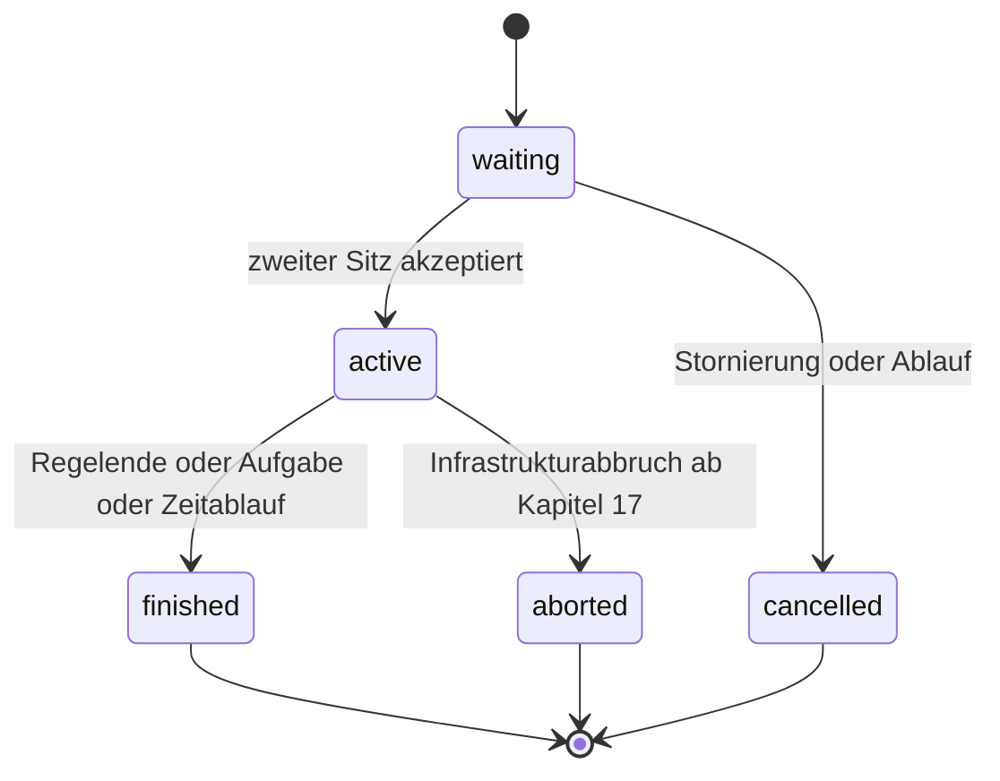

# 02 — Requirements, Domain Invariants und State Machines

[Dokumentationsindex](../INDEX.md) · [Fortschritt](../checklists/project-progress.md)

## 1. Chapter Overview

Du übersetzt die Plattformvision in überprüfbare Anforderungen. Das Ergebnis ist ein eigener Satz von Use Cases, Invarianten, Zustandsübergängen und Akzeptanzbeispielen. Dieser Vertrag begrenzt das MVP und verhindert, dass spätere HTTP- oder UI-Entscheidungen unbemerkt Spielregeln definieren.

Arbeite zunächst auf Papier beziehungsweise in Markdown. Eine State Machine ist wertvoll, bevor sie in Rust repräsentiert wird. [Anforderungen](../REQUIREMENTS.md) bleiben die gemeinsame Referenz; deine Übungen ergänzen sie durch begründete Beispiele.

## 2. Prerequisites

- [Kapitel 01](01-workspace.md) abgeschlossen; du kannst Prüfungen und Dokumentationsänderungen versionieren.
- Lies [Domain Model](../architecture/domain-model.md), [Roadmap](../ROADMAP.md) und [MVP-Milestone](../milestones/M5-godot-mvp.md).
- Unterscheide Spieler, Gast-Session, Verbindung und Partie. Die Umsetzung ihrer Typen folgt in Kapitel 03.
- Keine Kenntnisse über Axum oder Datenbanken nötig; beschreibe Verhalten unabhängig vom Speicherort.

## 3. Learning Objectives

- Du kannst eine vage Funktion in beobachtbare Given/When/Then-Kriterien zerlegen.
- Du kannst Invarianten von Eingabevalidierung und UI-Hinweisen unterscheiden.
- Du kannst für jeden Spielzustand erlaubte und verbotene Commands begründen.
- Du kannst MVP, spätere Erweiterung und ausdrücklich ausgeschlossene Infrastruktur abgrenzen.

## 4. Concepts and Theory

### Functional und Non-functional Requirements

Eine funktionale Anforderung beschreibt beobachtbares Verhalten, etwa das Beitreten einer freien Partie. Eine nichtfunktionale Anforderung beschreibt Qualität oder Rahmenbedingungen, etwa begrenzte Payloads. Kiban benötigt beide: „Reconnect funktioniert“ sagt ohne Identität, Zustand und Fehlerfälle zu wenig. Vermeide Wörter wie „schnell“ ohne Messmethode. Setze zunächst überprüfbare Projektbudgets statt erfundener Produktions-SLAs; lies die [Requirements](../REQUIREMENTS.md).

### Domain Invariant

Eine Invariante gilt vor und nach jeder akzeptierten fachlichen Zustandsänderung. Beispiel: Eine laufende Xiangqi-Partie besitzt genau zwei verschiedene besetzte Spielseiten. Eine leere Eingabe ist dagegen zunächst eine Transportvalidierung. Invarianten schützen das System auch bei einem manipulierten Client. Der häufige Fehler ist, sie ausschließlich in Buttons oder HTTP-Handlern zu prüfen. Die Definition gehört ins Domain Model; Prüfung später an dessen Übergängen.

### State Machine

Eine State Machine beschreibt Zustände, Ereignisse und erlaubte Übergänge. Sie macht sichtbar, dass „beendet“ kein loses Boolean neben beliebigen widersprüchlichen Feldern sein sollte. Kiban verwendet als Grundablauf `waiting`, `active` und `finished`; eine nicht gestartete Partie endet bei Stornierung oder Ablauf als `cancelled`. Ein infrastrukturell abgebrochenes aktives Spiel endet später als `aborted`, ohne sportliches Ergebnis. `recovery_required` sperrt ab Kapitel 17 einen ungewissen Persistenzzustand bis zur Klärung. Eine Netzwerkverbindung besitzt eine andere State Machine. Vermische nicht „offline“ mit „verloren“. Siehe [Domain Model](../architecture/domain-model.md).

### Use Case und Akzeptanzbeispiel

Ein Use Case benennt Akteur, Ausgangslage, Absicht, Erfolg und Alternativen. Given/When/Then präzisiert einen einzelnen beobachtbaren Fall. „Spieler tritt bei“ benötigt Alternativen wie volle Partie, fremde Einladung oder gleichzeitige Join-Versuche. Beispiele eignen sich als spätere Integrationstests, ersetzen aber keine vollständigen Invarianten. Dokumentiere identische Fachbegriffe durchgängig im [Glossar](../GLOSSARY.md).

### Scope und Traceability

Scope ist die bewusste Grenze dessen, was eine Lieferung enthält. Traceability verknüpft Anforderung, Vertrag, Aufgabe und Test. Das schützt Kiban vor voreiligen Accounts, Rating und Junqi im ersten MVP. Fehlerhaft ist, eine Anforderung nur dann als erfüllt zu betrachten, wenn ihre Dokumentation existiert: benötigt wird ein vorführbarer Ablauf. Die [Quality Gates](../checklists/quality-gates.md) verbinden diese Ebenen.

## 5. Architectural Context

Die Requirements liegen über allen Implementierungsschichten. Eine Partie ist ein fachliches Objekt; Session und Connection sind technische beziehungsweise identitätsbezogene Ressourcen. Ein Spiel kann aktiv bleiben, obwohl keine Verbindung besteht.

Das Diagramm zeigt die fachlichen Hauptzustände; der interne Zwischenzustand `recovery_required` und seine vollständigen Übergänge stehen im [Domain Model](../architecture/domain-model.md) und werden erst in Kapitel 17 umgesetzt. Der Game Actor aus Kapitel 13 wird Übergänge später serialisieren. Bis dahin werden sie synchron in Tests beschrieben. Datenbank, Uhren und UI werden hier nur als externe Anforderungen benannt, noch nicht vorausgesetzt.

## 6. Design Decisions

**Verbindlich: kleinstes spielbares MVP mit Gastidentität.** Problem: Registrierung würde den ersten Spielnachweis verzögern. Alternative: Accounts von Anfang an; sie ermöglichen Profile, erhöhen jedoch Sicherheits- und UX-Aufwand. Gäste reduzieren Einstiegshürden, brauchen trotzdem stabile serververifizierbare Sessions. Accounts kommen in Kapitel 27. Neu bewerten, falls anonyme Nutzung organisatorisch ausgeschlossen wird.

**Verbindlich: fachlicher Lebenszyklus getrennt von Verbindungsstatus.** Ein Zustand „DisconnectedGame“ wäre zunächst einfach, vervielfacht jedoch Zustandskombinationen und verleitet zum Anhalten der Uhr. Separate Connection-Zustände sind präziser, erfordern aber explizite Reconnect-Regeln. Optional darfst du unterschiedliche Diagrammdarstellungen erproben; die Übergangssemantik bleibt gleich.

## 7. Implementation Tasks

- [ ] 1. Ordne jede Kernanforderung einer Rolle zu: Gast, Teilnehmer, später registrierter Spieler oder Zuschauer. Prüfe, dass eine Rolle keine Identität ersetzt.
- [ ] 2. Schreibe für Gaststart, öffentliche Partie, private Einladung und Partiebeitritt je einen Use Case mit Vorbedingungen und sichtbarem Erfolg.
- [ ] 3. Ergänze für jeden Use Case mindestens zwei fachliche Ablehnungen; unterscheide Authentifizierungsfehler von falschem Spielzustand.
- [ ] 4. Erstelle die Übergangstabelle `waiting → active → finished` mit separatem `waiting → cancelled` in deiner Domain-Notiz. Trage pro Übergang Command, benötigte Rolle und resultierendes Ereignis ein.
- [ ] 5. Formuliere mindestens acht Invarianten, darunter unterschiedliche Teilnehmer, genau eine aktive Seite und Unveränderlichkeit terminaler Ergebnisse; teste sie gedanklich gegen jede Tabellenzeile.
- [ ] 6. Beschreibe Aufgabe aus Sicht beider Seiten und aus Sicht eines Fremden. Prüfe, dass nur ein Teilnehmer einer aktiven Partie aufgeben darf.
- [ ] 7. Definiere, was „Reconnect“ beobachtbar bedeutet: dieselbe Identität, derselbe Sitz und ein aktueller Snapshot. Verlange noch keine gespeicherte Wiederherstellung vor Kapitel 17.
- [ ] 8. Trenne funktionale Kriterien von Qualitätszielen. Lege für jedes Qualitätsziel Messung und Umgebung fest, statt ungeprüfte Zahlen als SLA zu behaupten.
- [ ] 9. Ordne Accounts, Rating, Matchmaking, Zuschauer und Junqi der Erweiterung zu. Prüfe, dass der MVP-Ablauf keines davon benötigt.
- [ ] 10. Baue eine Traceability-Tabelle mit Anforderungs-ID, zuständigem Kapitel und Testbeispiel; kontrolliere die zwölf Kernanforderungen auf Vollständigkeit.
- [ ] 11. Gehe einen parallelen Join-Versuch durch und notiere das zulässige Ergebnis: genau ein zusätzlicher Sitz. Die technische Serialisierung wird erst Kapitel 13 lösen.
- [ ] 12. Spiele einen kompletten Gastablauf als Rollenspiel durch. Protokolliere jede unklare Entscheidung und löse sie gegen Anforderungen und ADRs, bevor du Typen schreibst.

## 8. Public Interfaces and Contracts

| Fachlicher Command | Vorbedingung | Ergebnis | Ablehnung |
|---|---|---|---|
| CreateGame | gültige Session, unterstütztes Spiel/Regelprofil | `waiting`, Ersteller besetzt einen Sitz | ungültige Parameter |
| JoinGame | freier gegnerischer Sitz und erlaubter Zugang | zweiter Sitz, danach `active` | voll, falscher Zustand, fehlende Berechtigung |
| SubmitMove | aktive Partie und passende Seite | neuer fachlicher Zustand | illegal, fremder Teilnehmer |
| Resign | Teilnehmer einer aktiven Partie | `finished`, Sieg der Gegenseite | bereits beendet oder fremd |
| CancelGame | Ersteller einer wartenden Partie | `cancelled`, kein sportliches Ergebnis | fremd oder bereits aktiv |
| Resume | gleiche gültige Session | aktuelle erlaubte Sicht | abgelaufen oder widerrufen |

Konkrete JSON-Felder werden im [Protokoll](../protocol/overview.md) festgelegt. Requirements verwenden Namen konsistent, koppeln sich aber nicht an HTTP-Handler.

## 9. Edge Cases

- Ein Spieler sendet nach Aufgabe noch einen Zug: terminale Unveränderlichkeit gilt unabhängig vom Clientzustand.
- Dieselbe Identität versucht beide Sitze zu belegen: ablehnen; zwei Browserfenster sind nicht zwei Personenidentitäten.
- Die Verbindung fällt aus: kein automatischer Sieg, keine automatische Pause.
- Eine private Partie taucht in einer öffentlichen Liste auf: Vertraulichkeitsanforderung verletzt.
- Ein späteres anderes Spiel kennt Deployment: Erweiterung über Variant-State, nicht Umdeutung von Xiangqi-Zugregeln.

## 10. Testing Requirements

- **Given** eine wartende Partie mit einem Sitz, **When** ein anderer berechtigter Gast beitritt, **Then** sind zwei verschiedene Sitze besetzt und die Partie ist aktiv.
- **Given** dieselbe Ausgangslage, **When** der Ersteller selbst erneut beitreten will, **Then** entsteht kein zweiter Sitz für dieselbe Identität.
- **Given** eine beendete Partie, **When** ein Zug oder eine Aufgabe eintrifft, **Then** bleibt das ursprüngliche Ergebnis unverändert.
- **Given** eine private Partie, **When** öffentliche Partien aufgelistet werden, **Then** ist sie darin nicht enthalten.
- **Given** zwei konkurrierende Join-Absichten, **When** sie nacheinander auf denselben Zustand angewandt werden, **Then** gewinnt genau die erste zulässige Absicht.
- **Given** Verbindungsabbruch, **When** kein Regelende eintritt, **Then** bleibt die fachliche Partie aktiv.

## 11. Definition of Done

- [ ] Zwölf Kernanforderungen besitzen verknüpfte Akzeptanzbeispiele.
- [ ] Zustandsübergänge besitzen Rolle, Vorbedingung, Ergebnis und Ablehnung.
- [ ] Invarianten sind unabhängig vom Transport formuliert.
- [ ] MVP und Erweiterungen sind eindeutig abgegrenzt.
- [ ] Diagramm und Übergangstabelle widersprechen sich nicht.
- [ ] Begriffe sind mit Glossar und Domain Model abgestimmt.

## 12. Common Pitfalls

„Offline“ ist kein Spielresultat. Wer Connection-State in den Spielzustand mischt, erzeugt unklare Timeout-Regeln. Ebenso ist eine private Einladung kein dauerhafter Identitätsnachweis. Eine Liste von Features ohne Fehlerfälle lässt entscheidende Regeln offen. Anforderungen dürfen die Umsetzung leiten, aber keine künftige Datenbank bereits voraussetzen: beschreibe beobachtbares Verhalten, bevor du Tabellen entwirfst.

## 13. Reflection Questions

1. Welche Invariante schützt vor dem Belegen beider Sitze durch dieselbe Session?
2. Warum ist ein deaktivierter UI-Button keine Authorization-Regel?
3. Welche Informationen benötigt ein Test, um „Reconnect funktioniert“ zu beweisen?
4. Welcher Nachteil entsteht, wenn Connection-State Teil jedes Spielzustands wird?
5. Wann würdest du einen Qualitätswert als Projektbudget statt als SLA formulieren?
6. Wie lässt sich eine neue Junqi-Deployment-Phase ergänzen, ohne Xiangqi-Regeln zu verändern?

## 14. Further Reading

- [Rust Book: Enums](https://doc.rust-lang.org/book/ch06-00-enums.html): Vorbereitung auf die Darstellung geschlossener Zustandsmengen in Kapitel 03.
- [OWASP Authorization Cheat Sheet](https://cheatsheetseries.owasp.org/cheatsheets/Authorization_Cheat_Sheet.html): „Deny by Default“ auf Teilnehmerrechte übertragen.
- [Mermaid State Diagrams](https://mermaid.js.org/syntax/stateDiagram.html): Notation der fachlichen Übergänge studieren.
- [Requirements](../REQUIREMENTS.md) und [Domain Model](../architecture/domain-model.md): gemeinsame Projektreferenz für Scope und Invarianten.

## 15. Completion Record

- Abschlussdatum: _vom Entwickler einzutragen_
- Getroffene Designentscheidungen und Begründung: _nach Bearbeitung eintragen_
- Aufgetretene Schwierigkeiten: _nach Bearbeitung eintragen_
- Durchgeführte Tests und Belege: _nach Bearbeitung eintragen_
- Verbleibende technische Schulden: _nach Bearbeitung eintragen_
- Gewonnene Erkenntnisse: _nach Bearbeitung eintragen_
