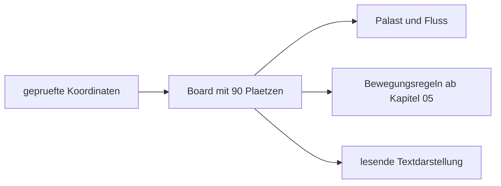

# 04 — Xiangqi-Board und Koordinatensysteme

[Dokumentationsindex](../INDEX.md) · [Fortschritt](../checklists/project-progress.md)

## 1. Chapter Overview

Du baust die räumliche Grundlage der Engine: ein Board mit 90 Schnittpunkten, eindeutigem Koordinatenvertrag und überprüfbarer Startstellung. Das Ergebnis deiner Eigenimplementierung lässt sich vollständig ohne Netzwerk und Grafik testen. Es handelt sich noch nicht um einen legalen Zuggenerator.

Dieses Kapitel schließt [M1](../milestones/M1-foundation.md) ab. Seine Koordinaten werden später von Protokoll, Replay und Godot übernommen; eine ungeklärte Orientierung würde sich deshalb durch das ganze System ziehen.

## 2. Prerequisites

- [Kapitel 03](03-domain-modeling.md), insbesondere Value Objects, `Option`, Borrowing und kontrollierte Konstruktion.
- Rust Book: Arrays, Slices und Vektoren lesen; Unterschiede zwischen fester und dynamischer Größe erklären können.
- Lies [Xiangqi-Grundregeln](../rules/xiangqi.md), [Bewegung](../rules/xiangqi-movement.md) und [Testpositionen](../rules/rule-test-positions.md).
- Reale oder gezeichnete Xiangqi-Startstellung als unabhängige visuelle Kontrolle bereitstellen.

## 3. Learning Objectives

- Du kannst jeden Schnittpunkt verlustfrei zwischen Koordinate und interner Ablage übersetzen.
- Du kannst rote und schwarze Vorwärtsrichtung sowie Palast- und Flussgrenzen begründen.
- Du kannst die vollständige Startstellung erzeugen und durch Inventar sowie konkrete Felder prüfen.
- Du kannst interne Speicherung ändern, ohne öffentliche Koordinaten oder Spielregeln zu verändern.

## 4. Concepts and Theory

### Schnittpunkte und Koordinaten

Xiangqi-Figuren stehen auf Schnittpunkten, nicht in den Feldern. Kiban verwendet `x=0..8` von links nach rechts aus roter Sicht und `y=0..9` von Rot nach Schwarz. Rot hat die Grundreihe `y=0`, Schwarz `y=9`; Rot zieht in Richtung steigender y-Werte. Diese feste Orientierung ist ein Wire Contract, keine Kameraposition. Häufige Fehler sind vertauschte Achsen und Orientierung abhängig vom lokalen Spieler. Der [Koordinatenvertrag](../rules/xiangqi.md) gilt auch für spätere schwarze Ansichten.

### Lineare Ablage und fachliche Adresse

Eine lineare Ablage macht das feste Board kompakt und leicht vergleichbar. Die fachliche Adresse bleibt ein geprüftes Koordinatenpaar; Indizes sind interne Details. Das Ziel einer Abbildung ist verlustfreier Zugriff auf 90 Plätze. Input ist eine gültige Koordinate, Output ein interner Index; Invariante ist eindeutige Rückabbildung. Aufwand pro Zugriff ist konstant. Ein Index außerhalb der Ablage darf nicht durch externe Daten erreichbar sein. Nutze Arrays oder eine bewusst begrenzte Alternative; lies Rust Book „Compound Types“.

### Geometrie als Regelgrundlage

Paläste umfassen `x=3..5`, für Rot `y=0..2`, für Schwarz `y=7..9`. Der Fluss liegt zwischen `y=4` und `y=5`. Rot hat ihn bei `y>=5`, Schwarz bei `y<=4` überschritten. „Eigene Hälfte“ und „bereits überquert“ sind unterschiedliche Fragen für Elephant und Soldier. Fehler an genau dieser Grenze verfälschen viele spätere Zugtests. Kleine reine Geometrieabfragen sind hier angemessen; sie kennen weder aktive Seite noch Check.

### Strukturvalidität und Spiellegalität

Ein Board kann geometrisch korrekt und dennoch als Spielstellung ungültig sein. Für die aktive Partie verlangt die Engine unter anderem genau einen General pro Seite. Ein Figuren-Bewegungstest darf dagegen mit einem kleinen Fragment arbeiten, sofern er keine Legalitätsbewertung behauptet. Trenne Fixture-Aufbau und validierten GameState. Sonst werden entweder nützliche Unit-Tests unmöglich oder ungültige Netzwerkzustände als Partie akzeptiert. Siehe [Unit-Teststrategie](../testing/unit-tests.md).

### Darstellung und Mutation

Eine Textdarstellung hilft beim Debuggen, ist aber keine alternative Wahrheit. Das Board besitzt Inhalte; der Renderer liest sie. Eine Move-Anwendung darf später Ausgang und Ziel nur nach vollständiger Validierung verändern. In diesem Kapitel können interne Testhelfer Positionen setzen, ohne eine öffentliche „beliebig ändern“-API einzuführen. Ein häufiger Fehler ist, UI-Glyphen als Figurenidentität zu speichern. Die Darstellung bleibt Adapteraufgabe.

## 5. Architectural Context

`Board` und `Coord` gehören nach `kiban-xiangqi`, weil andere Spiele andere Graphen verwenden können. Das Board besitzt seine Figurenwerte. Geometrie liest Koordinaten; Bewegung aus Kapitel 05 liest Board und Geometrie. Die Plattform kennt nur GameId und Spielart, keine 9×10-Pflicht.

Ein späteres JSON-DTO wird in diese geprüften Werte übersetzt. Es darf keinen ungeprüften Integer direkt als Arrayindex verwenden.

## 6. Design Decisions

**Verbindlich: feste öffentliche Koordinaten.** Problem: zwei Spieler schauen entgegengesetzt aufs Board. Alternative: Koordinaten pro Spieler drehen; das führt zu mehr Konvertierungen und Reconnect-Fehlern. Feste rote Orientierung erleichtert Tests und Protokoll, verlangt jedoch eine bewusste UI-Transformation. Neu bewerten nur bei einer neuen Protokoll-Major-Version.

**Gewählt: einfache feste Ablage vor Bitboards.** Bitboards oder Mailbox-Layouts können Suche beschleunigen, erhöhen aber Lernaufwand. Für Zugprüfung auf 90 Punkten reichen einfache Datenstrukturen. Nachteile sind begrenzte spätere Engine-Performance, die erst bei gemessenem Bedarf relevant wird. Optional darfst du Repräsentationen benchmarken, nachdem die Verträge und Tests identisch erfüllt sind.

## 7. Implementation Tasks

- [ ] 1. Zeichne alle Achsen, Paläste und den Fluss auf ein Board. Markiere vier Ecken und je ein Grenzfeld; prüfe die Orientierung aus roter Sicht.
- [ ] 2. Implementiere selbst einen geprüften `Coord` im Xiangqi-Kern. Eingaben außerhalb `0..8` und `0..9` müssen vor jeder Indexbildung scheitern.
- [ ] 3. Wähle eine interne Board-Ablage mit genau 90 Plätzen. Begründe ihre Größe und teste, dass kein Platz doppelt adressiert wird.
- [ ] 4. Ergänze Koordinate-zu-Index und Rückabbildung intern. Prüfe für sämtliche 90 Positionen die Rundreise in beide Richtungen.
- [ ] 5. Ergänze lesenden Zugriff auf einen Platz. Ein leerer Platz liefert Abwesenheit; ein ungültiger externer Wert wird nicht still geklemmt.
- [ ] 6. Beschreibe und prüfe `in_palace`, `own_half` und `crossed_river` getrennt. Verwende die sechs Randwerte der relevanten Bereiche als eigene Testfälle.
- [ ] 7. Erzeuge die rote Grundreihe: Chariot, Horse, Elephant, Advisor, General, Advisor, Elephant, Horse, Chariot auf `y=0`; prüfe jede x-Position.
- [ ] 8. Ergänze rote Cannons `(1,2)` und `(7,2)` sowie Soldiers auf `(0,3)`, `(2,3)`, `(4,3)`, `(6,3)`, `(8,3)`. Verifiziere alle besetzten und angrenzenden freien Schnittpunkte anhand einer Zeichnung, statt Bildschirmpositionen zu übernehmen.
- [ ] 9. Ergänze die schwarze Spiegelaufstellung auf `y=9`, Cannons auf `y=7`, Soldiers auf `y=6`. Prüfe schwarze Orientierung unabhängig von der roten Schleife.
- [ ] 10. Teste das Inventar: 32 Figuren insgesamt, je Seite 1 General, 2 Advisor, 2 Elephant, 2 Horse, 2 Chariot, 2 Cannon und 5 Soldier.
- [ ] 11. Definiere einen internen Fixture-Weg für leere und dünn besetzte Boards. Verhindere, dass dieser Testhelfer zur öffentlichen GameState-Konstruktion für Clients wird.
- [ ] 12. Schreibe eine lesende Textansicht für Debugzwecke im Test- oder Terminaladapter. Prüfe, dass sie den Zustand unverändert lässt und die Achsen beschriftet.
- [ ] 13. Prüfe fehlerhafte negative und übergroße Eingabewerte vor Integerkonvertierung. Verlange einen Fehler statt Wraparound oder Panic.
- [ ] 14. Dokumentiere Koordinaten und Startstellung im eigenen Implementierungsnachweis; führe alle bisherigen Tests und die M1-Abnahme durch.

## 8. Public Interfaces and Contracts

| Name | Vertrag |
|---|---|
| `Coord` | geprüfter Schnittpunkt mit festen Achsen; ungültige Werte werden abgelehnt |
| `Board` | besitzt genau 90 mögliche Figurenplätze; lesender Zugriff verändert nichts |
| `initial_position` | liefert reproduzierbar die definierte 32-Figuren-Startstellung |
| `in_palace` | Seite und Koordinate ergeben Palastzugehörigkeit |
| `crossed_river` | Seite und Koordinate ergeben Überschreitungsstatus für Soldier |
| `own_half` | Seite und Koordinate ergeben erlaubte Hälfte für Elephant |

Die geplante externe Koordinate lautet beispielsweise `{"x":4,"y":0}`. Keine Display-Pixel und keine intern linearen Indizes verlassen die fachliche Grenze.

## 9. Edge Cases

- `x=9`, `y=10`, negative Werte und sehr große Zahlen sind ungültig.
- Ein Soldier genau bei `y=4` als Rot hat den Fluss noch nicht überschritten; bei `y=5` schon.
- Ein schwarzer Spieler schaut gedreht aufs Board; die fachliche Koordinate bleibt gleich.
- Ein Fixture ohne General ist für Geometrie erlaubt, für eine aktive Partie nicht automatisch gültig.
- Das Textbild ist gespiegelt: Achsenbeschriftung und bekannte Corner-Fixtures decken dies auf.

## 10. Testing Requirements

- **Given** alle 90 Koordinaten, **When** jede in einen Index und zurück übersetzt wird, **Then** entstehen dieselben Werte und 90 verschiedene Indizes.
- **Given** `(8,9)`, **When** gelesen wird, **Then** ist dies der letzte gültige Schnittpunkt; `(9,9)` scheitert kontrolliert.
- **Given** die Startstellung, **When** gezählt wird, **Then** stehen genau 16 Figuren je Seite auf den dokumentierten Feldern.
- **Given** Rot bei `(4,4)` beziehungsweise `(4,5)`, **When** die Flussabfrage läuft, **Then** lautet das Ergebnis falsch beziehungsweise wahr.
- **Given** Schwarz bei `(4,5)` beziehungsweise `(4,4)`, **When** dieselbe Abfrage läuft, **Then** lautet das Ergebnis falsch beziehungsweise wahr.
- **Given** Palastränder `(3,0)`, `(5,2)`, `(2,1)`, **When** rote Palastzugehörigkeit geprüft wird, **Then** sind nur die ersten beiden erlaubt.
- **Given** eine Debugansicht, **When** sie mehrfach erzeugt wird, **Then** bleiben Boardinhalt und Hash beziehungsweise Vergleichswert unverändert.

## 11. Definition of Done

- [ ] Alle 90 Koordinaten und ungültigen Grenzwerte sind getestet.
- [ ] Startstellung ist über Einzelpositionen und Inventar unabhängig bestätigt.
- [ ] Palast-, Fluss- und Richtungsabfragen sind seitenkorrekt.
- [ ] Repräsentation ist privat und frei von UI-/Netzwerktypen.
- [ ] Fixture-Fragmente werden von gültigen Partieständen unterschieden.
- [ ] M1 ist demonstrierbar; bisherige Tests und Quality Gates bestehen.

## 12. Common Pitfalls

Eine Spiegelung auf dem Bildschirm darf nicht die Domain-Koordinate ändern. „Links“ ist ohne Sichtreferenz unbrauchbar; nutze x/y. Wenn Rot und Schwarz dieselbe Vorwärtsrichtung erhalten, fallen die Fehler erst nach mehreren Zügen auf. Ein Board als veränderbares öffentliches Array umgeht später jede Zugprüfung. Prüfe Startposition nicht nur durch Gesamtzählung: 32 falsch platzierte Figuren erfüllen dieselbe Zahl.

## 13. Reflection Questions

1. Warum sind Pixelkoordinaten kein geeigneter Board-Vertrag?
2. Welche Tests erkennen eine Achsenvertauschung trotz korrekter Figurenanzahl?
3. Weshalb unterscheidet sich eine Geometrie-Fixture von einem gültigen GameState?
4. Was müsste sich an den Tests ändern, wenn intern von Array zu Bitboard gewechselt würde?
5. Wieso sind „eigene Hälfte“ und „Fluss überschritten“ getrennte Begriffe?
6. Welche Repräsentationsentscheidung sollte Junqi ausdrücklich nicht übernehmen müssen?

## 14. Further Reading

- [Rust Book: Data Types](https://doc.rust-lang.org/book/ch03-02-data-types.html): Arrays, Indexzugriff und Zahlenbereiche studieren.
- [Rust Book: Slices](https://doc.rust-lang.org/book/ch04-03-slices.html): lesende Zugriffe ohne Besitzübernahme verstehen.
- [World Xiangqi Federation](https://www.wxf-xiangqi.org/): Regelbereich als autoritative Ausgangsquelle für Aufstellung und Geometrie; das Kiban-Casual-Profil ist gesondert dokumentiert.
- [Kiban-Testpositionen](../rules/rule-test-positions.md): vor jeder Bewegungsimplementierung auf dieselbe Orientierung prüfen.

## 15. Completion Record

- Abschlussdatum: _vom Entwickler einzutragen_
- Getroffene Designentscheidungen und Begründung: _nach Bearbeitung eintragen_
- Aufgetretene Schwierigkeiten: _nach Bearbeitung eintragen_
- Durchgeführte Tests und Belege: _nach Bearbeitung eintragen_
- Verbleibende technische Schulden: _nach Bearbeitung eintragen_
- Gewonnene Erkenntnisse: _nach Bearbeitung eintragen_
