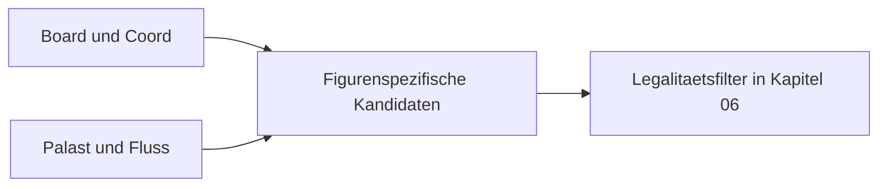

# 05 — Figurenbewegung und Pseudo-Legal Moves

[Dokumentationsindex](../INDEX.md) · [Fortschritt](../checklists/project-progress.md)

## 1. Chapter Overview

Du beschreibst und prüfst die Bewegung aller sieben Xiangqi-Figuren. Das Ergebnis ist eine reine, deterministische Schicht für pseudo-legale Zugkandidaten. Sie berücksichtigt Geometrie, Blockaden, Zielbelegung und figurenspezifische Einschränkungen, aber noch nicht die Sicherheit des eigenen Generals.

Diese bewusste Grenze macht Fehler lokalisierbar: Ein Horse-Leg-Fehler gehört hierher, ein gefesselter Horse gehört in Kapitel 06. Die [Bewegungsreferenz](../rules/xiangqi-movement.md) ist verbindlich für dieselben Koordinaten.

## 2. Prerequisites

- [Kapitel 04](04-board-representation.md): Boardzugriff, Startstellung und geprüfte Koordinaten.
- Rust-Grundlagen zu Iteration, Collections und Pattern Matching; Result und Option aus Kapitel 03.
- Lies [Bewegungsregeln](../rules/xiangqi-movement.md) und [Testpositionen](../rules/rule-test-positions.md).
- Keine Async-, HTTP- oder Schachuhrkenntnisse nötig. Verwende kleine Boards als isolierte Geometrie-Fixtures.

## 3. Learning Objectives

- Du kannst pseudo-legale Kandidaten von legalen Zügen erklären und getrennt testen.
- Du kannst Horse Leg, Elephant Eye und Cannon Screen jeweils durch einen Gegenbeispieltest belegen.
- Du kannst Rot und Schwarz an Fluss- und Palasträndern korrekt behandeln.
- Du kannst eine deterministische Kandidatenmenge ohne Boardmutation erzeugen.

## 4. Concepts and Theory

### Pseudo-Legalität

Ein pseudo-legaler Zug erfüllt Figurenbewegung und Belegungsregeln. Er behauptet noch nicht, dass danach der eigene General sicher ist. Diese Zwischenstufe trennt lokale Geometrie von globaler Stellungssicherheit. Ein häufiger Fehler ist, solche Kandidaten direkt im Multiplayer zu akzeptieren. Die Schicht ist für Regeltests und spätere Legalitätsfilter geeignet; das öffentliche Spielkommando verwendet ab Kapitel 06 vollständige Legalität.

### Ray-Bewegung: Chariot und Cannon

Der Chariot zieht orthogonal beliebig weit, solange keine Figur den Weg blockiert; eine gegnerische Figur am Ziel kann geschlagen werden. Cannon-Ruhebewegung ist ebenfalls orthogonal und ungehindert. Zum Schlagen verlangt die Cannon genau eine beliebige Figur als Screen zwischen Ausgang und gegnerischem Ziel. Zero oder zwei Screens sind unzulässig. Der Screen selbst wird nicht geschlagen. Input sind Board, Start und Richtung; Output ist eine begrenzte Kandidatenmenge. Ein Ray besucht höchstens neun weitere Punkte; alle Rays zusammen bleiben durch 90 Felder begrenzt. Fehlerhaft ist, Cannon-Angriff und leere Bewegung identisch zu behandeln.

### Horse und Elephant

Der Horse erreicht ein Ziel mit zwei Schritten auf einer Achse und einem auf der anderen. Das unmittelbar benachbarte orthogonale Feld auf der langen Achse ist das Horse Leg; ist es belegt, ist der Sprung blockiert. Der Elephant zieht genau zwei diagonal, benötigt ein freies mittleres Elephant Eye und bleibt auf eigener Flusshälfte. Beide Regeln sind keine westlichen Sprungregeln. Ihre kleine feste Zielmenge ermöglicht konstante lokale Prüfungen. Teste jede Symmetrie statt nur eine Richtung.

### General und Advisor

Der General zieht einen orthogonalen Schritt im eigenen Palast. Der Advisor zieht einen diagonalen Schritt im eigenen Palast. Die Beziehung der Generäle auf offener Linie wird in Kapitel 06 als besondere Angriffsinvariante ergänzt. Ein gewöhnlicher Zug darf deshalb hier nicht mit einer beliebigen weiten Generalbewegung verwechselt werden. Palastprüfung erfolgt am Ziel und setzt einen gültigen Ausgangszustand voraus. Lies die Palastdefinition aus Kapitel 04 vor den Tests.

### Soldier und Seitenrichtung

Vor dem Fluss zieht ein Soldier genau einen Schritt vorwärts. Nach Überschreiten darf er zusätzlich einen Schritt seitwärts, niemals rückwärts. Rot erhöht y, Schwarz vermindert y. Auf der letzten Reihe bleibt seitliches Ziehen möglich, es gibt keine Promotion. Dieser Unterschied zum westlichen Bauern muss explizit getestet werden. Der Flussstatus hängt von aktueller Position ab; es wird kein zusätzliches widersprüchliches „crossed“-Flag benötigt.

### Kandidatenmenge und deterministische Ordnung

Die fachliche Aussage ist eine Menge ohne Duplikate. Eine stabile Sortierung erleichtert Debugging und Reproduzierbarkeit, ist jedoch keine Zugbewertung. Bewegungsprüfung liest den Zustand und mutiert ihn nicht. Sammle zunächst Klarheit, bevor du Caches einführst: veraltete Cacheeinträge können korrekte Regeln vortäuschen. Siehe [Unit-Tests](../testing/unit-tests.md) zur isolierten Spezifikation.

## 5. Architectural Context

Alle Bewegungsregeln gehören in `kiban-xiangqi`. Board und Geometrie werden nur gelesen. Der spätere Legalitätsfilter ruft diese Kandidatenerzeugung auf und prüft daraus abgeleitete Folgezustände. Der Server und der Client dürfen keine eigene konkurrierende Bewegungsautorität einführen.

General-Linienangriff gehört zur Sicherheitsschicht. Test-Fixtures ohne vollständige Partie sind hier zulässig, dürfen aber nicht als aktive GameState-Werte exportiert werden.

## 6. Design Decisions

**Verbindlich: zunächst verständliche getrennte Figurenregeln.** Problem: Spezialfälle müssen unabhängig nachvollziehbar sein. Alternative: eine universelle Bewegungstabelle; sie ist kompakt, versteckt aber Cannon- und Blocking-Semantik. Getrennte Regeln sind leichter zu testen, wiederholen jedoch etwas Geometrie. Extrahiere gemeinsame Helfer erst nach nachgewiesener semantischer Gleichheit.

**Verbindlich: Pseudo-Legalität bleibt intern.** Ein einziger großer Prüfer wäre anfangs weniger API-Fläche, erschwert aber die Fehlerdiagnose zwischen Bewegung und Check. Die zwei Schichten erfordern eine klare Namensgebung. Neu bewerten nur bei Profiling, nicht wegen einer kürzeren Funktion. Optionale Experimente mit Iteratoren dürfen keine Kandidaten oder Regeln ändern.

## 7. Implementation Tasks

- [ ] 1. Lege für jede Figurenart eine Regeltabelle mit Zielgeometrie, Blocker, Regionsgrenze und Capture-Bedingung an; kontrolliere sie gegen die Referenz.
- [ ] 2. Definiere eine interne Kandidatenabfrage mit Board und Startfeld als Input. Leerer Start und eigene Zielfigur erzeugen keine erlaubte Bewegung.
- [ ] 3. Implementiere die Chariot-Rays eigenständig. Prüfe freie Punkte bis zum ersten Blocker; hinter dem ersten Blocker darf kein Kandidat entstehen.
- [ ] 4. Ergänze Chariot-Captures: ein erster gegnerischer Blocker ist Ziel, ein eigener nicht. Verifiziere beide Fälle mit ansonsten gleicher Stellung.
- [ ] 5. Implementiere Cannon-Bewegung auf leere Felder ohne Screen. Prüfe, dass sie nicht über den ersten Screen auf leere Felder springen kann.
- [ ] 6. Ergänze Cannon-Captures mit exakt einem Screen. Teste eigene und gegnerische Screens sowie zero, one und two Screens bei identischem Ziel.
- [ ] 7. Implementiere Horse-Zielgeometrie und alle vier Leg-Richtungen. Lege acht freie Zieltests und mindestens vier einzeln blockierte Leg-Fixtures an.
- [ ] 8. Implementiere Elephant-Ziele mit Eye-Prüfung. Teste diagonale Symmetrien, eigenen Blocker, gegnerischen Blocker und Flussüberschreitungsversuch.
- [ ] 9. Ergänze Advisor-Diagonalen mit eigener Palastgrenze. Verifiziere Mitte, Ecke und Versuch außerhalb des Palastes für beide Seiten.
- [ ] 10. Ergänze normale Generalbewegung um einen orthogonalen Palastschritt. Verhindere Diagonalen und Palastverlassen; kennzeichne Flying General als offene Sicherheitsaufgabe für Kapitel 06.
- [ ] 11. Ergänze Soldier-Vorwärtsbewegung je Seite. Teste seitliche Bewegung unmittelbar vor und nach dem Fluss sowie verbotene Rückwärtsbewegung.
- [ ] 12. Prüfe Soldier auf letzter Reihe: keine Promotion und kein Rückwärtszug; erlaubte seitliche Bewegung bleibt erhalten.
- [ ] 13. Vereinheitliche eigene Zielbelegung und Randprüfung vor Indexzugriff. Vergleiche dieselben Regeln an allen vier Boardrändern.
- [ ] 14. Stelle sicher, dass Kandidaten keine Duplikate enthalten und ein zweiter Aufruf dasselbe Ergebnis liefert. Vergleiche Board vor und nach jeder Abfrage.
- [ ] 15. Ergänze Rot-Schwarz-Spiegeltests durch Spiegelung der y-Achse und Seitentausch. Untersuche Abweichungen vor weiterer Optimierung.
- [ ] 16. Verknüpfe jede Zeile der Regeltabelle mit mindestens einem positiven und einem negativen Test. Führe den gesamten Engine-Testlauf ohne Server aus.

## 8. Public Interfaces and Contracts

| Abfrage | Input | Output | Grenze |
|---|---|---|---|
| `pseudo_legal_moves` | Board und belegtes Startfeld | eindeutige Zielzüge | keine Garantie für Generalsicherheit |
| `ray_targets` intern | Start, Richtung, Board | sichtbare Punkte/Blocker gemäß Auftrag | keine HTTP-Typen |
| `horse_leg` intern | gültige Horse-Geometrie | zu prüfender Zwischenpunkt | kein westlicher Knight-Sprung |
| `elephant_eye` intern | gültige Elephant-Geometrie | diagonaler Zwischenpunkt | eigene Hälfte separat prüfen |

Ein Zug beschreibt Start und Ziel; Captures werden vom Serverzustand abgeleitet, nicht von einem vertrauenswürdigen Clientflag. Ob ein Kandidat den General exponiert, beantwortet erst die folgende Schicht.

## 9. Edge Cases

- Cannon mit Screen direkt neben ihr und Gegner direkt dahinter: Capture erlaubt, sofern orthogonale Linie und sonstige Regeln passen.
- Zwei Screens vor dem Gegner: Capture verboten, selbst wenn beide Screens gegnerisch sind.
- Horse-Ziel frei, Leg besetzt: Bewegung verboten.
- Elephant-Eye frei, Ziel auf anderer Flusshälfte: Bewegung trotzdem verboten.
- Soldier am letzten Rand: keine Promotion und keine automatische Entfernung.
- Eigene Figur am Ziel: niemals Capture, auch nicht durch Cannon mit korrekter Screenzahl.

## 10. Testing Requirements

- **Given** rote Cannon `(0,0)` und schwarzes Ziel `(0,3)` ohne Zwischenfigur, **When** Capture geprüft wird, **Then** wird es abgelehnt.
- **Given** zusätzlich eine Figur `(0,1)`, **When** derselbe Capture geprüft wird, **Then** ist er pseudo-legal; bei weiterem Screen `(0,2)` ist er wieder verboten.
- **Given** Horse `(4,4)` und freies Ziel `(5,6)`, **When** `(4,5)` besetzt wird, **Then** entfällt genau der über dieses Leg erreichbare Sprung.
- **Given** roter Elephant `(2,4)`, **When** `(4,6)` verlangt wird, **Then** scheitert der Zug trotz freiem Eye am Fluss.
- **Given** roter Soldier `(4,4)`, **When** `(5,4)` verlangt wird, **Then** scheitert er; derselbe Seitenschritt von `(4,5)` ist zulässig.
- **Given** Chariot und erster eigener Blocker, **When** Ziele auf dessen Ray erzeugt werden, **Then** enthält die Menge weder Blocker noch Felder dahinter.
- **Given** ein Board und eine Kandidatenabfrage, **When** sie zweimal läuft, **Then** sind Ergebnis und unverändertes Board identisch.
- **Given** jede Teststellung gespiegelt mit getauschten Seiten, **When** dieselbe Bewegungsprüfung läuft, **Then** entspricht das Ergebnis der gespiegelten Zielmenge.

## 11. Definition of Done

- [ ] Alle sieben Figurenarten besitzen explizite Positiv- und Negativtests.
- [ ] Cannon-Screens, Horse Legs und Elephant Eyes sind unabhängig geprüft.
- [ ] Beide Seiten, Palastränder und Flussgrenzen sind abgedeckt.
- [ ] Eigene Ziele, Boardränder und leere Startfelder sind sicher behandelt.
- [ ] Kandidaten sind deterministisch, eindeutig und zustandsneutral.
- [ ] Öffentliche Anwendung akzeptiert noch keine bloß pseudo-legalen Züge.
- [ ] Regelreferenz und Tests verwenden dieselben Koordinaten.

## 12. Common Pitfalls

Horse als westlichen Knight zu behandeln ignoriert das Leg. Cannon mit Chariot-Capture zu implementieren übersieht den Screen. Soldier benötigen weder einen Doppelschritt noch Promotion. Allgemeine Bewegungshelfer sind nur dann hilfreich, wenn sie die unterschiedlichen Capture-Regeln nicht verwischen. Ein grüner Test aus einer zentralen freien Stellung sagt wenig über Rand- und Blocking-Regeln aus.

## 13. Reflection Questions

1. Worin unterscheidet sich ein Cannon-Capture von ihrer Bewegung auf ein leeres Ziel?
2. Welche Horse-Ziele werden durch genau ein besetztes Leg gleichzeitig blockiert?
3. Warum ist der Flussstatus eines Soldiers aus seiner Position ableitbar?
4. Weshalb darf der Server pseudo-legale Kandidaten noch nicht direkt akzeptieren?
5. Welche Symmetrien eignen sich als zusätzliche Tests und welche würden durch die Seitenrichtung gebrochen?
6. Wann könnte ein gemeinsamer Ray-Helfer versehentlich eine Figurenregel verändern?

## 14. Further Reading

- [Kiban-Bewegungsregeln](../rules/xiangqi-movement.md): jede implementierte Bedingung mit konkretem Positionsfall abgleichen.
- [World Xiangqi Federation](https://www.wxf-xiangqi.org/): offizielle Regelquelle für Figuren und Einschränkungen; keine westlichen Schachannahmen übernehmen.
- [Rust Book: Iterators](https://doc.rust-lang.org/book/ch13-02-iterators.html): lesende Kandidatenverarbeitung ohne versteckte Mutation.
- [Rust Book: Pattern Matching](https://doc.rust-lang.org/book/ch18-00-patterns.html): vollständige Behandlung der sieben Figurenarten.
- [Unit-Tests](../testing/unit-tests.md): kleine isolierte Fixtures statt ausschließlich kompletter Partien.

## 15. Completion Record

- Abschlussdatum: _vom Entwickler einzutragen_
- Getroffene Designentscheidungen und Begründung: _nach Bearbeitung eintragen_
- Aufgetretene Schwierigkeiten: _nach Bearbeitung eintragen_
- Durchgeführte Tests und Belege: _nach Bearbeitung eintragen_
- Verbleibende technische Schulden: _nach Bearbeitung eintragen_
- Gewonnene Erkenntnisse: _nach Bearbeitung eintragen_
