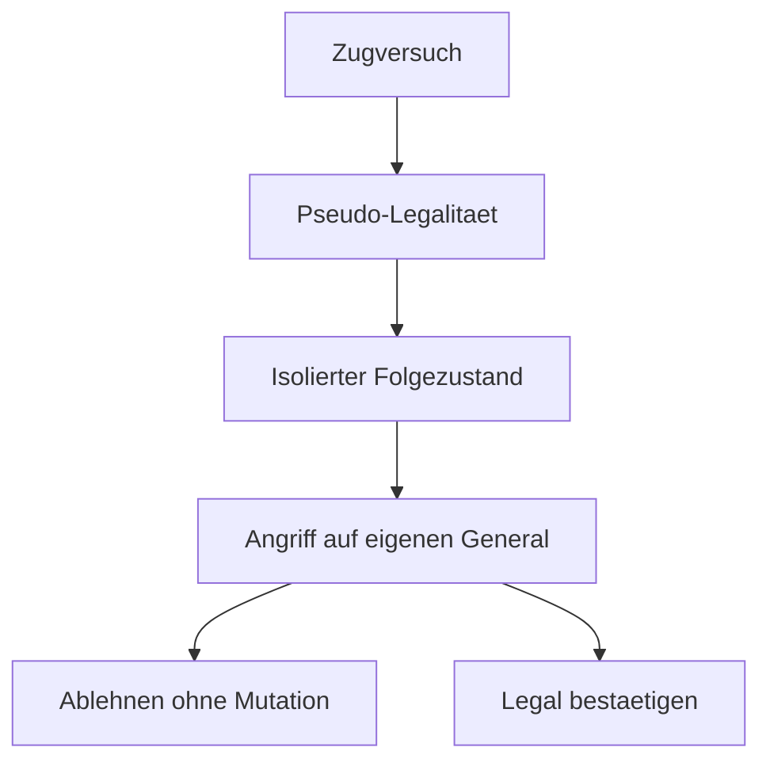

# 06 — Attack Detection, Check und Legal Moves

[Dokumentationsindex](../INDEX.md) · [Fortschritt](../checklists/project-progress.md)

## 1. Chapter Overview

Du verbindest Figurenbewegung mit der globalen Sicherheitsinvariante: Nach einem akzeptierten Zug darf der eigene General nicht angegriffen sein. Dazu kommen Flying General, gefesselte Figuren und die Unterscheidung von Angriff und tatsächlichem Zug. Das Ergebnis ist die zentrale Sicherheitsgrenze der Xiangqi-Engine.

Die Umsetzung muss ohne Rekursion zwischen „legaler Zug“ und „angegriffenes Feld“ auskommen. Lies die Theorie und entwirf die Verträge, bevor du Code schreibst. Dieses Kapitel ist bewusst umfangreicher als eine einfache Erweiterung der Bewegungsregeln.

## 2. Prerequisites

- [Kapitel 05](05-piece-movement.md), mit vollständigen Blocking-Tests aller Figuren.
- Du kannst Borrows, Kopien kleiner Werte, Result und unveränderten Fehlerzustand aus Kapitel 03 erklären.
- Lies [Endregeln](../rules/xiangqi-endgame.md), [Positionskatalog](../rules/rule-test-positions.md) und [Engine-Grenzen](../architecture/domain-model.md).
- Kenne den Unterschied zwischen einer Bewegungs-Fixture und einer validierten aktiven Stellung mit genau einem General pro Seite.

## 3. Learning Objectives

- Du kannst Angriffserkennung ohne Aufruf vollständiger Legalitätsprüfung erklären.
- Du kannst für jede Zugablehnung angeben, ob Bewegung, Eigencheck oder Flying General ursächlich ist.
- Du kannst belegbar verhindern, dass abgelehnte Zugversuche das ursprüngliche Board verändern.
- Du kannst Check, gefesselte Figuren und notwendige Check-Abwehr mit kleinen Positionen prüfen.

## 4. Concepts and Theory

### Angriff statt legaler Zug

Angriff bedeutet hier: Eine gegnerische Figur bedroht den General gemäß ihrer geometrischen Capture-Bedingungen im gegebenen Board. Diese Abfrage prüft keine gegnerische Selbstsicherheit durch rekursive legale Züge. Für Cannon ist das Ziel der besetzte General mit genau einem Screen, für Horse gelten Legs, für Soldier Richtung und Fluss. Der General besitzt zusätzlich den offenen Linienangriff gegen den anderen General. Diese präzise Low-Level-Abfrage vermeidet eine zyklische Definition. Nutze sie für Generalsicherheit, nicht ungeprüft als universelle UI-Markierung leerer Felder.

### Check und Flying General

Check liegt vor, wenn der eigene General angegriffen ist. Die beiden Generäle dürfen nicht ohne Zwischenfigur auf derselben Datei stehen. Wird der letzte Blocker entfernt, ist der Zug deshalb illegal, auch wenn keine gewöhnliche Nachbarbewegung des gegnerischen Generals das Ziel erreicht. In Kiban wird der General nicht als normales Spielende geschlagen: Eine legale Partie endet bei fehlenden legalen Antworten. Fehlerhaft wäre, Flying General erst nach dem akzeptierten Zug als Endresultat zu behandeln. Siehe [Xiangqi-Regeln](../rules/xiangqi.md).

### Probezustand und atomare Ablehnung

Eine Legalitätsprüfung bewertet den Folgezustand eines pseudo-legalen Zuges. Zweck: Sicherstellen, dass der eigene General danach sicher ist. Input sind gültige Stellung, Seite und Zug; Output ist erlaubter Übergang oder Ablehnungsgrund. Invariante: Bei Fehler bleibt der Ausgangszustand unverändert. Ein isolierter Probezustand ist zunächst leichter zu beweisen als Apply/Undo; er kostet zusätzliche Kopierarbeit. Auf einem 90-Punkte-Board ist Klarheit wichtiger als spekulative Suchperformance. Verstecktes Mutieren und unvollständiges Undo sind typische Fehler.

### Pin und Check-Abwehr

Eine gefesselte Figur könnte geometrisch ziehen, würde aber den General freilegen. Sie benötigt keine zusätzliche „pinned“-Autorität: Der Sicherheitscheck des Folgezustands erkennt sie. Bei Check kann eine Antwort den General bewegen, den Angreifer schlagen oder eine geeignete Linie blockieren; bei Horse können Leg-Blockaden relevant werden, bei Cannon verändert das Hinzufügen oder Entfernen eines Screens die Bedrohung. Westliche Standardannahmen über Blockieren reichen nicht. Konkrete Positionspaare sind deshalb unverzichtbar.

### Aufwand und Optimierung

Ein klarer Baseline-Prüfer erzeugt Kandidaten und untersucht je Kandidat einen begrenzten Folgezustand. Angriffserkennung durchsucht höchstens das feste Board und kurze Rays. Auf einem variabel gedachten Board mit B Feldern und K Kandidaten kostet ein naiver Gesamtfilter ungefähr O(K·B), zuzüglich begrenzter Ray-Prüfungen; für das feste Xiangqi-Board ist die praktische Menge klein. Erst spätere gemessene Anforderungen rechtfertigen Pin-Caches oder incremental attack maps. Diese wären zusätzliche abgeleitete Zustände mit Invalidierungsrisiko.

## 5. Architectural Context

Die Engine besteht aus gerichteten Schichten: Board/Geometrie → pseudo-legale Bewegung → Angriff auf General → vollständige Legalität → Übergang. Der Aufrufer erhält niemals das Recht, diese Schichten zu überspringen. Teilnehmer-Autorisierung wird später vor dem Engine-Aufruf in der Anwendung geprüft; die Engine selbst prüft die aktive Seite und Spiellegalität.

Die zwei letzten Kanten stehen für Angriff vorhanden beziehungsweise nicht vorhanden. Angriffserkennung ruft nicht wieder den gesamten Legalitätsfilter auf.

## 6. Design Decisions

**Verbindlich: nichtrekursive Low-Level-Angriffserkennung.** Alternative: gegnerische legale Züge erzeugen und nach dem General suchen. Das klingt elegant, erzeugt aber eine zirkuläre Definition und vermischt Pin-Semantik. Die direkte Angriffskontrolle ist expliziter, benötigt jedoch sorgfältige Cannon- und General-Spezialtests. Überprüfe ihren Vertrag erneut, wenn eine zusätzliche allgemeine Threat-API für die UI entsteht.

**Gewählt: Probezustand statt frühem Apply/Undo.** Problem: Fehler dürfen nichts verändern. Apply/Undo spart Kopien, verlangt aber lückenlose Rücknahme aller Zustandsfelder. Der Probezustand ist für dieses Lernprojekt gut prüfbar und ausreichend schnell; sein Nachteil ist mehr Kopierarbeit. Optional darf später benchmarkgestützt optimiert werden, sofern alle Unveränderlichkeitstests erhalten bleiben.

## 7. Implementation Tasks

- [ ] 1. Schreibe die Schichtabhängigkeiten auf und verbiete einen Rückruf von Attack Detection nach vollständiger Legalität. Prüfe den geplanten Call Graph vor Implementierung.
- [ ] 2. Ergänze eine validierte Suche nach genau einem General je Seite im aktiven GameState. Fehlende oder doppelte Generäle sind ungültiger Zustand, kein harmloses „nicht im Check“.
- [ ] 3. Definiere `is_in_check` mit Board und Seite. Lege fest, wie ungültige Fixtures abgegrenzt werden, und teste gültige Stellungen getrennt.
- [ ] 4. Ergänze Chariot-Angriff auf den besetzten General entlang ununterbrochener orthogonaler Linie. Teste eigenen und fremden Zwischenblocker.
- [ ] 5. Ergänze Cannon-Angriff mit genau einem Screen vor dem General. Prüfe zero, one und two Screens, unabhängig von ihrer Farbe.
- [ ] 6. Ergänze Horse-Angriff mit korrektem Leg und Soldier-Angriff mit Seitenrichtung. Vergleiche jeden Fall mit derselben Stellung nach gezielter Blockade.
- [ ] 7. Ergänze die General-gegen-General-Linie. Bei gleicher Datei und zero Zwischenfiguren ist die Stellung unsicher; jeder einzelne Blocker unterbricht diese Linie.
- [ ] 8. Entwerfe einen isolierten Folgezustand für einen pseudo-legalen Versuch. Prüfe vor und nach einem verworfenen Versuch jede beobachtbare Ausgangseigenschaft.
- [ ] 9. Filtere Kandidaten anhand der Sicherheit des bewegenden Generals. Der aktive Spieler darf nicht durch einen scheinbar guten Capture im Check verbleiben.
- [ ] 10. Baue eine Pin-Fixture mit rotem General `(4,0)`, schwarzem General `(3,9)`, schwarzem Chariot `(4,8)` und rotem Blocker `(4,3)`. Ein Seitwärtszug des Blockers muss scheitern.
- [ ] 11. Baue eine Flying-General-Fixture mit Generälen `(4,0)` und `(4,9)` und einzigem Blocker `(4,5)`. Jeder Zug des Blockers aus der Datei muss scheitern, sofern nicht anderweitig geblockt wird.
- [ ] 12. Prüfe Check-Abwehr durch Generalbewegung, Capture und Linienblockade mit eigenen legalen Positionen. Kontrolliere, dass jede Alternative selbst auf Folgesicherheit geprüft wird.
- [ ] 13. Prüfe eine Cannon-Abwehr, bei der Screen-Entfernung die Bedrohung beendet, sowie eine Stellung, in der ein neuer Screen die Bedrohung erst erzeugt.
- [ ] 14. Sorge dafür, dass ein Zug auf das Generalfeld nicht als normales akzeptiertes Capture veröffentlicht wird. Terminale Auswertung erfolgt über fehlende legale Antworten in Kapitel 07.
- [ ] 15. Ergänze `legal_moves` für die aktive Seite und vergleiche jeden ausgegebenen Zug mit der Einzelprüfung. Keine ausgegebene Antwort darf den eigenen General angreifbar lassen.
- [ ] 16. Erzeuge symmetrische und zufällig aus legalen Zügen erreichte Teststellungen. Prüfe die Sicherheitsinvariante nach jedem akzeptierten Übergang und dokumentiere reproduzierbare Seeds.
- [ ] 17. Führe alle Bewegungs- und Boardtests unverändert weiter aus; eine Sicherheitskorrektur darf keine Figurenregel stillschweigend verändern.

## 8. Public Interfaces and Contracts

| Name | Input | Output und Fehler |
|---|---|---|
| `is_in_check` | validierte Stellung, Seite | Angriff vorhanden oder nicht; ungültige Generalkonfiguration gesondert |
| `legal_moves` | gültiger aktiver Zustand | eindeutige vollständig legale Züge |
| `validate_move` | Zustand, aktive Seite, Start/Ziel | zulässig oder konkreter Domain Error |
| `simulate_move` intern | pseudo-legaler Versuch | isolierter Folgezustand; keine Veröffentlichung |

Ablehnungsgründe müssen mindestens falsche Seite, Bewegungsregel und unsicheren eigenen General unterscheidbar machen. Ein abgelehnter Versuch erzeugt weder Zugnummernfortschritt noch History-Eintrag. Transport und Uhren sind noch nicht Teil dieses Vertrags.

## 9. Edge Cases

- Ein Capture entfernt einen Angreifer, legt aber einen zweiten Angreifer frei: weiterhin illegal.
- Ein Blocker verlässt die Generaldatei und schlägt dabei eine wertvolle Figur: Flying General bleibt ausschlaggebend.
- Ein Horse ist geometrisch nah, sein Leg blockiert: kein Check durch dieses Horse.
- Ein Cannon-Screen wird verschoben: die Zahl der Zwischenfiguren muss aus dem Folgezustand berechnet werden.
- Zwei Angreifer gleichzeitig: eine Antwort muss beide Bedrohungen auflösen.
- Ungültige Importposition ohne General: Validierungsfehler statt Panic oder erfundenem Sieg.

## 10. Testing Requirements

- **Given** Generäle `(4,0)` und `(4,9)` mit einem Blocker `(4,5)`, **When** der Blocker seitwärts zieht, **Then** wird der Versuch ohne Zustandsänderung abgelehnt.
- **Given** General `(4,0)` und gegnerischer Chariot `(4,8)` mit freier Linie, **When** Check geprüft wird, **Then** ist das Ergebnis wahr.
- **Given** dieselbe Linie mit einem Zwischenblocker, **When** Check geprüft wird, **Then** droht durch diesen Chariot kein Check.
- **Given** Cannon und General auf einer Datei, **When** die Screenzahl zero, one und two beträgt, **Then** ist nur one ein Cannon-Check.
- **Given** eine gefesselte Figur, **When** sie die Sicherheitslinie verlässt, **Then** bleibt der vollständige Ausgangszustand identisch.
- **Given** eine zulässige Check-Abwehr, **When** sie angewandt wird, **Then** ist der eigene General danach nicht angegriffen.
- **Given** jede von `legal_moves` gelieferte Antwort, **When** ihre Einzelvalidierung läuft, **Then** wird sie akzeptiert und erhält die Sicherheitsinvariante.
- **Given** eine Stellung ohne General, **When** ein aktiver GameState konstruiert wird, **Then** wird sie kontrolliert als ungültig abgelehnt.

## 11. Definition of Done

- [ ] Attack Detection ist nichtrekursiv und für alle relevanten Figuren getestet.
- [ ] Flying General, Pin, Mehrfachangriff und Check-Abwehr besitzen Positionsbelege.
- [ ] Jeder akzeptierte Zug erhält die Sicherheit des eigenen Generals.
- [ ] Jeder abgelehnte Zug lässt Zustand und History unverändert.
- [ ] Ungültige Generalkonfigurationen sind von Check-Ergebnissen getrennt.
- [ ] Kandidaten- und Einzelvalidierung stimmen überein.
- [ ] Keine Infrastrukturabhängigkeit oder voreilige Performance-Optimierung wurde eingeführt.

## 12. Common Pitfalls

Der häufigste Entwurfsfehler ist die gegenseitige Rekursion von Legalität und gegnerischen legalen Zügen. Eine zweite Gefahr ist das Prüfen des aktuellen statt des resultierenden Boards: ein bewegter Blocker kann erst nach dem Zug Check erzeugen. Unvollständiges Undo lässt Testreihenfolgen über Erfolg entscheiden. Ein simpler „General wurde geschlagen“-Endtest übersieht Checkmate und verletzt den gewählten legalen Spielablauf.

## 13. Reflection Questions

1. Warum darf Attack Detection nicht einfach gegnerische `legal_moves` aufrufen?
2. Welche Zustandsänderung macht einen vorher harmlosen Cannon-Ray gefährlich?
3. Warum reicht es nicht, vor einem Zug festzustellen, dass der eigene General sicher ist?
4. Welchen Beweis verlangt eine spätere Umstellung von Probezustand auf Apply/Undo?
5. Wie unterscheidet sich eine gefesselte Figur von einer Figur mit verändertem Bewegungsmuster?
6. Weshalb muss eine Check-Abwehr selbst wieder vollständig legal sein?
7. Welche Fehler würde ein Test mit nur einer offenen Generaldatei ohne anderen Angreifer nicht erkennen?

## 14. Further Reading

- [Kiban-Endregeln](../rules/xiangqi-endgame.md): General-Sicherheit und fehlende legale Antworten zusammen lesen.
- [Kiban-Testpositionen](../rules/rule-test-positions.md): Pin-, Cannon- und Flying-General-Fixtures unabhängig nachzeichnen.
- [World Xiangqi Federation](https://www.wxf-xiangqi.org/): Regelbereich für Check und Generäle; Abweichungen des Casual-Profils gesondert behandeln.
- [Rust Book: References and Borrowing](https://doc.rust-lang.org/book/ch04-02-references-and-borrowing.html): erklären, weshalb lesende Validierung keinen exklusiven Zugriff benötigt.
- [Testing Strategy](../testing/strategy.md): Invariantenprüfungen ergänzen konkrete bekannte Positionen, ersetzen sie nicht.

## 15. Completion Record

- Abschlussdatum: _vom Entwickler einzutragen_
- Getroffene Designentscheidungen und Begründung: _nach Bearbeitung eintragen_
- Aufgetretene Schwierigkeiten: _nach Bearbeitung eintragen_
- Durchgeführte Tests und Belege: _nach Bearbeitung eintragen_
- Verbleibende technische Schulden: _nach Bearbeitung eintragen_
- Gewonnene Erkenntnisse: _nach Bearbeitung eintragen_
