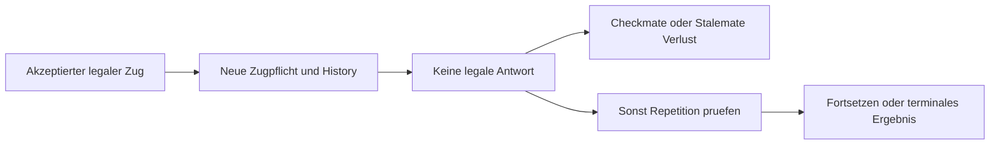

# 07 — Endgame, Repetition und Regelprofile

[Dokumentationsindex](../INDEX.md) · [Fortschritt](../checklists/project-progress.md)

## 1. Chapter Overview

Du schließt die lokale Spielregel-Pipeline durch eindeutige terminale Ergebnisse. Checkmate, Stalemate, Aufgabe und die gewählte Repetition-Semantik müssen dieselben reproduzierbaren Resultate liefern. Das Ergebnis ist eine lokal bis zum Ende spielbare Xiangqi-Partie unter einem ausdrücklich benannten Casual-Regelprofil.

Dieses Kapitel behauptet keine Turnierkonformität. Besonders Perpetual Chase besitzt komplexe schiedsrichterliche Definitionen; Kiban dokumentiert diese Grenze, statt westliche Dreifachwiederholung unbemerkt als vollständiges Xiangqi-Regelwerk auszugeben.

## 2. Prerequisites

- [Kapitel 06](06-legal-moves.md): vollständige Legalität, Check und zustandsneutrale Ablehnung.
- Lies [Xiangqi-Endgame](../rules/xiangqi-endgame.md), [Repetitionsprofil](../rules/xiangqi-repetitions.md) und [Testpositionen](../rules/rule-test-positions.md).
- Collections, Gleichheit und grundlegendes Hashing aus Rust Book kennen; Hashgleichheit nicht mit bewiesener Positionsgleichheit verwechseln.
- Verstehe, dass Schachuhren erst in Kapitel 14–15 hinzukommen. Zeitüberschreitung wird hier als späterer externer terminaler Grund benannt, noch nicht implementiert.

## 3. Learning Objectives

- Du kannst Checkmate und Stalemate unterscheiden und beide korrekt als Niederlage der zugpflichtigen Seite behandeln.
- Du kannst das gewählte Casual-Profil von WXF-Turnierregeln und deren Chase-Komplexität abgrenzen.
- Du kannst Positionsgleichheit, Wiederholungszählung und Check-Metadaten getrennt modellieren.
- Du kannst ein terminales Ergebnis gegen spätere Commands unveränderlich machen.

## 4. Concepts and Theory

### Terminale Ergebnisse

Ein terminales Ergebnis beendet fachliche Veränderungen. Checkmate bedeutet: zugpflichtige Seite steht im Check und hat keine legale Antwort. Stalemate bedeutet: kein Check, aber keine legale Antwort. Im Xiangqi verliert die zugpflichtige Seite auch bei Stalemate. Ein häufiger westlicher Übertragungsfehler wäre Remis. Aufgabe ist eine erlaubte Teilnehmerentscheidung, keine Figurenbewegung. Ein Abbruch vor regulärem Ende ist kein erfundener Sieg und wird später gesondert geführt. Siehe [Endregeln](../rules/xiangqi-endgame.md).

### Position, History und Repetition

Eine Position umfasst für die Wiederholungsprüfung Figurenverteilung und zugpflichtige Seite. Der gleiche Bildinhalt mit anderer Zugpflicht ist nicht dieselbe Position. History enthält zusätzlich die tatsächlich akzeptierte Reihenfolge und Check-Metadaten. Input der Wiederholungsprüfung sind neue Position und akzeptierte Historie; Output ist kein Ende, Remis oder regelbedingte Niederlage. Ungültige Versuche dürfen den Zähler nicht erhöhen. Ein einfacher vollständiger Vergleich kostet O(H·B) bei H historischen Positionen und B Boardplätzen; Indizes können später helfen. Hashes benötigen Kollisionsschutz durch Vergleich oder eine ausdrücklich analysierte Strategie.

### Gewähltes Profil `kiban-xiangqi-casual-v1`

Beim dritten Auftreten derselben Position wird der letzte vollständige Zyklus zwischen zweitem und drittem Auftreten betrachtet. Hat genau eine Seite auf jedem ihrer Züge in diesem Zyklus Check gegeben, verliert diese Seite wegen einseitigem Dauerschach. „Jeder“ verlangt mindestens einen tatsächlichen Zug dieser Seite; ein leerer Ausschnitt erfüllt die Bedingung nicht. Andernfalls endet die Partie remis durch Repetition. Die Startstellung wird als erstes Auftreten gezählt. Die Profil-ID wird pro Partie unveränderlich festgehalten. Diese Definition ist eine bewusste Projektregel, keine Behauptung über alle Verbandsregeln.

### Perpetual Check und Perpetual Chase

Perpetual Check wiederholt Drohungen gegen den General; Perpetual Chase betrifft wiederholtes Verfolgen beziehungsweise Angreifen anderer Figuren und kann von Schutz, Schlagabtausch und Ausnahmefällen abhängen. Das Casual-Profil klassifiziert Chase nicht automatisch. Eine wiederholte Chase-Stellung fällt somit unter die oben definierte Repetition, sofern die Check-Sonderregel nicht greift. Fehlerhaft wäre eine naive „gleiche Figur zweimal angegriffen“-Heuristik als Turnierregel zu verkaufen. Turnierkonformität verlangt ein neues versioniertes Profil, konkrete autoritative Regelausgabe und unabhängig geprüfte Beispielsammlung.

### Auswertungsreihenfolge

Nach einem akzeptierten legalen Zug entstehen Folgezustand und neue Zugpflicht. Zuerst wird fehlende legale Antwort ausgewertet, anschließend Repetition. Damit wird ein unmittelbar entscheidendes Checkmate nicht durch eine allgemeine Wiederholung überdeckt. Aufgabe verändert das Board nicht, beendet aber die Partie. Nicht unterstützte Draw-Regeln werden nicht erfunden: keine westliche 50-Züge-Regel, keine automatische Materialwertung, kein Draw-Angebot im MVP. Diese Auswahl ist offenzulegen; ein späteres Profil kann sie ausdrücklich ergänzen.

## 5. Architectural Context

Der Regelkern entscheidet regelbasierte Enden aus Position und History. Die Anwendung ergänzt später Authorization für Aufgabe und Timeout aus der Clock Engine. Alle Quellen münden in denselben terminalen `GameResult`, ohne eine zweite Ergebnisautorität zu schaffen.

Die Ruleset-ID ist Teil der Partie-Metadaten und wird später persistiert. Eine Protokollversion und eine Regelprofilversion sind unterschiedliche Versionierungsräume.

## 6. Design Decisions

**Verbindlich: explizites Casual-Profil.** Problem: vollständige Turnieradjudikation überfordert den ersten spielbaren Kern und ist ohne belastbare Quellen riskant. Alternative: sofort ein genaues WXF-Profil implementieren; das ist fachlich anspruchsvoller und benötigt deutlich mehr Chase-Tests. Casual-Regeln sind nachvollziehbar und testbar, erlauben jedoch bewusst andere Resultate als Turnierregeln. Neu bewerten vor offiziellen Turnieren oder ratingrelevantem Wettbewerbsanspruch.

**Verbindlich: vollständige Positionsgleichheit.** Ein Boardbild allein ist zu wenig, reine Hashgleichheit ist nicht logisch hinreichend. Vollständige Vergleiche sind einfach, benötigen aber mehr Speicher und Zeit. Optional darf ein Index beschleunigen; die Ergebnissemantik und Kollisionsbehandlung bleiben unverändert.

## 7. Implementation Tasks

- [ ] 1. Schreibe das Regelprofil mit exakter ID in deine Engine-Dokumentation und Partie-Metadaten. Verifiziere, dass die ID nach Spielstart unveränderlich ist.
- [ ] 2. Ergänze die Abfrage nach legalen Antworten der neuen zugpflichtigen Seite. Prüfe den leeren Fall ohne Annahme über Check.
- [ ] 3. Kombiniere leere Antwortmenge mit `is_in_check`: mit Check ist es Checkmate, ohne Check Stalemate; in beiden Fällen verliert die zugpflichtige Seite.
- [ ] 4. Lege konkrete Checkmate- und Stalemate-Fixtures aus dem Positionskatalog an. Kontrolliere ihre Legalität unabhängig, bevor du das erwartete Ergebnis festschreibst.
- [ ] 5. Definiere die Repetition-Position als Figurenverteilung plus aktive Seite. Teste, dass Uhr, Request-ID und Verbindungsstatus nicht in diese Gleichheit geraten.
- [ ] 6. Zähle die Startstellung als erstes Vorkommen. Ergänze nur nach akzeptierten Zügen weitere Positionen und prüfe ungültige Versuche als Negativfall.
- [ ] 7. Speichere pro akzeptiertem Zug bewegende Seite und ob der resultierende Zustand die Gegenseite ins Check setzt. Prüfe diese Metadaten gegen `is_in_check`.
- [ ] 8. Erkenne das dritte identische Vorkommen. Vorher darf keine allgemeine Repetition-Adjudikation entstehen; prüfe insbesondere zweites versus drittes Vorkommen.
- [ ] 9. Grenze den letzten Zyklus zwischen zweitem und drittem Vorkommen exakt ab. Prüfe Off-by-one-Fälle und dokumentiere, welche Zugmetadaten eingeschlossen werden.
- [ ] 10. Prüfe je Seite die Bedingung „auf jedem eigenen Zug Check gegeben“. Genau eine erfüllende Seite verliert; wenn keine oder beide erfüllen, endet das Casual-Profil remis.
- [ ] 11. Ergänze ein Chase-Beispiel ohne durchgehendes Check. Erwartet wird die dokumentierte Casual-Repetition, keine erfundene Turnierstrafe.
- [ ] 12. Definiere Aufgabe als terminalen Übergang mit unverändertem Board. Fremde Spielerrechte prüft später die Anwendung; die Domain prüft aktiven Zustand und korrekte Seite.
- [ ] 13. Lege terminale Unveränderlichkeit fest: spätere Züge und Aufgaben dürfen Ergebnis, History und Board nicht verändern.
- [ ] 14. Prüfe die Auswertungsreihenfolge: fehlende legale Antwort vor Repetition. Nutze einen gezielt konstruierten Grenzfall oder eine kontrollierte History-Fixture.
- [ ] 15. Ergänze Replay-Prüfung aus Startstellung und akzeptierter Zugliste. Endzustand und Endgrund müssen reproduzierbar gleich sein, ohne Uhr und Netzwerk.
- [ ] 16. Dokumentiere nicht unterstützte Draw-/Chase-Regeln sichtbar. Bewerte den späteren Aufwand eines Turnierprofils, ohne dessen Lösung jetzt zu implementieren.

## 8. Public Interfaces and Contracts

| Ergebnisgrund | Bedingung | Ausgang |
|---|---|---|
| `checkmate` | keine legale Antwort und Check | zugpflichtige Seite verliert |
| `stalemate` | keine legale Antwort ohne Check | zugpflichtige Seite verliert |
| `resignation` | aktive Seite gibt fachlich wirksam auf | aufgebende Seite verliert |
| `perpetual_check` | dritte Position, genau eine durchgehend checkende Seite im letzten Zyklus | checkende Seite verliert |
| `repetition` | dritte Position ohne obige eindeutige Check-Schuld | Remis |

`evaluate_terminal` erhält gültige Position, akzeptierte History und Profil-ID. Es liefert Fortsetzung oder genau ein Ergebnis. `timeout` und `server_restart` kommen erst durch spätere Anwendungskapitel hinzu; sie sind keine reine Board-Adjudikation. Die öffentliche Darstellung benennt den Grund zusätzlich zum Gewinner.

## 9. Edge Cases

- Gleiches Board mit anderer aktiver Seite: kein identisches Vorkommen.
- Dritter Zyklus besitzt einen nicht checkenden Zug der bisher checkenden Seite: die Durchgängigkeitsbedingung ist nicht erfüllt.
- Beide Seiten geben auf jedem eigenen Zykluszug Check: Casual-Profil behandelt dies als Repetition-Remis.
- Ein Zugversuch wird abgelehnt: keine neue History und keine erhöhte Repetitionszahl.
- Hashkollision: niemals ohne vollständigen Gleichheitsnachweis ein falsches Ende erzeugen.
- Dieselbe Partie wird unter anderem Profil wiedergegeben: ablehnen oder als bewusste Analyse markieren, nicht still umdeuten.

## 10. Testing Requirements

- **Given** eine gültige Stalemate-Stellung, **When** terminal ausgewertet wird, **Then** verliert die zugpflichtige Seite trotz fehlendem Check.
- **Given** eine Checkmate-Stellung, **When** ausgewertet wird, **Then** gewinnt die Gegenseite mit Grund `checkmate`.
- **Given** zwei gleiche Vorkommen, **When** geprüft wird, **Then** läuft die Partie weiter; beim dritten greift die Profilentscheidung.
- **Given** gleicher Boardinhalt mit wechselnder Zugpflicht, **When** Repetition gezählt wird, **Then** zählen diese Zustände getrennt.
- **Given** genau eine auf jedem eigenen Zykluszug checkende Seite, **When** das dritte Vorkommen entsteht, **Then** verliert diese Seite.
- **Given** ein einzelner eigener Nicht-Check-Zug im betrachteten Zyklus, **When** die Check-Schuld bewertet wird, **Then** erfüllt diese Seite die Durchgängigkeitsbedingung nicht.
- **Given** eine illegale Eingabe zwischen zwei gültigen Zügen, **When** Replay und History verglichen werden, **Then** bleibt die illegale Eingabe vollständig unberücksichtigt.
- **Given** ein terminales Ergebnis, **When** weitere Transitionen versucht werden, **Then** bleiben alle fachlichen Daten gleich.

## 11. Definition of Done

- [ ] Checkmate und Stalemate sind unterschiedliche Gründe mit korrektem Verlustresultat.
- [ ] Dritte Wiederholung, aktive Seite und letzter Zyklus sind präzise getestet.
- [ ] Check-Metadaten entstehen ausschließlich aus akzeptierten Folgezuständen.
- [ ] Casual-Profil, Chase-Grenzen und Turnierabweichung sind sichtbar dokumentiert.
- [ ] Terminale Ergebnisse sind unveränderlich und replaybar.
- [ ] Kein fehlendes Regelwissen wurde durch eine westliche Schachregel ersetzt.
- [ ] Vollständige bisherige Engine-Testreihe besteht.

## 12. Common Pitfalls

Stalemate als Remis ist im Xiangqi falsch. Eine reine Hash-Tabelle ohne Kollisionsstrategie macht eine seltene Kollision zu einem falschen Spielende. „Dauerschach“ nach Gefühl zu erkennen erzeugt nicht reproduzierbare Urteile. Das Profil muss bereits beim Erzeugen einer Partie feststehen; nachträgliche Regelupdates dürfen historische Resultate nicht verändern. Ein Repetition-Test nur mit synthetischen Zählern reicht nicht: mindestens ein vollständiger legaler Zugzyklus muss die Verkettung beweisen.

## 13. Reflection Questions

1. Warum gehört die aktive Seite zur Positionsgleichheit, die aktuelle Restzeit aber nicht?
2. Welcher Unterschied besteht zwischen einer dokumentierten Casual-Regel und behaupteter Turnierkonformität?
3. Warum ist Perpetual Chase schwerer als das Wiedererkennen desselben Boards?
4. Welche Metadaten benötigt Replay, um einen Dauerschachgrund nachzuvollziehen?
5. Weshalb muss eine abgelehnte Eingabe auch die History unverändert lassen?
6. Wann wäre ein zweites Regelprofil nötig statt einer stillen Korrektur von Casual v1?
7. Welche Auswirkung hätte ein Off-by-one-Fehler beim letzten Wiederholungszyklus?

## 14. Further Reading

- [Kiban-Repetitionsregeln](../rules/xiangqi-repetitions.md): die verbindliche Casual-Definition vor der History-Implementierung lesen.
- [Kiban-Endgame](../rules/xiangqi-endgame.md): Ergebnisprioritäten und nicht unterstützte Draw-Regeln gegenprüfen.
- [World Xiangqi Federation](https://www.wxf-xiangqi.org/): offizielle Regelsammlung als Startpunkt einer späteren Turnierprofil-Recherche, inklusive konkreter Ausgabe und Beispiele.
- [Rust HashMap](https://doc.rust-lang.org/std/collections/struct.HashMap.html): Gleichheit, Hashing und Entry-API verstehen, bevor ein Repetition-Index entsteht.

## 15. Completion Record

- Abschlussdatum: _vom Entwickler einzutragen_
- Getroffene Designentscheidungen und Begründung: _nach Bearbeitung eintragen_
- Aufgetretene Schwierigkeiten: _nach Bearbeitung eintragen_
- Durchgeführte Tests und Belege: _nach Bearbeitung eintragen_
- Verbleibende technische Schulden: _nach Bearbeitung eintragen_
- Gewonnene Erkenntnisse: _nach Bearbeitung eintragen_
