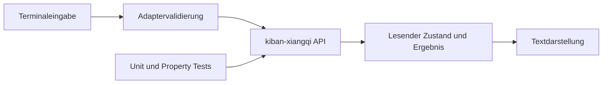

# 08 — Engine API, Property-Based Testing und Terminalspiel

[Dokumentationsindex](../INDEX.md) · [Fortschritt](../checklists/project-progress.md)

## 1. Chapter Overview

Du stabilisierst die Engine als eigenständig benutzbare Bibliothek und führst eine vollständige lokale Partie über einen selbst geschriebenen Terminaladapter durch. Zusätzlich erweitern generierte Testfolgen die Sammlung bekannter Positionen. Das greifbare Ergebnis ist [M2](../milestones/M2-xiangqi-engine.md): eine ohne Netzwerk bis zum Ergebnis spielbare und getestete Xiangqi-Engine.

Die Terminaloberfläche ist ein Lern- und Diagnosewerkzeug. Sie darf einfach bleiben: Eingabe, lesende Darstellung, fachliche Fehlermeldung und Ergebnis reichen. Keine lokale Grafik ist nötig.

## 2. Prerequisites

- [Kapitel 07](07-endgame-rules.md), einschließlich legaler Übergänge und reproduzierbarer History.
- Rust Book: Traits, generische Grundlagen, Tests und Dokumentationskommentare lesen.
- Lies [Teststrategie](../testing/strategy.md), [Unit-Tests](../testing/unit-tests.md) und [M2](../milestones/M2-xiangqi-engine.md).
- Lerne einen Property-Test-Ansatz vor seiner Verwendung. Eine eigene deterministische Fallgeneration ist als Einstieg zulässig; eine neue Dependency benötigt eine begründete Auswahl.

## 3. Learning Objectives

- Du kannst eine kleine öffentliche API ohne unkontrollierte Boardmutation entwerfen.
- Du kannst eine komplette Partie über dieselben Engine-Operationen wie ein späterer Server spielen.
- Du kannst ein Property, seine Eingabemenge und seine Aussagegrenze erläutern.
- Du kannst einen gefundenen generierten Fehler als reproduzierbaren Regressionstest festhalten.

## 4. Concepts and Theory

### Public API als Vertrag

Eine Public API definiert, was Aufrufer dauerhaft verwenden dürfen. Sie sollte fachliche Absichten ausdrücken statt interne Arrays und Mutationsreihenfolgen offenzulegen. Kiban bietet Spielinitialisierung, Zustandsabfrage, Zugversuch und Ergebnisabfrage; keine „setze beliebige Figur“-Produktionsmethode. Eine zu große API bindet spätere Refactorings. Eine zu kleine API kann Aufrufer zu Umgehungen zwingen. Rust API Guidelines helfen bei Benennung und Vorhersagbarkeit.

### Command, Query und Ergebnis

Ein Command fordert eine Änderung an, eine Query liest. Ein erfolgreicher Zug liefert den akzeptierten neuen Zustand beziehungsweise ein fachliches Übergangsergebnis, ein Fehler lässt den alten Zustand bestehen. Diese Trennung erleichtert später Snapshot und Actor-Orchestrierung. Eine Query darf keine Uhr lesen oder History ergänzen. Der häufige Fehler ist, Darstellung oder Validierung als versteckten Schreibzugriff zu verwenden.

### Unit-Test, Property und Beispiel

Ein Beispieltest prüft eine bekannte konkrete Position. Ein Property prüft eine allgemeine Behauptung über viele erzeugte gültige Eingaben, etwa „jeder akzeptierte Zug erhält die eigene Generalsicherheit“. Das ersetzt kein unabhängiges Regelwissen: Wenn Generator und Prüfer denselben Fehler teilen, kann alles grün sein. Behalte daher bekannte Positionen als Oracle und nutze Properties zusätzlich. Geeignete Eingaben entstehen durch gültige Startstellung plus legale Zugfolgen, nicht durch beliebige zufällige Boards.

### Seed und Shrinking

Ein Seed macht eine Zufallsfolge reproduzierbar. Shrinking versucht, einen Fehlschlag auf einen kleineren Input zurückzuführen. Bei Zugsequenzen müssen reduzierte Beispiele weiterhin gültige Voraussetzungen erfüllen; beliebiges Löschen kann eine ganz andere Ablehnung erzeugen. Kiban speichert Seed, Profil-ID und konkrete Folge für jeden echten Fund. Fehlermeldungen ohne reproduzierbare Eingabe sind wenig nützlich. Lies die Testbibliotheksdokumentation vor Auswahl der Strategie.

### Adapter und Parsing

Ein Adapter übersetzt eine externe Darstellung in fachliche Werte. Der Terminaladapter liest Text, konstruiert geprüfte Koordinaten und ruft die Engine auf. Er entscheidet keine Legalität. Fehlerhafte Eingabe darf die Session des lokalen Spiels nicht zerstören. Diese einfache Grenze bereitet HTTP vor und zeigt, dass Frontend und Regeln unabhängig sind. Standard-I/O und explizite Fehlermeldungen reichen für den ersten Nachweis.

## 5. Architectural Context

`kiban-cli` hängt von `kiban-xiangqi` ab; die Engine kennt den Terminaladapter nicht. Ein Ablauf besteht aus Lesen → Parsen → Command → Engine → Darstellung. Der spätere Server wird einen anderen Adapter vor dieselbe fachliche API setzen.

Die Engine bleibt synchron, ohne Tokio, Session-Token, DB-Pool und Systemzeit. Die Anwendungsschicht wird erst später Authorization und zeitliche Akzeptanz ergänzen.

## 6. Design Decisions

**Verbindlich: ein Engine-Einstieg für alle Adapter.** Alternative: Terminalablauf direkt auf Boardhelfer aufbauen; das spart kurzfristig API-Arbeit, testet aber nicht die spätere Servergrenze. Die gemeinsame API beweist Wiederverwendbarkeit, verlangt saubere Fehlerkategorien. Neu bewerten, wenn ein zweiter echter Adapter an derselben Stelle zusätzliche, fachlich sinnvolle Abfragen benötigt.

**Gewählt: klare Beispiele plus generierte Sequenzen.** Ausschließlich generierte Tests wirken umfassend, können aber systematische Fehler übersehen. Ausschließlich Beispiele lassen viele Sequenzen offen. Die Kombination erhöht Vertrauen, kostet jedoch Testpflege und Laufzeit. Optional darfst du zwischen eigener Seed-Generation und `proptest` entscheiden; dokumentiere, welche Shrinking-Fähigkeit tatsächlich vorliegt.

## 7. Implementation Tasks

- [ ] 1. Schreibe eine Liste erlaubter öffentlicher Operationen und entferne interne Boardhelfer aus der externen API. Kontrolliere, dass alle bisherigen Tests weiterhin geeignete Zugriffsmöglichkeiten besitzen.
- [ ] 2. Definiere `new_game` mit unveränderlicher Profil-ID und reproduzierbarer Startstellung. Nicht unterstützte Profile müssen kontrolliert scheitern.
- [ ] 3. Biete lesende Abfragen für aktive Seite, Boardansicht, History und Ergebnis an. Prüfe, dass Abfragen den Zustand nicht verändern und keine veränderlichen Interna herausgeben.
- [ ] 4. Biete einen zentralen `submit_move`-Vertrag an. Er verbindet aktive Seite, vollständige Legalität, History und Endauswertung; Ablehnung bleibt atomar.
- [ ] 5. Ergänze die fachliche Aufgabeoperation und prüfe terminale Unveränderlichkeit über die öffentliche API statt nur interne Helfer.
- [ ] 6. Schreibe eine kurze API-Nutzungsbeschreibung in eigener Sprache. Benenne Inputs, Outputs und typische Domain Errors, ohne Transportdetails einzuführen.
- [ ] 7. Erstelle eigenständig den optionalen Terminaladapter. Parsen von Start/Ziel verwendet geprüfte Koordinaten; kein String wird direkt zum Arrayindex.
- [ ] 8. Ergänze lesende Boarddarstellung mit Achsen, aktiver Seite und Ergebnis. Ein Eingabefehler kehrt zur Eingabe zurück und verändert die Partie nicht.
- [ ] 9. Spiele eine kontrollierte Folge legaler Züge und eine Aufgabe durch. Vergleiche die gedruckte History mit den tatsächlich akzeptierten Versuchen.
- [ ] 10. Definiere mindestens fünf Properties, unter anderem General-Sicherheit, unveränderte Ablehnung, Replay-Gleichheit und fehlende eigene Captures. Begrenze die gültige Eingabemenge jeweils ausdrücklich.
- [ ] 11. Wähle die Fallgeneration und dokumentiere neue Dependencies beziehungsweise den einfachen eigenen Seed-Ansatz. Verwende in CI feste reproduzierbare Seeds und zusätzlich bewusst variierbare lokale Läufe.
- [ ] 12. Erzeuge gültige Sequenzen durch Auswahl aus `legal_moves`. Beende eine Folge bei terminalem Zustand; generiere keine erfundenen Folgezustände.
- [ ] 13. Speichere jeden gefundenen echten Fehler als konkrete minimale Regression-Fixture. Verifiziere den Fehlschlag vor Korrektur und den Erfolg danach.
- [ ] 14. Teste einen vollständigen Replay über die öffentliche API. Endboard, Zugpflicht, History und Ergebnis müssen mit der Ausgangspartie übereinstimmen.
- [ ] 15. Führe die Engine separat ohne Server aus, dokumentiere die M2-Demonstration und prüfe, dass keine Netzwerk-/Async-Dependency eingeschlichen ist.

## 8. Public Interfaces and Contracts

| Operation | Input | Output | Fehler |
|---|---|---|---|
| `new_game` | unterstützte Ruleset-ID | Anfangszustand | unbekanntes Profil |
| `position_view` | vorhandene Partie | lesende Board- und Zugpflichtsicht | kein Schreibzugriff |
| `legal_moves` | aktive Partie | legale Start-/Zielzüge | terminale Partie liefert keine Fortsetzung |
| `submit_move` | Start/Ziel der aktiven Seite | akzeptierter Übergang plus mögliches Ende | illegal, falscher Zustand |
| `resign` | aufgebende Seite | terminales Ergebnis | bereits beendet |
| `replay` im Adapter/Test | Startprofil plus akzeptierte Folge | rekonstruierter Zustand | erste ungültige Ply mit Grund |

Ein UI- oder Netzwerk-DTO ist kein Domain-State. Die Engine enthält noch keine Request-ID-Deduplizierung; die wird in Kapitel 16 in der Anwendung ergänzt.

## 9. Edge Cases

- Leere Terminaleingabe oder nicht numerische Koordinate: Fehlermeldung und unveränderter Zustand.
- EOF beziehungsweise Benutzerabbruch: sauberer Programmabschluss, kein erfundener Sieg im Regelkern.
- Terminal zeigt noch eine alte Auswahl nach einem Zug: Darstellung vollständig aus aktuellem Zustand erneuern.
- Generator erreicht ein Ende früh: Folge beenden, nicht mit illegalen Zügen „auffüllen“.
- Replay enthält einen ungültigen Zug: bei der ersten fehlerhaften Ply stoppen und Ursache benennen.
- API veröffentlicht mutierbaren Boardzugriff: als Vertragsverletzung korrigieren, bevor HTTP darauf aufbaut.

## 10. Testing Requirements

- **Given** eine neue Engine-Partie, **When** ein gültiger Zug über Public API erfolgt, **Then** stimmen Board, aktive Seite und History überein.
- **Given** dieselbe Partie, **When** ein illegaler Zug erfolgt, **Then** bleiben sämtliche lesbaren Werte identisch.
- **Given** eine legal erzeugte Sequenz, **When** sie aus derselben Startstellung replayt wird, **Then** entsteht exakt derselbe fachliche Zustand.
- **Given** beliebige erfolgreich akzeptierte Züge, **When** deren Folgezustände untersucht werden, **Then** ist jeweils der vorher bewegende General sicher.
- **Given** ein reproduzierbarer Seed, **When** dieselbe Testversion erneut läuft, **Then** kann der fehlerhafte Input rekonstruiert werden.
- **Given** fehlerhafter Terminaltext, **When** Parsing scheitert, **Then** läuft die lokale Partie weiter und die History wächst nicht.
- **Given** der M2-Ablauf ohne Netzwerk, **When** zwei Menschen abwechselnd spielen und aufgeben, **Then** entsteht ein korrektes terminales Ergebnis.

## 11. Definition of Done

- [ ] Public API schützt Mutation und dokumentiert alle fachlichen Fehler.
- [ ] Vollständiger lokaler Spielablauf funktioniert ausschließlich über diese API.
- [ ] Mindestens fünf begründete Properties ergänzen bekannte Positionstests.
- [ ] Seeds und Regression-Fixtures machen Fehler reproduzierbar.
- [ ] Replay stimmt für nichtterminale und terminale Folgen überein.
- [ ] Engine ist ohne Tokio, HTTP, Datenbank und Godot testbar.
- [ ] M2-Szenario sowie sämtliche Quality Gates sind nachgewiesen.

## 12. Common Pitfalls

Eine Property „Ausgabe stimmt mit derselben Funktion überein“ ist tautologisch. Ein Generator beliebiger Boards testet oft nur ungültige Voraussetzungen. Ein Terminaladapter darf nicht neue Figurenregeln enthalten, nur weil eine Fehlermeldung dort einfacher scheint. Zu früh eingeführte generische Traits erhöhen die API-Fläche, bevor ein zweites Spiel konkrete Anforderungen liefert. Halte den Kern klein und seine Aussagen präzise.

## 13. Reflection Questions

1. Welche API-Methode würde die Sicherheitsinvariante leicht umgehen können?
2. Warum sind bekannte Testpositionen zusätzlich zu tausenden generierten Zügen nötig?
3. Welche Voraussetzungen muss eine General-Sicherheits-Property ausdrücklich nennen?
4. Wieso kann unbedachtes Shrinking eine Zugsequenz ungültig machen?
5. Was beweist ein erfolgreiches Replay über Determinismus und was beweist es nicht über Regelrichtigkeit?
6. Welche Verantwortung darf der Terminaladapter mit einem späteren HTTP-Adapter teilen?

## 14. Further Reading

- [Rust API Guidelines](https://rust-lang.github.io/api-guidelines/): Naming, Flexibility und Documentation für die Engine-Schnittstelle.
- [Rust Book: Testing](https://doc.rust-lang.org/book/ch11-00-testing.html): Unit- und Integrationstestgrenzen sowie öffentliche API prüfen.
- [proptest](https://docs.rs/proptest/latest/proptest/): falls gewählt, Strategien, Seeds und Shrinking vor eigener Generatorgestaltung lesen.
- [Rust Standard I/O](https://doc.rust-lang.org/std/io/): Fehlerbehandlung beim Terminaladapter.
- [M2](../milestones/M2-xiangqi-engine.md): den vollständigen lokalen Nachweis am Ende durchführen.

## 15. Completion Record

- Abschlussdatum: _vom Entwickler einzutragen_
- Getroffene Designentscheidungen und Begründung: _nach Bearbeitung eintragen_
- Aufgetretene Schwierigkeiten: _nach Bearbeitung eintragen_
- Durchgeführte Tests und Belege: _nach Bearbeitung eintragen_
- Verbleibende technische Schulden: _nach Bearbeitung eintragen_
- Gewonnene Erkenntnisse: _nach Bearbeitung eintragen_
