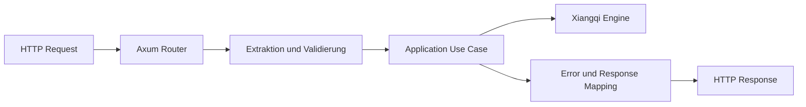

# 09 — Axum, HTTP, Routing und Configuration

[Dokumentationsindex](../INDEX.md) · [Fortschritt](../checklists/project-progress.md)

## 1. Chapter Overview

Du ergänzt einen HTTP-Adapter vor dem bereits getesteten Kern. Das Ergebnis ist ein lokal startbarer Server mit klarer Konfigurationsgrenze, strukturierten Fehlern und ohne Godot testbaren Routen. Fachliche Spielaktionen kommen in den nächsten Kapiteln schrittweise hinzu; dieses Kapitel schafft Transport und Diagnose, nicht einen zweiten Regelkern.

Für die praktische Arbeit schreibst du alle Handler und Konfigurationen selbst. Die Dokumentation benennt Verantwortlichkeiten und Verträge, liefert aber keine fertigen Handler oder produktionsfähigen Konfigurationsdateien.

## 2. Prerequisites

- [Kapitel 08](08-engine-api.md) und M2 abgeschlossen; die Engine-API ist lokal beweisbar.
- Rust Book: `Result`, Traits und grundlegende Lifetimes verstehen. Lies Tokio „Hello Tokio“, „Async in depth“ und „Shared state“ vor Serverimplementierung.
- Lies [Backend-Architektur](../architecture/backend.md), [REST-Vertrag](../protocol/rest-api.md) und [Error-Vertrag](../protocol/errors.md).
- Ein HTTP-Testwerkzeug wie `curl`; PostgreSQL und Godot werden noch nicht benötigt. Session- und Lobby-Daten bleiben bis Kapitel 17 flüchtig.

## 3. Learning Objectives

- Du kannst HTTP-Methode, Resource, Statuscode und Body anhand einer Kiban-Anfrage erklären.
- Du kannst Tokio-Task und OS-Thread unterscheiden und begründen, warum blockierende Arbeit problematisch ist.
- Du kannst externe Daten in geprüfte DTOs und danach in Domain-Werte überführen.
- Du kannst Konfigurationsfehler beim Start und Request-Fehler zur Laufzeit konsistent darstellen.

## 4. Concepts and Theory

### HTTP-Semantik und REST-Grenze

HTTP beschreibt Requests und Responses mit Methoden, Statuscodes, Headers und optionalem Body. GET liest eine Resource und soll keine fachliche Mutation auslösen; POST fordert hier Erzeugung oder einen definierten Use Case an. REST in Kiban übernimmt Sessions, Lobby und History. Laufende Partiecommands werden später über WebSocket geschickt. Eine leere 200-Antwort für jeden Fehler erschwert Clients und Monitoring. Lies RFC 9110 für Methoden und Statuscodes; die konkreten Endpoints stehen im [REST-Vertrag](../protocol/rest-api.md).

### Async/Await, Future und Runtime

Eine Future beschreibt eine noch nicht abgeschlossene Berechnung. `await` erlaubt der Runtime, während eines wartenden I/O-Schritts andere Tasks voranzubringen. Tokio organisiert diese Tasks; ein Task ist nicht gleich ein OS-Thread. CPU-Schleifen oder blockierende Dateizugriffe auf Runtime-Threads können sämtliche Verbindungen verzögern. Kiban verwendet Async für Transport und später Datenbank-I/O, während der kurze deterministische Regelkern synchron bleibt. Fehlerhaft wäre, Async überall einzuführen oder `await` mit „parallel“ gleichzusetzen. Lies das Tokio-Tutorial vor eigener Spawn-Nutzung.

### Routing, Extractors und Responses

Ein Router ordnet Pfad und Methode einem Handler zu. Extractors übersetzen Requestbestandteile in geprüfte Adapterwerte, Responses übersetzen fachliche Ergebnisse zurück. Ein Extractor ersetzt keine Authorization. Kiban hält Handler schlank und ruft Use Cases der Anwendung auf. Ein häufiger Fehler ist, die gesamte Engine im Handler zu implementieren oder Raw-JSON tief im Kern zu reichen. Axum-Dokumentation zu Routing, Extractors und Responses erklärt die Frameworkgrenzen.

### DTO und Domain Model

Ein DTO beschreibt ein Transportformat. Es darf optionale Felder, Strings und externe Zahlen besitzen, die erst in Domain-Werte überführt werden. Serde übernimmt Serialisierung, nicht die gesamte fachliche Prüfung. Unbekannte oder ungültige Werte benötigen einen dokumentierten Fehler. Die Trennung ist angemessen, weil sich Protokoll und innere Repräsentation unabhängig entwickeln. Fehlerhaft wäre, Domain-Typen nur für bequemes JSON mit beliebig veränderlichen Feldern auszustatten.

### Configuration und Startup Validation

Konfiguration beschreibt Umgebungseinflüsse wie Bind-Adresse und später Datenbankzugang. Sie wird beim Start gelesen, typisiert und vollständig validiert. Defaults sind nur für ungefährliche lokale Werte geeignet; ein fehlendes Secret darf nicht durch ein bekanntes Standardsecret ersetzt werden. Kiban trennt Configuration von Domain State. Eine halbfertige Initialisierung sollte vor Annahme von Requests scheitern. Dokumentiere jeden Parameter und logge sensible Werte niemals.

### Error Mapping und Correlation

Ein Domain Error erhält erst im Adapter HTTP-Status und stabilen maschinenlesbaren Code. Interne Ursachen können für Diagnose protokolliert werden, ohne Stacktrace oder SQL an Clients zu senden. Eine Correlation-ID verbindet Anfrage und Diagnose; sie ist weder Authorization noch Idempotency-Key. Die hier minimale strukturierte Diagnose wird in Kapitel 26 ausgebaut. Ein häufiger Fehler ist, interne Error-Strings unkontrolliert als Response zu serialisieren.

## 5. Architectural Context

`kiban-server` besitzt Listener, Router, DTO-Konvertierung und Infrastrukturhandles. `kiban-application` beschreibt Use Cases; `kiban-xiangqi` bleibt unabhängig von HTTP. Zu diesem Zeitpunkt reicht eine ungefährliche Liveness-Abfrage; spätere Routen werden nicht durch erfundene erfolgreiche Dummyantworten vorweggenommen.

GET `/health/live` ist eine Betriebsroute außerhalb `/api/v1`. Sie belegt nur Prozessreaktion, nicht Datenbankbereitschaft; echte Readiness und Shutdown folgen Kapitel 26.

## 6. Design Decisions

**Verbindlich: Axum und Tokio als Adaptertechnologien.** Alternativen wie Actix Web oder ein synchroner Server können ebenfalls HTTP bedienen. Axum passt zu Tokio, typisierten Extractors und dem vorgesehenen WebSocket-Pfad; Nachteile sind Async-Komplexität und sich entwickelnde Framework-APIs. Verwende die zur gewählten Version passende offizielle Dokumentation. Neu bewerten bei gemessenen Anforderungen, nicht wegen kurzfristiger Tutorialpräferenzen.

**Verbindlich: getrennte DTOs.** Direkte Domain-Serialisierung spart zunächst Mapping, koppelt aber Wire Contract und private Repräsentation. DTOs benötigen mehr Konvertierungstests und bieten dafür kontrollierte Validierung und Versionierung. Optional darfst du lokale Startparameter per Environment oder expliziter Datei verwalten; dokumentiere Priorität und vermeide widersprüchliche Quellen.

## 7. Implementation Tasks

- [ ] 1. Lies und protokolliere die aktuell gewählte Axum-/Tokio-/Serde-Version mit unterstützter Toolchain. Ergänze nur die tatsächlich benötigten Features im Serveradapter.
- [ ] 2. Definiere die lokalen Startparameter: Bind-Adresse, Port und Log-Level. Dokumentiere zulässige Werte und welche Fehler den Start verhindern.
- [ ] 3. Implementiere eigenständig eine getrennte Configuration-Einlesegrenze in `kiban-server`. Prüfe ungültigen Port, ungültige Adresse und unbekannten Log-Level ohne geöffneten Listener.
- [ ] 4. Erstelle den Runtime-/Listener-Einstieg. Belege durch lokalen Start und sauberes Beenden, dass der Server erreichbar ist und Fehler verständlich meldet.
- [ ] 5. Ergänze GET `/health/live` mit stabiler ungefährlicher Antwort. Sie darf keine Secrets, Enginezustände oder fiktive DB-Bereitschaft enthalten.
- [ ] 6. Lege den API-Router unter `/api/v1` an. Prüfe unbekannte Pfade und falsche Methoden; noch nicht implementierte Fachrouten dürfen keinen Erfolg vortäuschen.
- [ ] 7. Definiere das gemeinsame Fehler-DTO anhand des Error-Vertrags. Mappe ungültiges JSON, Validierungsfehler und unbekannte Route konsistent.
- [ ] 8. Trenne Serde-Deserialisierung von Domain-Konvertierung. Schreibe Tests, die syntaktisch gültige, fachlich aber ungültige Werte kontrolliert ablehnen.
- [ ] 9. Setze Request-Body-Grenzen und dokumentierte Content-Type-Prüfung vor aufwendige Verarbeitung. Verifiziere, dass ein übergroßer Body vor dem Use Case abgewiesen wird.
- [ ] 10. Ergänze eine Request-/Correlation-ID für Diagnose. Prüfe, dass sie nicht als Spieleridentität oder späterer Deduplizierungsschlüssel behandelt wird.
- [ ] 11. Baue Routertests, die keinen echten externen Port voraussetzen. Verifiziere Status, Headers und maschinenlesbaren Error-Code statt freier Textgleichheit.
- [ ] 12. Prüfe einen echten lokalen Request zusätzlich mit einem unabhängigen HTTP-Client. Halte URL, erwarteten Status und Ergebnis im Nachweis fest.
- [ ] 13. Untersuche alle Handler auf blockierende Arbeit und lange kritische Abschnitte. Der Regelkern bleibt synchron; Netzwerk-I/O wird asynchron awaited.
- [ ] 14. Prüfe, dass Engine-Tests unverändert ohne Server laufen. Ein Transportfehler darf keine Domain-API-Änderung erzwingen.
- [ ] 15. Dokumentiere den Startablauf und die Fehlermatrix, führe Formatierung, Clippy und Tests aus und bereite die Authentifizierungsgrenze für Kapitel 10 vor.

## 8. Public Interfaces and Contracts

| Grenze | Vertrag |
|---|---|
| GET `/health/live` | 200 bei reagierendem Prozess; keine fachliche Zustandsänderung |
| `/api/v1` | versionierter Namespace für die folgenden REST-Use-Cases |
| Request-DTO | ausschließlich Transportwerte; geprüfte Konvertierung in Domain-Werte |
| Error-Response | stabiler `code`, verständliche `message`, zuordenbare Request-ID nach Protokoll |
| Startup | alle notwendigen Parameter vor Listenerbetrieb geprüft |

Die [REST-Spezifikation](../protocol/rest-api.md) und [Fehlerspezifikation](../protocol/errors.md) sind normative Feldreferenzen. Dieses Kapitel definiert keine alternativen Error-Namen. Zustandsverändernde Spielcommands und `expected_version` kommen erst mit dem WebSocket-Vertrag.

## 9. Edge Cases

- Ungültiges JSON ist ein anderer Fehler als syntaktisch gültige, fachlich unmögliche Koordinaten.
- Port bereits belegt: klarer Startup-Fehler statt stiller Wechsel auf einen anderen Port.
- Client trennt sich während einer Anfrage: keine fachliche Aussage aus bloßem Transportabbruch ableiten.
- Extrem großer Body: begrenzte Verarbeitung und definierte Ablehnung.
- Ein Handler verursacht internen Fehler: keine internen Pfade oder Secrets im Response.
- Ein Task blockiert: unabhängige Requests dürfen nicht durch bewusst unbeschränkte Arbeit ausgehungert werden.

## 10. Testing Requirements

- **Given** gültige lokale Configuration, **When** der Server startet und Liveness gelesen wird, **Then** folgt 200 ohne Domain-Mutation.
- **Given** ungültiger Port, **When** Startup läuft, **Then** scheitert er vor Annahme von Requests mit ungefährlicher Diagnose.
- **Given** unbekannter Pfad, **When** er aufgerufen wird, **Then** folgt 404 mit dem vereinbarten Error-Format.
- **Given** falsche Methode an einer bekannten Resource, **When** der Request erfolgt, **Then** folgt 405 statt fachlicher Mutation.
- **Given** zu großer Request-Body, **When** er eintrifft, **Then** wird er vor dem Use Case entsprechend der Größenregel abgelehnt.
- **Given** syntaktisch gültige ungültige Werte, **When** DTO-Konvertierung läuft, **Then** entsteht ein definierter Clientfehler ohne Panic.
- **Given** viele unabhängige Liveness-Requests, **When** sie gleichzeitig laufen, **Then** bleiben alle Antworten korrekt und der gemeinsame Zustand unverändert.

## 11. Definition of Done

- [ ] Lokaler HTTP-Start und unabhängiger Clientnachweis funktionieren.
- [ ] Routing, Methodenfehler und Größenlimits sind getestet.
- [ ] Configuration scheitert bei ungültigen Pflichtwerten vor Listenerbetrieb.
- [ ] Error Mapping schützt interne Details und bleibt maschinenlesbar.
- [ ] DTOs und Domain-Werte sind getrennt.
- [ ] Routertests benötigen weder Godot noch PostgreSQL.
- [ ] Bestehende Engine-Tests und Quality Gates bleiben grün.

## 12. Common Pitfalls

`async` beschleunigt keine CPU-Arbeit automatisch. Ein Handler sollte nicht zugleich Routing, Regeln, Identität und Persistence besitzen. Deserialisierung ist nicht gleich Fachvalidierung. Falsche oder fehlende Content-Types unbemerkt zu akzeptieren macht Clients schwerer diagnostizierbar. Erfinde vor Kapitel 17 keine „persistierten“ Daten in flüchtigen Beispielen; benenne den vorläufigen In-Memory-Zustand ehrlich.

## 13. Reflection Questions

1. Welche Grenze trennt einen DTO-Validierungsfehler von einem Domain Error?
2. Warum ist eine Tokio-Task nicht automatisch ein eigener OS-Thread?
3. Welche Nachteile hätte direktes Serialisieren privater Boardrepräsentation?
4. Was beweist `/health/live` und welche Verfügbarkeit beweist es noch nicht?
5. Weshalb sollte ein unbekannter API-Pfad keinen generischen 200-Response bekommen?
6. Welche Konfigurationsfehler müssen vor der Annahme eines Requests erkannt werden?
7. Warum darf eine Correlation-ID später nicht versehentlich Authorization ersetzen?

## 14. Further Reading

- [Axum API](https://docs.rs/axum/latest/axum/): Routing, Extractors, Responses und Error Handling für die konkret verwendete Version; beim Quellenabruf war 0.8.9 sichtbar.
- [Tokio Tutorial](https://tokio.rs/tokio/tutorial): „Hello Tokio“, „Async in depth“ und „Shared state“ vor eigenen Runtime- und State-Entscheidungen lesen.
- [Serde](https://serde.rs/): „Overview“ und Datenmodell für Transportkonvertierung studieren.
- [RFC 9110](https://www.rfc-editor.org/rfc/rfc9110): Methodensemantik, Statuscodes und Content-Type als normative HTTP-Grundlage.
- [Kiban REST API](../protocol/rest-api.md): verbindliche Endpoints und Fehlerkonventionen abgleichen.

## 15. Completion Record

- Abschlussdatum: _vom Entwickler einzutragen_
- Getroffene Designentscheidungen und Begründung: _nach Bearbeitung eintragen_
- Aufgetretene Schwierigkeiten: _nach Bearbeitung eintragen_
- Durchgeführte Tests und Belege: _nach Bearbeitung eintragen_
- Verbleibende technische Schulden: _nach Bearbeitung eintragen_
- Gewonnene Erkenntnisse: _nach Bearbeitung eintragen_
