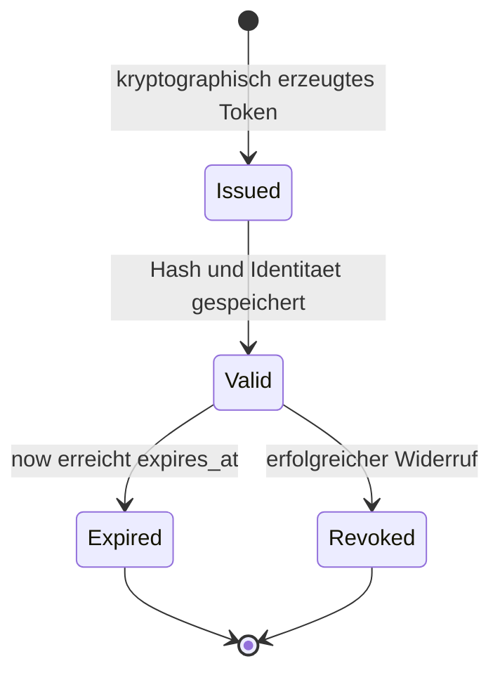

# 10 — Guest Identity, Sessions und Authorization

[Dokumentationsindex](../INDEX.md) · [Fortschritt](../checklists/project-progress.md)

## 1. Chapter Overview

Du ermöglichst anonymen Spielern eine stabile, serververifizierbare Identität. Das Ergebnis ist ein Gast-Session-Fluss mit kryptographisch zufälligem Credential, gehashter Speicherung, Ablauf, Widerruf und sauberer Trennung von Authentication und Authorization. Ein Nutzer braucht kein Konto, um später denselben Sitz nach Reconnect wiederzuerkennen.

Bis Kapitel 17 verwendet die Anwendung ein ausdrücklich flüchtiges Session-Repository. Ein Prozessneustart beendet diese vorläufigen Sessions. Das ist ein bekannter Zwischenschritt und kein bereits gelöstes Crash-Recovery-Versprechen.

## 2. Prerequisites

- [Kapitel 09](09-http-server.md): Router, DTOs, Error Mapping und Configuration funktionieren.
- [Kapitel 03](03-domain-modeling.md): PrincipalId, SessionId und Ownership sind verstanden.
- Lies [Authentication-Architektur](../architecture/authentication.md), [Protokoll-Authentication](../protocol/authentication.md) und [Security](../architecture/security.md).
- Lerne kryptographischen Zufall, Bearer-Credentials, Hashing und Cookie-Eigenschaften aus den unten verlinkten Quellen, bevor du eine Dependency auswählst. Entwickle keinen eigenen Zufallsgenerator.

## 3. Learning Objectives

- Du kannst PrincipalId, SessionId, Secret Token und Connection-ID unterscheiden.
- Du kannst erklären, warum ein erratbarer Anzeigename oder eine GameId keine Authentication liefert.
- Du kannst Ablauf und Widerruf deterministisch testen sowie jede Anfrage einer überprüften Identität zuordnen.
- Du kannst browserbasierte Cookies und native Bearer-Header sicher in denselben fachlichen Session-Kontext überführen.

## 4. Concepts and Theory

### Authentication und Authorization

Authentication prüft, welche Identität ein Credential repräsentiert. Authorization prüft, ob diese Identität eine konkrete Aktion an einer Resource ausführen darf. Ein gültiger Gast ist nicht automatisch Teilnehmer jeder Partie. Kiban erzeugt deshalb einen `AuthenticatedPrincipal`, dessen PrincipalId später mit den Sitzbelegungen verglichen wird. Ein häufiger Fehler ist, eine `principal_id` aus einem Clientbody als Autorität zu übernehmen. Prüfe Identität am vertrauenswürdigen Adapter und Teilnehmerrechte erneut am fachlichen Command-Punkt. Siehe OWASP Authorization Cheat Sheet.

### Opaque Token und kryptographischer Zufall

Ein Opaque Token enthält für den Client keine auszuwertende Bedeutung; sein Besitz berechtigt zur Nutzung der Session. Kiban verwendet 256 Bit aus einer Betriebssystem-gestützten kryptographisch sicheren Zufallsquelle. Ein Zeitstempel, fortlaufender Zähler oder normaler Spiele-Zufallsgenerator ist dafür ungeeignet. Die äußere Codierung dient nur Transport und Lesbarkeit; sie erhöht nicht die Entropie. Verwende etablierte Bibliotheken und prüfe Fehler der Entropiequelle. Das Token ist ein Secret, auch wenn der Spieler anonym ist.

### Hashing und Speicherung

Der Server speichert den SHA-256-Hash des zufälligen Tokens, nicht dessen Klartext. Der Hash dient als Such-/Prüfwert; der Sessiondatensatz enthält Identität, Ablauf und Widerruf. Bei einem Repository-Leak ist der Hash selbst kein akzeptiertes Credential. Die hohe zufällige Entropie unterscheidet dieses Token von einem menschlichen Passwort: Passwortspeicherung in Kapitel 27 benötigt ein dafür geeignetes langsames Verfahren. Fehlerhaft wären Tokenlogging, reversible Verschlüsselung ohne Bedarf oder das Akzeptieren eines Tokenhashes als Bearer. Der Klartext wird nur bei Ausgabe beziehungsweise Transport benötigt.

### Ablauf und Widerruf

Eine Session besitzt einen expliziten Ablaufzeitpunkt und optionalen Widerruf. Prüfung verwendet eine injizierbare Zeitquelle; bei `now >= expires_at` ist das Credential abgelaufen. Ablauf wird nicht nur beim ersten Verbindungsaufbau relevant. Laufende WebSocket-Verbindungen müssen später bei Ablauf oder Widerruf ihre Berechtigung verlieren; die Command-Grenze schützt vor verspäteten Aktionen. Die genauen konfigurierten Laufzeiten stehen im [Authentication-Vertrag](../protocol/authentication.md). Eine Uhr aus dem Client ist niemals vertrauenswürdig.

### Native und Browser Credentials

Native Clients übertragen das Token als Bearer-Header und speichern es nach Möglichkeit im OS Credential Vault. Browser verwenden same-origin ein `HttpOnly`, `Secure`, `SameSite=Lax`-Cookie; JavaScript und Godot-Webcode sollen das Secret nicht lesen. Zustandsändernde Browser-Requests benötigen zusätzlich die dokumentierte Origin-/CSRF-Prüfung. HTTPS/WSS schützen den Transport. Browser-WebSocket-APIs erlauben keine beliebigen Authorization-Headers; Kiban nutzt dort das Cookie und später eine erste Authenticate-Nachricht ohne Tokenpayload. Native WebSockets senden ihr Token im ersten Authenticate-Frame. Tokens gehören niemals in URLs, Logs oder Replays.

### Repository-Grenze und kurze Synchronisation

Ein Repository kapselt Zugriff auf Sessiondatensätze. Hier ist es eine In-Memory-Implementierung; Kapitel 17 ersetzt die Speicherung durch PostgreSQL. Ein Mutex schützt den kurzen Zugriff auf gemeinsam genutzte Daten vor Race Conditions. Er ist kein Besitz einer ganzen Partie und kein Ersatz für spätere Game Actors. Halte keine Lock-Grenze über Netzwerk-I/O beziehungsweise `await`. Der häufige Fehler ist, einen globalen Lock um vollständige Handler zu legen. Lies Tokio „Shared state“ vor der Wahl des Synchronisationsprimitivs.

## 5. Architectural Context

Der HTTP-Adapter extrahiert Credentials, der Session-Service hasht und prüft sie gegen das Repository. Nur der daraus entstandene Principal wird an Use Cases weitergereicht. Der Client darf keine andere PrincipalId auswählen. Es existieren noch keine Spielsitze; ihre Authorization folgt in Kapitel 11 und 13.

Eine Connection ist kurzlebig, eine gültige Session überdauert mehrere Connections. Vor Kapitel 17 überdauert sie ausdrücklich noch keinen Prozessneustart. Das langfristige Repository erhält dieselben fachlichen Prüfverträge.

## 6. Design Decisions

**Verbindlich: zufälliges Opaque Token statt Client-ID oder JWT.** Problem: stabile Gastidentität ohne vorzeitige Accountverwaltung. Eine Client-ID verhindert keine Impersonation. JWT reduziert bestimmte Lookups, erschwert aber unmittelbaren Widerruf und bringt Signatur-/Claim-Komplexität. Opaque Tokens sind einfach widerrufbar, benötigen dafür Repositoryzugriff. Neu bewerten erst bei realen verteilten Anforderungen; ein einzelner Server braucht keinen Token-Service.

**Verbindlich: getrennte Client-Credential-Wege mit gleichem Principal.** Ein Browser-Bearer in LocalStorage ist bequem, erhöht jedoch Exposure durch Scripts; HttpOnly-Cookies benötigen CSRF-Schutz. Native Vault-Speicherung erfordert Plattformintegration. Die gewählte Trennung folgt den Clientfähigkeiten und hält die fachliche Identität einheitlich. Optional darf die erste Lernimplementierung nur den nativen HTTP-Testpfad vorführen; vor Web-MVP sind Cookie- und CSRF-Tests verpflichtend.

## 7. Implementation Tasks

- [ ] 1. Beschreibe PrincipalId, SessionId, Connection-ID und Token getrennt im eigenen Auth-Design. Prüfe, dass ausschließlich das Token geheim ist und keine öffentliche ID als Credential akzeptiert wird.
- [ ] 2. Wähle eine gepflegte CSPRNG- und SHA-256-Bibliothek mit dokumentierter Betriebssystemanbindung. Halte Version, Features und Fehlerverhalten fest; implementiere keinen eigenen Kryptoprimitiv.
- [ ] 3. Definiere den Sessiondatensatz mit Hash, PrincipalId, Ablauf und Widerrufsstatus in der Anwendung. Kein Feld darf den Klartexttoken dauerhaft speichern.
- [ ] 4. Entwirf eine Session-Repository-Grenze und zunächst eine In-Memory-Implementierung. Prüfe, dass später SQLx ergänzt werden kann, ohne Teilnehmeridentität oder Tokenformat zu ändern.
- [ ] 5. Ergänze eine injizierbare Zeitquelle für Sessionprüfung. Teste Ablauf exakt am Grenzzeitpunkt ohne echte Wartezeit; diese Wall-Clock-Metadaten sind keine spätere monotone Spieluhr.
- [ ] 6. Implementiere eigenständig POST `/api/v1/guest-sessions`. Erzeuge Identität und Token serverseitig, speichere den Hash und liefere nur den vertragsgemäßen Credential-Weg aus.
- [ ] 7. Prüfe Repositoryfehler beim Erzeugen: kein erfolgreiches Credential ausgeben, wenn dessen Datensatz nicht gespeichert wurde. Entropiefehler müssen ebenso kontrolliert scheitern.
- [ ] 8. Ergänze native Bearer-Extraktion. Leere, mehrfach widersprüchliche, fehlerhaft codierte und unbekannte Credentials müssen kontrolliert scheitern.
- [ ] 9. Ergänze Cookie-Ausgabe und Cookie-Extraktion für den Browserpfad gemäß Protokoll. Prüfe HttpOnly, Secure, SameSite und eine festgelegte Path-/Domain-Regel.
- [ ] 10. Lege bei widersprüchlichen Cookie-/Header-Credentials ein eindeutiges Ablehnungsverhalten fest und gleiche es mit dem Authentication-Vertrag ab; niemals still zwischen Identitäten wechseln.
- [ ] 11. Erzeuge nach erfolgreicher Hash-/Ablauf-/Widerrufsprüfung einen unverfälschbaren anwendungsinternen Principal. Ignoriere jede fremde `principal_id` im Requestbody als Berechtigungsquelle.
- [ ] 12. Implementiere POST `/api/v1/session/revoke` für die aktuelle Session. Der spezielle Logout-Pfad liefert für denselben bekannten bereits widerrufenen Token erneut 204, ein unbekannter Token bleibt 401. Verifiziere, dass das widerrufene Credential an allen anderen geschützten Grenzen abgewiesen wird.
- [ ] 13. Ergänze Browser-Origin-/CSRF-Prüfung für zustandsändernde Requests. Ein fremder Origin muss vor Mutation scheitern; SameSite ist keine alleinige fachliche Schutzschicht.
- [ ] 14. Ergänze begrenzte Erzeugungs- und Fehlversuchsraten sowie endliche Repository-Kapazität. Lies dazu den Security-Vertrag; voller Speicher darf keine unbegrenzte Allokation erzeugen.
- [ ] 15. Schreibe Diagnoseereignisse ohne Token, Tokenhash oder Cookie-Header. Prüfe Testlogs mit markierten Secrets auf versehentliche Ausgabe.
- [ ] 16. Prüfe parallele Session-Erzeugungen und Widerruf gegen Validierung. Kurze Repositoryoperationen sind atomar; kein Lock wird über Netzwerk-I/O gehalten.
- [ ] 17. Dokumentiere Credential-Speicherung für native und Web-Clients als Integrationsauftrag für Kapitel 20. URL-Token und LocalStorage-Secrets sind kein genehmigter Ersatz.
- [ ] 18. Führe zwei unabhängige HTTP-Clients vor: verschiedene Gäste, wiederholter Zugriff mit gleicher Identität, abgelehnter Fremdtoken und wirksamer Widerruf. Halte die vorläufige Neustartgrenze ausdrücklich fest.

## 8. Public Interfaces and Contracts

| Grenze | Input | Output | Ablehnung |
|---|---|---|---|
| POST `/api/v1/guest-sessions` | vertragsgemäße Gast-Erzeugung | neue Session/PrincipalId und Credential über den vorgesehenen Clientweg | Limit, interne Erzeugung fehlgeschlagen |
| `authenticate` | extrahiertes Credential plus vertrauenswürdiges now | `AuthenticatedPrincipal` | ungültig, abgelaufen, widerrufen |
| POST `/api/v1/session/revoke` | bekanntes Credential der eigenen Session, CSRF bei Cookie | 204; erneut für denselben bekannten widerrufenen Token ebenfalls 204 | fehlendes/unbekanntes Credential: 401 |
| `authorize_participant` später | Principal und Sitzbelegung | erlaubte Seite | gültige Session ohne Teilnehmerrecht |
| Session-Repository | Tokenhash und Metadaten | atomar gespeicherter/geladener Datensatz | Kapazitäts-/Speicherfehler |

Nur der spezielle Revoke-Endpunkt darf einen bekannten bereits widerrufenen Token zur idempotenten Logout-Bestätigung nachschlagen; daraus entsteht kein gültiger Principal und keine andere Berechtigung. Normale Authentication bleibt nach Widerruf gesperrt. Die exakten JSON-Felder, Statuscodes, Laufzeiten und Cookie-Attribute folgen [REST](../protocol/rest-api.md) und [Authentication](../protocol/authentication.md). Die spätere WebSocket-Authentifizierung sendet native Credentials im ersten Authenticate-Frame; der Browser nutzt das bereits geprüfte Cookie und einen leeren Auth-Payload. Dieser Kapitelabschluss implementiert noch keinen WebSocket.

## 9. Edge Cases

- Tokenausgabe gelingt, Speicherung scheitert: kein erfolgreicher Gaststart; ungespeichertes Credential verwerfen.
- Token ist syntaktisch plausibel, aber unbekannt: gleiche ungefährliche Ablehnung wie andere ungültige Credentials, keine internen Details.
- Ablauf genau jetzt: `now >= expires_at` wird abgelehnt.
- Zwei Requests verwenden dasselbe gültige Token: dieselbe Identität, keine neue Gastidentität pro Request.
- Widerruf konkurriert mit Prüfung: Repositoryoperationen haben eine klare Reihenfolge; später wird Authorization an der Command-Grenze erneut geprüft.
- Browser sendet Auth-Cookie an fremden Origin: Origin-/CSRF-Grenze muss Mutation verhindern.
- Prozess endet vor Kapitel 17: In-Memory-Sessions sind verloren; keine angebliche Wiederherstellung aus öffentlicher PrincipalId.
- Logs enthalten einen vorbereiteten Marker als Secret: Test muss den Leak finden und die Ausgabe korrigieren.

## 10. Testing Requirements

- **Given** eine neue native Gast-Session, **When** ihr Bearer-Token erneut verwendet wird, **Then** entsteht derselbe Principal mit derselben PrincipalId.
- **Given** eine öffentliche PrincipalId ohne Token, **When** ein geschützter Use Case aufgerufen wird, **Then** wird Authentication abgelehnt.
- **Given** ein gültiges Token, **When** ausschließlich sein Hash als Bearer gesendet wird, **Then** wird es nicht als Credential akzeptiert.
- **Given** ein Ablaufzeitpunkt T, **When** die injizierte Zeit T−1 beziehungsweise T erreicht, **Then** ist die Session vorher gültig und ab T ungültig.
- **Given** eine widerrufene Session, **When** dieselben Credentials an einem geschützten fachlichen Endpunkt eintreffen, **Then** bleiben sie ungültig.
- **Given** derselbe bekannte bereits widerrufene Token, **When** Logout erneut aufgerufen wird, **Then** folgt erneut 204 ohne neue Berechtigung; ein unbekannter Token erhält 401.
- **Given** erfolgreicher Gaststart, **When** Repository und Testlogs untersucht werden, **Then** ist der Klartexttoken nur am vorgesehenen Ausgabepunkt vorhanden.
- **Given** parallele Gaststarts, **When** alle Antworten vorliegen, **Then** besitzen sie unterschiedliche Sessionidentitäten und korrekt zuordenbare Datensätze.
- **Given** Browser-Cookie und fremder Origin, **When** eine mutierende Anfrage erfolgt, **Then** bleibt der Zustand unverändert und die Anfrage wird abgewiesen.
- **Given** ein erzwungener Repositoryfehler, **When** eine Session erzeugt wird, **Then** wird kein scheinbar funktionierendes Credential als Erfolg ausgegeben.
- **Given** ein Neustart der vorläufigen In-Memory-Implementierung, **When** alte Tokens verwendet werden, **Then** scheitern sie kontrolliert; Persistence wird erst Kapitel 17 verlangt.

## 11. Definition of Done

- [ ] Credentials haben 256 Bit kryptographischen Zufall und werden nur gehasht gespeichert.
- [ ] Identität entsteht aus geprüftem Credential, niemals aus frei gewählter PrincipalId.
- [ ] Ablauf und Widerruf sind mit injizierter Zeit deterministisch getestet.
- [ ] Native Bearer- und Browser-Cookie-Pfade sind getrennt dokumentiert und korrekt geschützt.
- [ ] Tokens erscheinen weder in URLs noch in Logs oder History.
- [ ] Erzeugungsfehler und Kapazitätsgrenzen erzeugen keine scheinbar gültigen Sessions.
- [ ] Repositoryoperationen sind kurz und konkurrierend korrekt; kein Lock über I/O.
- [ ] Zwei unabhängige HTTP-Clients demonstrieren stabile verschiedene Gastidentitäten.
- [ ] Die fehlende Neustartpersistenz ist als vorläufige Kapitelgrenze dokumentiert.

## 12. Common Pitfalls

Ein Gast ist anonym gegenüber anderen Spielern, aber nicht identitätslos gegenüber dem Server. Ein zufälliger Anzeigename reicht nicht als Credential. Opaque High-Entropy-Tokens und menschliche Passwörter benötigen unterschiedliche Hashstrategien. Tokens im URL-Query können in Logs und History landen. Eine Cookie-Lösung ohne Origin-/CSRF-Konzept ist unvollständig. Ein Check nur beim Verbindungsaufbau schützt später nicht gegen Widerruf während einer langen Partie. Ein Mutex um einen ganzen Handler blockiert unabhängige Gäste unnötig.

## 13. Reflection Questions

1. Welche Information beweist ein Tokenbesitzer und welche Aussage über eine reale Person beweist das nicht?
2. Warum kann ein SHA-256-Hash für dieses zufällige Token angemessen sein, aber nicht als alleinige Passwortspeicherung?
3. Weshalb darf die PrincipalId im Clientbody nicht den Principal überschreiben?
4. Welche unterschiedlichen Risiken haben HttpOnly-Cookies und native Bearer-Tokens?
5. Wieso benötigt ein Browser zusätzlich zu SameSite eine dokumentierte CSRF-/Origin-Grenze?
6. Welche Semantik gilt, wenn Widerruf und Command gleichzeitig eintreffen?
7. Warum ist eine injizierte Zeitquelle bei Sessiontests nützlich, obwohl Spieluhren erst später eingeführt werden?
8. Welche Grenze muss beim Austausch des In-Memory-Repositories durch PostgreSQL stabil bleiben?

## 14. Further Reading

- [OWASP Session Management Cheat Sheet](https://cheatsheetseries.owasp.org/cheatsheets/Session_Management_Cheat_Sheet.html): Token-Entropie, Lebenszyklus, Cookie-Eigenschaften und Leakage studieren.
- [OWASP Authorization Cheat Sheet](https://cheatsheetseries.owasp.org/cheatsheets/Authorization_Cheat_Sheet.html): Deny-by-default und Prüfung an jeder Aktion auf Gast-Sitze übertragen.
- [OWASP CSRF Prevention](https://cheatsheetseries.owasp.org/cheatsheets/Cross-Site_Request_Forgery_Prevention_Cheat_Sheet.html): Origin-Prüfung und Cookie-basierte Requests vor Browserintegration lesen.
- [Tokio Shared State](https://tokio.rs/tokio/tutorial/shared-state): kurze Mutex-Zugriffe und Risiken über Async-Grenzen verstehen.
- [RFC 6750](https://www.rfc-editor.org/rfc/rfc6750): Bearer-Transport und Schutzanforderungen, ohne daraus einen OAuth-Server für Kiban abzuleiten.
- [Kiban Authentication](../protocol/authentication.md): verbindliche Credential-Wege, Limits und Lebenszyklen gegen die Implementierung prüfen.

## 15. Completion Record

- Abschlussdatum: _vom Entwickler einzutragen_
- Getroffene Designentscheidungen und Begründung: _nach Bearbeitung eintragen_
- Aufgetretene Schwierigkeiten: _nach Bearbeitung eintragen_
- Durchgeführte Tests und Belege: _nach Bearbeitung eintragen_
- Verbleibende technische Schulden: _nach Bearbeitung eintragen_
- Gewonnene Erkenntnisse: _nach Bearbeitung eintragen_
