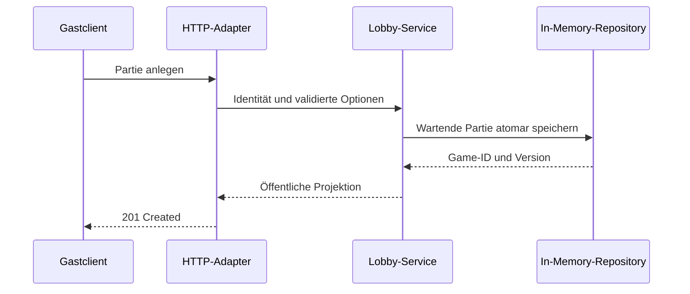

# Kapitel 11 — Spielanlage, Lobby und Einladungen

[Dokumentationsindex](../INDEX.md) · [Vorheriges Kapitel](10-guest-authentication.md) · [Nächstes Kapitel](12-websocket-protocol.md)

## 1. Chapter Overview

Dieses Kapitel verbindet die bisher isolierte Xiangqi-Engine mit einer nutzbaren Spielvermittlung. Zwei Gäste können eine Partie anlegen, einen freien Platz entdecken und genau einmal beitreten. Das Ergebnis ist über HTTP und einen selbst geschriebenen Terminal-Testclient überprüfbar. Godot, Datenbank und Schachuhr sind noch keine Voraussetzung.

Eine Lobby ist eine Plattformfunktion: Sie kennt Spielart, Regelversion, Sichtbarkeit, Teilnehmer und Zeitkontrolle, aber keine Figurenbewegungen. Diese Trennung erlaubt später Junqi, ohne Einladungen und Teilnehmerverwaltung neu zu entwickeln.

## 2. Prerequisites

- Kapitel 01–10 abgeschlossen; besonders Domain State Machines, HTTP-Fehler und Gastidentitäten.
- Einen gültigen Session-Token im lokalen Testclient halten können, ohne ihn zu protokollieren.
- Vor Beginn die Unterschiede zwischen Authentifizierung, Autorisierung und Ressourcenentdeckung anhand von Kapitel 10 wiederholen.
- Die [REST-Verträge](../protocol/rest-api.md) und den [Domain Model](../architecture/domain-model.md) lesen.

## 3. Learning Objectives

- Der Entwickler kann öffentliche Auffindbarkeit von der Berechtigung zum Spielen unterscheiden.
- Er kann zwei gleichzeitige Join-Versuche so testen, dass niemals drei Teilnehmer entstehen.
- Er kann einen Einladungsfehler behandeln, ohne Existenz oder Geheimnisse privater Partien unnötig preiszugeben.
- Er kann Zeitkontrollen als validierte Daten modellieren, ohne bereits laufende Uhren vorauszusetzen.

## 4. Concepts and Theory

### Ressourcen und Commands

Eine HTTP-Ressource besitzt eine Identität und einen lesbaren Zustand; ein Command fordert eine Zustandsänderung an. Die Unterscheidung verhindert, dass ein GET versehentlich eine Partie startet. In Kiban liefern Listen nur Zusammenfassungen; Create und Join verändern den Lebenszyklus. Ein häufiger Fehler ist, Lobbydaten als vollständigen Spielzustand zu behandeln. Dieses Modell passt, wenn mehrere Clients denselben Lebenszyklus beobachten. Die [HTTP-Semantik](https://www.rfc-editor.org/rfc/rfc9110.html) erläutert sichere Methoden und Statuscodes.

### Atomizität und Race Condition

Eine Operation ist atomar, wenn andere Beteiligte keinen teilweise ausgeführten Zwischenzustand beobachten. Eine Race Condition macht das Ergebnis von unkontrollierter Verschachtelung abhängig. Beim Join müssen Prüfung des freien Platzes und Belegung zusammengehören. Zwei getrennte Schritte „frei lesen“ und „Teilnehmer schreiben“ reichen nicht. Bis Kapitel 13 schützt ein kurzer synchroner Repository-Abschnitt diese Invariante; später übernimmt der Spiel-Actor. Mutex-Grundlagen stehen in [Tokios Shared-State-Tutorial](https://tokio.rs/tokio/tutorial/shared-state).

### Einladungsgeheimnis

Ein zufälliger Einladungscode ist eine begrenzte Berechtigung zum Finden und Beitreten einer privaten Lobby. Er ersetzt keine Session und verleiht keine spätere Zugberechtigung. Kiban verwendet mindestens 128 Bit kryptografische Entropie, zeigt den Code nur dem Ersteller bei Erstellung beziehungsweise identischem Create-Retry und speichert den Suchwert als Hash. Die kurzlebige verschlüsselte Create-Receipt-Antwort gemäß REST-Vertrag erlaubt Retry ohne Klartextlogging. Kurze fortlaufende Codes erlauben Durchprobieren. Diese Wahl passt für kopierbare Links; bei telefonisch diktierten Codes wären andere UX- und Rate-Limit-Entscheidungen nötig. Siehe [OWASP Authorization](https://cheatsheetseries.owasp.org/cheatsheets/Authorization_Cheat_Sheet.html).

### Pagination und stabile Sortierung

Pagination teilt eine begrenzte Ergebnismenge in Seiten. Eine stabile Sortierung benötigt neben dem Erstellungszeitpunkt einen eindeutigen Tie-Breaker. Für die kleine In-Memory-Lobby genügt ein dokumentiertes Limit; Kapitel 17 überführt es in eine Datenbankabfrage. Einträge können zwischen Seiten verschwinden, weil jemand beitritt. Der Client darf deshalb aus einem Listeneintrag keine Reservierung ableiten. Geeignet ist diese Technik für veränderliche Listen, bei denen absolute Vollständigkeit pro Bildschirmaufruf unnötig ist; SQL-Ordnungsregeln werden in Kapitel 17 vertieft.

## 5. Architectural Context

`kiban-server` extrahiert die Session und dekodiert den HTTP-Request. `kiban-application` prüft die Plattformregeln und besitzt vorläufig ein In-Memory-Repository. `kiban-xiangqi` liefert erst bei Aktivierung den initialen Engine-Zustand. Die Transportebene greift nicht direkt auf Brettfelder zu.

Bis Kapitel 17 gehen angelegte und aktive Spiele bei Prozessende verloren. Diese Lehrstufe darf lokal getestet, aber nicht als zuverlässiger öffentlicher Dienst angeboten werden.

## 6. Design Decisions

**Verbindlich:** Eine Lobby besitzt genau zwei Plätze; der Ersteller erhält Rot, der beitretende Gast Schwarz. Zufällige Seitenzuweisung ist optional und muss später als explizite Einstellung modelliert werden. Feste Seiten machen erste Tests reproduzierbar, bieten aber noch keinen Farbausgleich für Rated Play.

**Verbindlich:** Public und private verändern die Auffindbarkeit. Private Spiele erscheinen nie in öffentlichen Listen. Der Join benötigt zusätzlich zur Session das Einladungsgeheimnis. Ein bloß bekannter Game-Identifier genügt nicht. Öffentliches Listing aller Spiele wäre einfacher, widerspräche aber privaten Einladungen.

**Verbindlich:** Konfigurierte Kontrollen 1+0, 3+2, 5+0 und 10+5 werden als `initial_ms` und `increment_ms` ausgedrückt. Freie Texteingaben sind zunächst ausgeschlossen. Das vereinfacht Validierung und UI; freie Kontrollen werden erst bei begründetem Bedarf ergänzt.

## 7. Implementation Tasks

Die Aufgaben bauen in dieser Reihenfolge aufeinander auf; nach jedem Schritt die angegebene Prüfung durchführen.

- [ ] In `kiban-domain` Spielart und Regelversion getrennt beschreiben; nach Kapitel 07 nur Xiangqi mit freigegebenem Ruleset zulassen. Prüfung: unbekannte Kombination liefert einen Domain-Fehler.
- [ ] Im Application-Layer Erstellungsoptionen aus Sichtbarkeit und Zeitkontrolle bilden; noch keine Timer starten. Prüfung: alle vier erlaubten Kontrollen roundtrippen ohne Rundungsverlust.
- [ ] Einen wartenden Spielzustand mit Ersteller und freiem zweiten Platz definieren. Prüfung: ein aktiver Zustand ohne zweiten Teilnehmer ist nicht konstruierbar.
- [ ] Im In-Memory-Repository Game-IDs auf Eindeutigkeit prüfen. Prüfung: injizierte ID-Kollision überschreibt kein bestehendes Spiel.
- [ ] Nach diesen Grundlagen Create als einen zusammenhängenden Zustandsübergang ausführen. Prüfung: fehlerhafte Optionen hinterlassen keinen halben Datensatz.
- [ ] Im HTTP-Adapter den Erstellungsrequest gegen Größe und Feldtypen prüfen. Prüfung: ein Objekt statt einer Zeitdauer liefert den dokumentierten Clientfehler.
- [ ] Für private Lobbys einen kryptografischen Code erzeugen und nur dessen Hash speichern. Prüfung: Repository-Dump enthält keinen nutzbaren Einladungscode.
- [ ] Die erfolgreiche Erstellung in eine Antwort ohne Session-Token projizieren. Prüfung: nur die Erstellerantwort enthält das Einladungsgeheimnis.
- [ ] Nach Create ein begrenztes öffentliches Listing implementieren. Prüfung: private und aktive Spiele fehlen unabhängig von ihrer Erstellungszeit.
- [ ] Die Sortierung nach Erstellungszeit und Game-ID definieren. Prüfung: gleiche Zeitstempel liefern bei Wiederholung dieselbe Reihenfolge.
- [ ] Join zunächst mit authentifizierter Identität und Sichtbarkeitsprüfung versehen. Prüfung: ein anonymer HTTP-Aufruf belegt keinen Platz.
- [ ] Prüfung und Belegung des zweiten Platzes in einen kurzen atomaren Abschnitt ziehen. Prüfung: zwei synchron freigegebene Testtasks erzeugen genau einen Gewinner.
- [ ] Wiederholten Join derselben Identität als unveränderte Mitgliedschaft behandeln. Prüfung: kein zusätzlicher Start und kein zusätzlicher Teilnehmer.
- [ ] Beim erfolgreichen zweiten Join den Engine-Anfangszustand einmal erstellen. Prüfung: Rot ist am Zug und die initiale Stellung entspricht Kapitel 04.
- [ ] Ersteller-Join auf das eigene wartende Spiel ablehnen. Prüfung: keine Partei spielt gegen dieselbe Principal-ID.
- [ ] Einladungsfehler und unbekannte private Partien mit derselben äußeren Antwort behandeln. Prüfung: Response-Form und Status verraten keine Codes.
- [ ] Nach Create dessen Request-ID für Wiederholung beibehalten und die Antwortstrategie privater Einladungen aus dem REST-Vertrag festlegen. Prüfung: Antwortverlust erzeugt weder eine zweite Partie noch einen unberechtigten Klartext-Codeabruf; der vorläufige Cache wird in Kapitel 17 dauerhaft ersetzt.
- [ ] Wartende Lobbys über Ersteller-Cancel und die festgelegte 24-Stunden-Gültigkeit begrenzen. Prüfung: abgelaufene Lobbys sind nicht joinbar und Cancellation startet keine Uhr.
- [ ] Nach allen Operationen einen Terminal-Ablauf mit zwei getrennten Sessions protokollieren. Prüfung: öffentliche Suche, private Einladung und paralleler Join sind ohne Godot nachweisbar.
- [ ] Den vorläufigen Speicherverlust und den späteren Actor-Übergang dokumentieren. Prüfung: kein Test behauptet bereits Crash-Durability oder laufende Uhren.

## 8. Public Interfaces and Contracts

`CreateGame` nimmt die authentifizierte Principal-ID, eine `request_id` und validierte Optionen entgegen. Es liefert Game-ID, Sichtbarkeit, Teilnehmerprojektion und gegebenenfalls einmalig den Einladungscode. `JoinGame` benötigt Game-ID, Principal-ID, `request_id`, `expected_version` und bei privaten Partien `invitation_code` im POST-Body; mögliche Fehler sind `not_found`, `forbidden`, `game_full` und `invalid_state` gemäß [Fehlerkatalog](../protocol/errors.md).

`POST /api/v1/games` legt an, `GET /api/v1/games` listet öffentliche wartende Partien, `POST /api/v1/games/{game_id}/join` tritt bei. Exakte JSON-Felder und Statuscodes sind im [REST-Vertrag](../protocol/rest-api.md) maßgeblich. Clientseitige Anzeigenamen sind keine Identitäten.

## 9. Edge Cases

- Ein Listeneintrag ist beim Klick bereits voll: Join entscheidet anhand des aktuellen Zustands.
- Eine Session läuft zwischen Listing und Join ab: erneut authentifizieren; keine Platzbelegung durch fehlgeschlagenen Request.
- Der Ersteller versucht die zweite Seite zu übernehmen: ablehnen.
- Zwei private Codes kollidieren: neu erzeugen, keine bestehende Einladung ersetzen.
- Die Antwort geht nach erfolgreichem Join verloren: erneuter Join derselben Identität bestätigt den bestehenden Platz.
- Ein Prozess endet nach Create: in dieser Lehrstufe ist der Verlust ausdrücklich erwartbar; Kapitel 17 ändert die Garantie.

## 10. Testing Requirements

| Given | When | Then |
|---|---|---|
| Gültiger Gast, erlaubte Optionen | Öffentliche Partie erstellen | Genau eine wartende Partie und eine Game-ID entstehen |
| Öffentliche und private Lobby | Öffentliche Liste abrufen | Nur die öffentliche Lobby erscheint |
| Ein freier Platz | Zwei verschiedene Gäste gleichzeitig joinen | Genau einer belegt den Platz, der andere erhält einen Konflikt |
| Bereits beigetretener Gast | Derselbe Join wird wiederholt | Mitgliedschaft bleibt unverändert |
| Privates Spiel | Falschen Code senden | Keine Mitgliedschaft, keine Information über das Geheimnis |
| Ungültige Zeitkontrolle | Create senden | Kein Spiel und ein typisierter Fehler |
| Zwei gleiche Erstellungszeiten | Liste zweimal lesen | Deterministische Reihenfolge durch Game-ID |

Tests verwenden eine steuerbare ID- und Zufallsquelle sowie eine Barrier für konkurrierende Joins; zufälliges mehrfaches Wiederholen ersetzt keinen gezielten Race-Test.

## 11. Definition of Done

- [ ] Zwei Gastidentitäten erreichen über HTTP eine aktive Partie.
- [ ] Alle vier Zeitkontrollen sind validiert, ohne bereits Zeitablauf zu behaupten.
- [ ] Private Lobbys sind nicht auflistbar; Einladungscodes erscheinen weder im Repository noch in Logs im Klartext.
- [ ] Concurrent Join, Wiederholung und Selbstbeitritt sind spezifiziert und getestet.
- [ ] HTTP-Adapter enthalten keine Engine-Regeln; Fehler entsprechen dem gemeinsamen Vertrag.
- [ ] Terminal-Nachweis und dokumentierte In-Memory-Grenze liegen vor.

## 12. Common Pitfalls

Ein `GET`, das einen Platz reserviert, wird durch Wiederholungen, Prefetching und Caches unzuverlässig. Ein Mutex um das ganze HTTP-Leben hält fremde Tasks beim Netzwerk-I/O auf. Ein Anzeigename als Schlüssel erlaubt Identitätsverwechslungen. Zuletzt führt ein nur im UI verstecktes privates Spiel zu einem Datenleck, sobald jemand direkt die API abfragt.

## 13. Reflection Questions

1. Warum ist eine öffentliche Liste keine Zusage eines freien Platzes?
2. Welche Zustandsprüfung muss zusammen mit Join atomar sein?
3. Warum sind Session-Token und Einladungscode unterschiedliche Berechtigungen?
4. Welchen Test vereinfacht die feste anfängliche Seitenzuweisung?
5. Welche Garantie ändert sich beim späteren Wechsel auf PostgreSQL?
6. Welche Informationen darf ein nicht beteiligter Gast über ein privates Spiel sehen?

## 14. Further Reading

- [RFC 9110](https://www.rfc-editor.org/rfc/rfc9110.html): sichere Methoden, POST und Konfliktantworten auf den Lobby-Lebenszyklus anwenden.
- [Tokio: Shared state](https://tokio.rs/tokio/tutorial/shared-state): kurze synchrone Locks von Locks über `await` unterscheiden.
- [OWASP: Authorization](https://cheatsheetseries.owasp.org/cheatsheets/Authorization_Cheat_Sheet.html): Berechtigungen für jede Objektoperation prüfen.
- [Backend-Architektur](../architecture/backend.md): Adapter und Application Service vor der Umsetzung abgrenzen.

## 15. Completion Record

| Feld | Eigener Eintrag |
|---|---|
| Abschlussdatum | |
| Entwurfsentscheidungen | |
| Herausforderungen | |
| Ausgeführte Tests und Ergebnisse | |
| Verbleibende technische Schulden | |
| Lernerfahrungen | |
