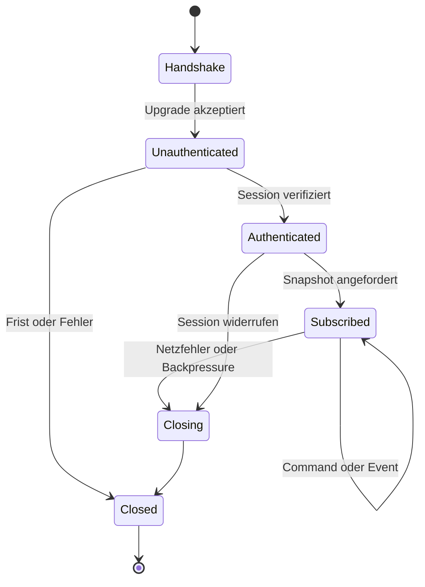

# Kapitel 12 — WebSocket-Transport und Anwendungsprotokoll

[Dokumentationsindex](../INDEX.md) · [Vorheriges Kapitel](11-lobby-management.md) · [Nächstes Kapitel](13-multiplayer-state.md)

## 1. Chapter Overview

HTTP vermittelt Partien; eine laufende Partie benötigt zusätzlich geordnete Servernachrichten. Dieses Kapitel baut den WebSocket-Adapter und seinen Vertrag. Am Ende kann ein Terminalclient authentifizieren, einen Snapshot abonnieren, einen typisierten Command senden und einen strukturierten Fehler empfangen. Die verbindliche Spielverarbeitung folgt in Kapitel 13.

Der Transport darf keine eigene Spielwahrheit erzeugen. Für dieses Kapitel beantwortet ein kontrollierter Application-Testadapter die Commands. Dadurch lassen sich Parsing, Grenzen und Verbindungsende unabhängig von Engine, Godot und PostgreSQL prüfen.

## 2. Prerequisites

- Kapitel 09–11 abgeschlossen; HTTP-Requests und authentifizierte Principal-IDs verstanden.
- Ownership von Sockets und `async`-Tasks aus Rust/Tokio wiederholen.
- [Protokollübersicht](../protocol/overview.md), [Nachrichtenkatalog](../protocol/websocket-messages.md) und [Versionierung](../protocol/versioning.md) lesen.
- Vor Umsetzung den Unterschied zwischen einem TCP-Bytefluss, WebSocket-Nachrichten und Kiban-Commands erklären können.

## 3. Learning Objectives

- Transport-Lebenszyklus und Spiel-Lebenszyklus separat zeichnen.
- JSON-Frames vor ihrer Weiterleitung nach Größe, Version und Schema validieren.
- Request-Antwort-Korrelation mit `request_id` von Zustandsordnung mit `state_version` unterscheiden.
- Einen langsamen Empfänger durch begrenzte Queues isolieren und alle Tasks einer geschlossenen Verbindung beenden.

## 4. Concepts and Theory

### Upgrade und WebSocket-Lebenszyklus

WebSocket beginnt mit einem HTTP-Handshake und wechselt in einen bidirektionalen Nachrichtentransport. Open, Closing und Closed beschreiben die Verbindung, nicht den Spielzustand. In Kiban endet ein Socket beim Netzfehler, die Partie besteht weiter. Ein verbreiteter Fehler ist, Disconnect als Resign zu interpretieren. WebSocket passt zu geordneten kleinen Spielnachrichten; große Dateien gehören weiterhin zu HTTP. [RFC 6455](https://www.rfc-editor.org/rfc/rfc6455.html) beschreibt Nachrichten, Kontrollframes und Close-Verhalten.

### Transportordnung und Anwendungsversion

Eine einzelne offene Verbindung liefert ihre Nachrichten geordnet; nach Reconnect gibt es damit keine automatische Kenntnis verlorener Nachrichten. Eine `state_version` bezeichnet deshalb einen akzeptierten fachlichen Übergang. `request_id` identifiziert dagegen einen Clientversuch. Kiban nutzt beide, um Antwortverlust und veraltete Zustände zu unterscheiden. Zeitstempel ersetzen keine Version: gleiche Zeiten oder Uhrsprünge wären mehrdeutig. Das Konzept ist immer nötig, sobald mehrere Clients und Verbindungswechsel vorkommen; [State Synchronization](../protocol/state-synchronization.md) legt die Prüfregeln fest.

### Serialisierung und Vertrauensgrenze

Serialisierung übersetzt strukturierte Daten in ein übertragbares Format. Serde dekodiert JSON, validiert aber nicht automatisch alle Domain-Invarianten. Der Adapter prüft äußere Form und Größen; der Application-Layer prüft Zugberechtigung und Spielzustand. Ein Fehler ist, ein syntaktisch gültiges Feld `principal_id` als Identitätsbeweis zu übernehmen. Diese Trennung passt für jede unzuverlässige Eingabe. [Serde: Data model](https://serde.rs/data-model.html) erläutert die Zuordnung zwischen Datenformen.

### Backpressure und Cancellation

Backpressure begrenzt, wie viel Arbeit ein Produzent einem langsameren Verbraucher aufbürden darf. Eine begrenzte Outbound-Queue schützt den Server vor einem Client, der nicht liest. Cancellation beendet zusammengehörige Tasks und gibt ihre Ressourcen frei. Kiban trennt Reader und Writer, koppelt aber ihren Lebenszyklus. Eine unbeschränkte Queue verschiebt das Problem in den Arbeitsspeicher; ein unbeaufsichtigter Writer überlebt den Socket. [Tokio mpsc](https://docs.rs/tokio/latest/tokio/sync/mpsc/index.html) erklärt begrenzte Channels und sauberes Schließen.

### Snapshot und Event

Ein Snapshot beschreibt den vollständigen für eine Identität sichtbaren Zustand an einer Version. Ein Event beschreibt einen bestätigten Übergang. Kiban beginnt mit einem Snapshot; Clients dürfen danach nur zusammenhängende Versionen anwenden. Ein Event ist weder ein Wunsch des Clients noch eine vorläufige Animation. Snapshot-basierte Synchronisierung passt besonders zu kleinen Brettspielzuständen. Ein vollständiges Event-Sourcing-System wäre hier unnötiger Zusatzaufwand; die [Protokollspezifikation](../protocol/state-synchronization.md) grenzt die Formen ab.

## 5. Architectural Context

Der WebSocket-Adapter in `kiban-server` besitzt den Socket, Transportzustand und Connection-ID. Er übergibt validierte Commands mit serverseitig abgeleiteter Principal-ID an `kiban-application`. Der Testadapter dieses Kapitels liefert feste Projektionen; Kapitel 13 ersetzt ihn durch Game-Actors.

## 6. Design Decisions

**Verbindlich:** JSON über WebSocket bleibt zunächst lesbar und terminaltauglich. Binärformate sparen Bytes, erschweren aber frühe Diagnose. Erst gemessene Bandbreiten- oder CPU-Probleme begründen einen Wechsel.

**Verbindlich:** Sessiongeheimnisse erscheinen nicht in URL-Queryparametern. Native Clients können Header verwenden; für browserkompatible Verbindungen wird Authentifizierung nach dem Upgrade als erste Anwendungsnachricht beziehungsweise nach dem zentralen [Authentifizierungsvertrag](../protocol/authentication.md) ausgeführt. Vor Erfolg sind Spielabonnements gesperrt. Das vermeidet URL-Logs, benötigt aber eine kurze Frist für unauthentifizierte Sockets.

**Verbindlich:** Das Transportlimit und die Queue-Kapazität werden konfiguriert und mit dem gemeinsamen Vertrag abgeglichen. Ein voller Client-Ausgang führt zum kontrollierten Schließen und späteren Snapshot-Reconnect; der Server verwirft keine beliebigen bestätigten Events stillschweigend.

## 7. Implementation Tasks

- [ ] Im Serveradapter einen WebSocket-Endpunkt unter `/api/v1/ws` vorsehen. Nach HTTP-Grundlagen prüfen: normales HTTP erhält keinen Spielzustand.
- [ ] Den Upgrade von der anschließenden Socket-Verarbeitung abgrenzen. Prüfung: Upgrade-Fehler hinterlassen keine Connection-Registrierung.
- [ ] Einen Connection-Zustand ohne Principal bis zum Authentifizierungserfolg führen. Prüfung: davor ist kein Spiel lesbar.
- [ ] Die Authentifizierungsfrist mit einer steuerbaren Zeitquelle testen. Prüfung: ein stiller Socket schließt innerhalb der festgelegten Frist.
- [ ] Erst nach erfolgreicher Prüfung die unveränderliche Principal-ID im Verbindungskontext halten. Prüfung: ein nachfolgendes Clientfeld kann sie nicht überschreiben.
- [ ] Den äußeren Nachrichtenumschlag mit Protokollversion, Typ und Request-Korrelation beschreiben. Prüfung: fehlende Pflichtfelder liefern den gemeinsamen Fehler.
- [ ] Textnachrichten vor JSON-Dekodierung auf die verbindliche Bytegrenze prüfen. Prüfung: ein einzelnes Mehrbytezeichen wird nach Bytes, nicht Zeichenanzahl gezählt.
- [ ] Binäre Spielnachrichten in Version 1 kontrolliert ablehnen. Prüfung: keine Panik und keine Weiterleitung in die Domain.
- [ ] JSON-Struktur und zulässige Nachrichtentypen getrennt validieren. Prüfung: unbekannte Version und unbekannter Typ sind unterscheidbar.
- [ ] Nach dem Decoder einen Application-Testadapter anschließen. Prüfung: derselbe Command erreicht ihn genau einmal mit Principal und Connection-ID.
- [ ] Einen festen Snapshot aus Testdaten senden. Prüfung: der Client kann seine Version lesen, ohne Engine-Interna zu kennen.
- [ ] Reader und Writer mit begrenzter Outbound-Queue trennen. Prüfung: blockierendes Lesen verhindert keinen Close-Pfad.
- [ ] Volle Outbound-Queue als Backpressure-Fall behandeln. Prüfung: langsamer Client schließt, schneller zweiter Client funktioniert weiter.
- [ ] Ping/Pong und Close vom fachlichen JSON-Vertrag unterscheiden. Prüfung: Kontrollframes werden nicht als Commands geparst.
- [ ] Beim Reader-Ende Writer, Abonnement und Connection-Registrierung bereinigen. Prüfung: Zähler fallen auf den Ausgangswert zurück.
- [ ] Protokollfehler ohne Raw-Token und ohne vollständige Eingabepayload loggen. Prüfung: ein absichtlich sensitives Testfeld erscheint nicht im Log.
- [ ] Einen Terminaldialog aus Authentifizierung, Snapshot und ungültigem Command aufzeichnen. Prüfung: alle Antworten sind anhand der Request-ID zuzuordnen.
- [ ] Grenzen und Close-Verhalten im Protokolldokument nachführen. Prüfung: Terminalclient und Server verwenden dieselben Nachrichtenbezeichnungen.

## 8. Public Interfaces and Contracts

Jeder zustandsändernde Command trägt `request_id`, `game_id` und `expected_version`; das authentifizierte Principal kommt aus dem Verbindungskontext. `state_version` erscheint in Serverprojektionen und bestätigten Übergängen. Ein Snapshot ist kein zustandsändernder Command und verwendet die im Katalog definierte Abonnementform.

Die genaue JSON-Form steht im [Nachrichtenkatalog](../protocol/websocket-messages.md). Der Adapter darf Antworten nicht anhand von Reihenfolge allein dem zuletzt gedrückten UI-Knopf zuordnen. Fehler enthalten einen stabilen maschinenlesbaren Code und eine Request-Korrelation, sofern die Anfrage ausreichend dekodierbar war. Sie enthalten keine internen Rust-Fehlertypen oder Datenbanktexte.

## 9. Edge Cases

- Fragmentierte Frames bilden erst nach Reassembly eine Nachricht; das Gesamtlimit bleibt bindend.
- Ein Client sendet einen Command vor Authentifizierung: keine Domain-Ausführung.
- Ein Peer liest nicht mehr: begrenzter Speicher und kontrolliertes Schließen.
- Die Verbindung endet mitten im JSON-Text: kein halber Command wird akzeptiert.
- Der Browser sendet eine unerlaubte Origin: gemäß zentraler Allowlist ablehnen; CORS allein schützt WebSockets nicht.
- Ein Close erreicht den Reader, während ein Writer wartet: beide Pfade müssen terminieren.

## 10. Testing Requirements

| Given | When | Then |
|---|---|---|
| Nicht authentifizierter Socket | Spielabonnement senden | Zugriff verweigert, keine Projektion |
| Gültige Session | Authentifizieren und abonnieren | Snapshot mit Version wird geliefert |
| Genau zulässige Payloadgröße | Textframe senden | Schema entscheidet, nicht Größenfehler |
| Ein Byte oberhalb des Limits | Frame senden | Kein Decoder-/Domain-Aufruf |
| Unbekannte Protokollversion | Envelope senden | Stabiler Versionsfehler |
| Langsamer und schneller Client | Viele Testevents erzeugen | Nur langsamer Client verliert Verbindung |
| Aktiver Reader und Writer | Peer schließt | Beide Tasks und Registrierung werden bereinigt |
| Raw-Token in fehlerhafter Eingabe | Fehler auslösen | Logs enthalten kein Token |

Für Transporttests einen lokalen Server auf einem freien Port und feste kleine Testlimits verwenden. Noch keine behauptete Exactly-once-Garantie: Kapitel 16 führt die fachliche Deduplizierung ein.

## 11. Definition of Done

- [ ] Authentifizierter Terminalclient kann einen Snapshot empfangen.
- [ ] Nachrichtengröße, Version, Authentifizierungsfrist und unbekannte Typen sind getestet.
- [ ] Reader, Writer und Abonnements besitzen einen gemeinsamen Ende-Pfad.
- [ ] Langsame Clients verursachen keinen unbegrenzten Speicherverbrauch.
- [ ] Application-Testadapter ist austauschbar; Transport enthält keine Xiangqi-Regeln.
- [ ] Dokumentation und JSON-Katalog beschreiben denselben Vertrag.

## 12. Common Pitfalls

Das Wissen, dass TCP geordnet ist, wird oft mit verlustfreier Wiederaufnahme verwechselt. Ein versendeter Frame ist noch kein fachlich akzeptierter Zug. Dieselbe Request-ID in mehreren unabhängigen Versuchen verliert ihren Zweck. Schließlich kann ein Mutex um den Socket beide Richtungen blockieren, wenn ein Netzaufruf lange wartet.

## 13. Reflection Questions

1. Welche Garantie endet beim Schließen einer einzelnen WebSocket-Verbindung?
2. Warum kann ein Snapshot keine Berechtigungsprüfung ersetzen?
3. Welche Daten bleiben nach einem Decoderfehler vertrauenswürdig?
4. Warum braucht der Client sowohl Request-ID als auch State-Version?
5. Welche Alternative zur begrenzten Queue würde welchen neuen Fehler verursachen?
6. Warum darf eine Verbindung nach Disconnect keine Domain-Aufgabe erzwingen?

## 14. Further Reading

- [RFC 6455](https://www.rfc-editor.org/rfc/rfc6455.html): Handshake, Framing und Close vor Adapterbau studieren.
- [Axum WebSocket](https://docs.rs/axum/latest/axum/extract/ws/index.html): Ownership nach Upgrade und getrenntes Lesen/Schreiben nachvollziehen; keine Beispiele kopieren.
- [Tokio mpsc](https://docs.rs/tokio/latest/tokio/sync/mpsc/index.html): Backpressure und Channel-Schließung auf die Outbound-Queue übertragen.
- [Serde Data Model](https://serde.rs/data-model.html): Grenzen zwischen syntaktischem DTO und validiertem Domain-Wert klären.

## 15. Completion Record

| Feld | Eigener Eintrag |
|---|---|
| Abschlussdatum | |
| Entwurfsentscheidungen | |
| Herausforderungen | |
| Ausgeführte Tests und Ergebnisse | |
| Verbleibende technische Schulden | |
| Lernerfahrungen | |
