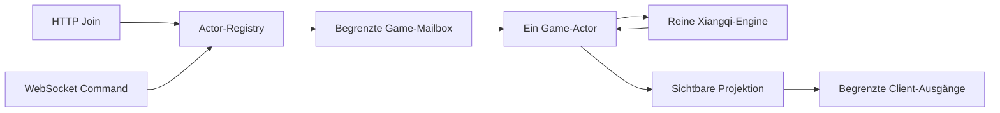

# Kapitel 13 — Game-Actors, Nebenläufigkeit und autoritativer Zustand

[Dokumentationsindex](../INDEX.md) · [Vorheriges Kapitel](12-websocket-protocol.md) · [Nächstes Kapitel](14-chess-clock-engine.md)

## 1. Chapter Overview

Jetzt spielen zwei entfernte Terminalclients tatsächlich Xiangqi. Ein Game-Actor besitzt den Zustand einer Partie und verarbeitet Commands seriell. Der Transport aus Kapitel 12 wird an diesen Besitzer angeschlossen; die Engine aus Kapitel 08 entscheidet weiterhin rein deterministisch über Regeln.

Dieses Kapitel schließt M3 ab. Die Partie kann ziehen und aufgeben, besitzt aber noch keine laufende Uhr und keine dauerhafte Speicherung. Diese Begrenzung ist eine bewusste Lernstufe, keine Zuverlässigkeitszusage für einen öffentlichen Dienst.

## 2. Prerequisites

- Kapitel 01–12 abgeschlossen; insbesondere Engine-API, Lobby-Invarianten und WebSocket-Adapter.
- Vor Beginn `Send`, `Sync`, Ownership über Task-Grenzen und Tokio Channels wiederholen.
- [Actor Model](../architecture/actor-model.md), [Concurrency](../architecture/concurrency.md) und [Concurrency-Tests](../testing/concurrency-tests.md) lesen.
- Einen Terminalclient mit zwei getrennten Gastidentitäten bedienen können.

## 3. Learning Objectives

- Einen einzigen Besitzer je Partie benennen und daraus die erlaubten Mutationswege ableiten.
- Race Conditions bei Join, Move und Resign durch gezielte Interleavings nachweisen.
- Mutex, RwLock und Actor anhand von Sperrdauer, Ownership und Backpressure vergleichen.
- Clientzustände ausschließlich aus bestätigten Projektionen aktualisieren.

## 4. Concepts and Theory

### Task, Thread und Future

Eine Future beschreibt fortsetzbare Arbeit; Tokio pollt sie auf Runtime-Threads. Ein Task ist daher kein eigener OS-Thread. Kiban kann viele überwiegend wartende Game-Actors betreiben, ohne pro Spiel einen Thread zu reservieren. CPU-intensive Engine-Arbeit darf dennoch nicht unbegrenzt einen Runtime-Thread blockieren. Der Anfängerfehler „async macht jede Berechnung parallel“ bleibt falsch. Tasks passen zu I/O und wartenden Mailboxes; [Tokio: Spawning](https://tokio.rs/tokio/tutorial/spawning) erklärt ihre Ausführungsgrenzen.

### Actor Model

Ein Actor besitzt privaten veränderlichen Zustand und empfängt Nachrichten über eine Mailbox. In Kiban hält er Teilnehmer, Lebenszyklus, Engine-Zustand und State-Version. Kein HTTP-Handler verändert diese Felder direkt. Das vereinfacht Reihenfolge und Invarianten; ein Actor beseitigt aber keine verteilten Zustellfehler. Geeignet ist das Modell, weil Partien weitgehend unabhängig sind. [Tokio: Channels](https://tokio.rs/tokio/tutorial/channels) verbindet Message Passing mit Ownership.

### Mutex und RwLock

Ein Mutex gewährt exklusiven Zugriff; ein RwLock erlaubt mehrere Leser oder einen Schreiber. Sie schützen Speicherzugriff, definieren aber allein noch keine fachliche Reihenfolge. Kiban nutzt kurze Locks allenfalls für die Actor-Registry, nicht für den gesamten Spielablauf. Ein Lock über Netzwerk-`await` kann andere Clients unbestimmt blockieren; mehrere Locks können zyklisch aufeinander warten. Shared-State-Ansätze bleiben für sehr kleine synchrone Daten angemessen. Die [Tokio-Dokumentation zu Shared State](https://tokio.rs/tokio/tutorial/shared-state) erläutert diese Abwägung.

### Serialisierung und Linearization Point

Serielle Verarbeitung bedeutet, dass der Actor einen Command vollständig fachlich entscheidet, bevor er den nächsten entscheidet. Der Linearization Point ist die Stelle, an der ein Übergang als verbindlich gilt. Bis Kapitel 16 ist dies die bestätigte In-Memory-Übernahme; ab Kapitel 17 der erfolgreiche Datenbank-Commit. Ein Versionstest außerhalb des Actors wäre bereits beim Eintritt veraltet. Dieses Konzept passt für alle konkurrierenden Änderungen am selben Aggregat; der [Transaktionsvertrag](../database/transactions.md) erweitert es später.

### Bounded Mailbox und Ressourcenbesitz

Eine begrenzte Mailbox macht Überlast sichtbar statt Speicher unbegrenzt wachsen zu lassen. Sender besitzen Handles, nicht das Spiel selbst. Geschlossene Kanäle und beendete Actors müssen aus der Registry entfernt werden. Eine volle Queue darf nicht durch endloses Spawnen wartender Sendetasks umgangen werden. Das passt zu kontrollierter Last und begrenzten Spielsitzungen; [Tokio mpsc](https://docs.rs/tokio/latest/tokio/sync/mpsc/index.html) beschreibt Kapazität und Channel-Ende.

## 5. Architectural Context

`kiban-application` besitzt Registry und Game-Actors. Die Registry findet den zuständigen Actor, entscheidet aber keine Züge. `kiban-server` ist nur Sender und Empfänger. `kiban-xiangqi` erhält den jeweiligen Engine-Zustand als Input und liefert einen validierten Folgezustand oder Fehler zurück.

Die frühere Lobby-Atomizität wandert zum Actor. Während dieser Migration darf es keinen zweiten Mutationseigentümer im alten Repository geben.

## 6. Design Decisions

**Verbindlich:** Ein Actor pro Partie mit begrenzter Mailbox. Ein globaler Mutex wäre anfangs kürzer, würde aber unabhängige Partien koppeln. Pro-Spiel-Mutex ist eine ernsthafte Alternative, erfordert jedoch sorgfältige Sperrgrenzen und Timeout-Integration. Der Actor passt zu späteren Clock-Commands und geordneten Projektionen. Bei gemessenen sehr großen Actor-Zahlen kann eine gemeinsame Schedulerstruktur erwogen werden.

**Verbindlich:** Die Registry besitzt nur Adressen und Lebenszyklusmetadaten; Engine-Zustände werden nicht zur bequemen Nebenbearbeitung geklont. Snapshots sind lesbare Projektionen, keine zweite autoritative Kopie.

**Verbindlich:** `expected_version` wird im Actor geprüft. Ein veralteter neuer Command verändert nichts und fordert Resync. Vollständige Request-Deduplizierung folgt in Kapitel 16; bis dahin darf ein Client unklare Ergebnisse nicht blind als neue Commands wiederholen.

## 7. Implementation Tasks

- [ ] In `kiban-application` einen klaren Game-Aggregatbesitzer festlegen. Nach den Domain-Typen prüfen: kein Serverhandler erhält mutable Engine-Referenzen.
- [ ] Die Registry auf Game-ID und Actor-Handle begrenzen. Prüfung: Registry-Lesen kann keinen Zug ausführen.
- [ ] Eine begrenzte Mailbox pro Spiel anlegen. Prüfung: ein Test mit ausgeschöpfter Kapazität liefert die festgelegte Überlastreaktion.
- [ ] Einen separaten Antwortweg pro Command vorsehen. Prüfung: zwei parallele Requests werden anhand ihrer Request-ID korrekt beantwortet.
- [ ] Beim Erstellen einer Lobby genau einen Actor registrieren. Prüfung: ID-Kollision erzeugt keinen überschriebenen Actor.
- [ ] Den Join aus Kapitel 11 in die Mailbox verschieben. Prüfung: konkurrierende Joins bleiben atomar und erzeugen genau zwei Plätze.
- [ ] Den alten direkten Repository-Schreibpfad entfernen. Prüfung: eine Suche nach Mutationseinstiegen zeigt nur den Actor.
- [ ] Session-Principal und Command-Payload getrennt weiterreichen. Prüfung: gefälschte Clientspieler-ID ändert die Autorisierung nicht.
- [ ] Vor jedem neuen Spielcommand Teilnehmerrolle und Lebenszyklus prüfen. Prüfung: Zuschauerrolle ist noch nicht implementiert und gewährt kein Zugrecht.
- [ ] `expected_version` im Actor gegen seinen aktuellen Zustand prüfen. Prüfung: zwei verschiedene Commands derselben Version können nicht beide akzeptiert werden.
- [ ] Einen Move an die reine Engine delegieren. Prüfung: illegaler Zug verändert weder Zustand noch Version.
- [ ] Einen legalen Folgezustand vollständig übernehmen und die Version genau einmal erhöhen. Prüfung: Brett, Zugrecht und Event beschreiben dieselbe Version.
- [ ] Resign als eigenen Domain-Übergang implementieren. Prüfung: der Gegner gewinnt; weiterer Move wird abgelehnt.
- [ ] Snapshots aus dem im Actor befindlichen Zustand erstellen. Prüfung: ein Snapshot nach Move enthält entweder eindeutig davor oder danach, niemals gemischte Felder.
- [ ] Events nur nach bestätigter Übernahme an Subscriber senden. Prüfung: Engine-Fehler erzeugt keinen erfolgreichen Move-Event.
- [ ] Langsame Subscriber ohne Blockade des Actors entfernen. Prüfung: eine zweite Verbindung kann weiterziehen.
- [ ] Actor-Ende, Registry-Cleanup und Channel-Schließung definieren. Prüfung: beendete Spiele behalten keine unbeabsichtigten Connection-Referenzen.
- [ ] Einen Zwei-Terminal-Spielablauf mit legalem Zug, illegalem Zug und Aufgabe durchführen. Prüfung: beide Clients erreichen dieselbe terminale Version.
- [ ] Einen Determinismus-Test derselben Commandfolge ergänzen. Prüfung: wiederholte Ausführung liefert denselben fachlichen Zustand.
- [ ] Die In-Memory-Grenze und den späteren Commit-Punkt vermerken. Prüfung: M3 verlangt weder PostgreSQL noch Godot noch Echtzeituhren.

## 8. Public Interfaces and Contracts

`GameActorHandle` adressiert eine Partie. `GameCommand` beschreibt einen autorisierten fachlichen Wunsch mit Request-ID und erwarteter Version; der genaue Wire-Name bleibt im [Nachrichtenkatalog](../protocol/websocket-messages.md). `GameProjection` enthält ausschließlich für den Empfänger sichtbare Daten. `GameResult` trennt Sieger und Grund, beispielsweise Aufgabe oder regelbedingtes Ende.

Für jede neue Mutation gilt: Autorisierung, Lebenszyklus und erwartete Version prüfen; Engine beziehungsweise Domain-Übergang entscheiden; Zustand einmal übernehmen; bestätigte Projektion veröffentlichen. Kapitel 16 ergänzt den vorgeschalteten Receipt-Lookup, Kapitel 17 ersetzt die In-Memory-Übernahme durch Commit-before-publish. Diese Reihenfolge ist eine Vertragsbeschreibung, keine Implementierungsvorlage.

## 9. Edge Cases

- Zwei Moves derselben Version treffen auf verschiedenen Sockets ein: nur der zuerst entschiedene kann erfolgreich sein.
- Move und Resign konkurrieren: Actor-Reihenfolge entscheidet; nach Ende ist keine Mutation zulässig.
- Empfänger schließt den Antwortkanal: eine bereits akzeptierte Mutation wird nicht rückgängig gemacht.
- Registry besitzt ein veraltetes Handle: typisierten nicht verfügbaren Zustand liefern und bereinigen.
- Actor-Panik: keine stillschweigende Neuanlage einer Partie unter derselben ID; Fehler sichtbar machen.
- Alle Clients gehen offline: dies ist keine Aufgabe und später auch keine Uhrenpause.

## 10. Testing Requirements

| Given | When | Then |
|---|---|---|
| Zwei Teilnehmer, Rot am Zug | Legalem Rot-Command folgt Schwarz-Command | Beide akzeptiert, Version steigt zweimal |
| Gleiche Anfangsversion | Zwei konkurrierende Rot-Commands | Höchstens einer akzeptiert |
| Nicht beteiligter Gast | Move senden | `forbidden`, keine Versionserhöhung |
| Illegaler Engine-Zug | Actor verarbeitet ihn | Zustand und Eventzahl unverändert |
| Aktive Partie | Resign und Move konkurrieren | Eine serielle gültige Geschichte, genau ein Endergebnis |
| Langsamer Subscriber | Outbound-Kapazität überschreiten | Subscriber endet, Actor bleibt ansprechbar |
| Geschlossener Antwortempfänger | Gültiger Command wurde übernommen | Zustand bleibt akzeptiert |
| Gleiche Commandfolge | Zwei isolierte Actors ausführen | Identische Zustandsprojektionen |

Kontrollierte Barriers vor dem Mailbox-Senden verwenden; Tests müssen zulässige Actor-Reihenfolgen explizit benennen. Kein Test darf eine zufällige Task-Reihenfolge als fachlichen Vertrag voraussetzen.

## 11. Definition of Done

- [ ] Zwei Terminalclients spielen eine vollständige lokale Netzwerkpartie bis zur Aufgabe oder einem Engine-Ende.
- [ ] Einziger Mutationsbesitzer und alle Mailbox-Kapazitäten sind dokumentiert.
- [ ] Concurrent Join, veraltete Version, unberechtigter Move und Subscriber-Ausfall sind getestet.
- [ ] Engine bleibt ohne Runtime und HTTP testbar.
- [ ] Ergebnis und State-Version stimmen auf beiden Clients überein.
- [ ] [M3](../milestones/M3-multiplayer.md) ist demonstrierbar; noch fehlende Durability ist ausdrücklich benannt.

## 12. Common Pitfalls

Ein Actor, der beim Broadcast auf jeden Client wartet, besitzt zwar seinen Zustand allein, wird aber von einem langsamen Client vollständig blockiert. Ein Actor pro Spiel benötigt keinen Thread pro Spiel. Das Klonen des Bretts zur Darstellung ist unproblematisch; eine zweite schreibende Spielkopie im HTTP-Service ist es nicht. Ein Task-Abbruch ist außerdem kein fachlicher Partieverlust und darf nicht als Resign ausgegeben werden.

## 13. Reflection Questions

1. Welche Invarianten schützt Ownership, welche erst die Domain-Validierung?
2. Warum genügt ein Mutex allein nicht zur Definition einer fairen Command-Reihenfolge?
3. Wo liegt der aktuelle Linearization Point, und wie ändert Kapitel 17 ihn?
4. Warum darf ein geschlossenes Antwortziel einen bestätigten Zug nicht zurücknehmen?
5. Welche Ressourcen halten eine beendete Partie unbeabsichtigt am Leben?
6. Wann wäre ein Pro-Spiel-Mutex eine angemessene Alternative?
7. Welche Tests zeigen ein Race gezielter als tausend zufällige Wiederholungen?

## 14. Further Reading

- [Tokio: Spawning](https://tokio.rs/tokio/tutorial/spawning): Task-Ausführung, Ownership und `Send` vor Actor-Implementierung studieren.
- [Tokio: Channels](https://tokio.rs/tokio/tutorial/channels): Request-/Antwortwege und Message Passing ableiten.
- [Tokio: Shared state](https://tokio.rs/tokio/tutorial/shared-state): begründen, wo kurze Locks weiterhin passen.
- [Actor Model](../architecture/actor-model.md) und [Concurrency-Tests](../testing/concurrency-tests.md): lokale Design- und Prüfregeln anwenden.

## 15. Completion Record

| Feld | Eigener Eintrag |
|---|---|
| Abschlussdatum | |
| Entwurfsentscheidungen | |
| Herausforderungen | |
| Ausgeführte Tests und Ergebnisse | |
| Verbleibende technische Schulden | |
| Lernerfahrungen | |
