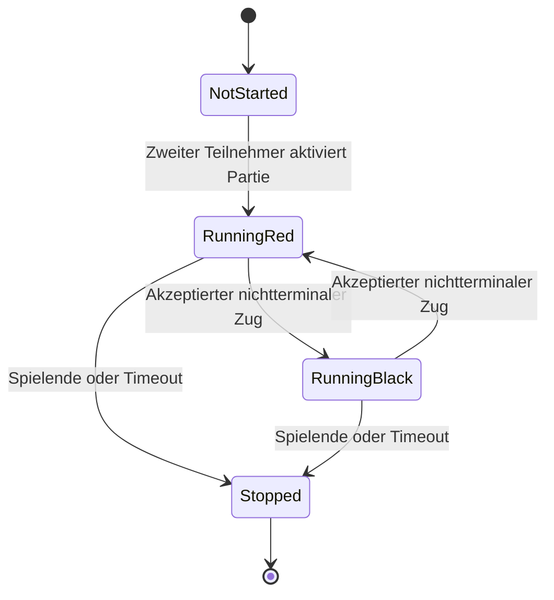

# Kapitel 14 — Schachuhrmodell, monotone Zeit und Fischer Increment

[Dokumentationsindex](../INDEX.md) · [Vorheriges Kapitel](13-multiplayer-state.md) · [Nächstes Kapitel](15-timed-matches.md)

## 1. Chapter Overview

Eine Schachuhr ist ein Domain Model, kein regelmäßig heruntergezählter UI-Wert. Dieses Kapitel entwickelt eine deterministisch testbare Clock Engine ohne Timer und Netzwerk. Sie kann starten, Restzeiten zu einem gegebenen Zeitpunkt bestimmen, einen akzeptierten Zug abrechnen und in einen terminalen Zustand wechseln.

Das Ergebnis ist eine kleine, rein fachlich prüfbare Komponente für alle zeitgesteuerten Kiban-Spiele. Ihre Ausführung im Game-Actor und die Behandlung tatsächlich ablaufender Deadlines folgen erst in Kapitel 15.

## 2. Prerequisites

- Kapitel 01–13 abgeschlossen; Domain-Zustände, Actor-Ownership und Fehlerbehandlung verstanden.
- Vor Implementierung die Unterschiede zwischen Dauer, Zeitpunkt und kalenderbezogenem Zeitstempel erklären können.
- [Clock-Architektur](../architecture/chess-clocks.md) und [Clock-Tests](../testing/clock-tests.md) lesen.
- Ganzzahlarithmetik, Überlaufprüfung und kontrollierte Zeitinjektion wiederholen.

## 3. Learning Objectives

- Begründen, weshalb eine laufende Uhr einen monotonen Zeitgeber benötigt.
- Restzeit und Deadline aus einem verankerten Zeitbudget herleiten.
- Fischer Increment korrekt von Delay und periodischem Herunterzählen unterscheiden.
- Grenzfälle mit virtueller Zeit ohne reales Warten testen.
- Erklären, welche Uhrinformationen nach Prozessneustart nicht wiederverwendbar sind.

## 4. Concepts and Theory

### Monotone Zeit und Wall Clock

Monotone Zeit ordnet verstrichene Dauer innerhalb eines laufenden Prozesses, ohne durch NTP oder manuelle Kalenderkorrekturen rückwärts zu springen. Wall Clock beschreibt dagegen einen Kalenderzeitpunkt, etwa für Audit und Anzeige. Kiban verwendet monotone Zeit zur Partientscheidung und UTC-Zeit für persistente Metadaten. Ein gespeicherter `Instant` ist über Prozessneustarts nicht sinnvoll. Diese Trennung passt überall, wo Fristen korrekt sein müssen. [Rust `Instant`](https://doc.rust-lang.org/std/time/struct.Instant.html) und [Rust `SystemTime`](https://doc.rust-lang.org/std/time/struct.SystemTime.html) erläutern die verschiedenen Zusagen.

### Verankertes Budget statt Tick-Zähler

Ein Zeitbudget ist die Restdauer am Beginn eines Zuges. Dazu gehört ein monotoner Startanker. Die aktuelle Anzeige ergibt sich aus Budget minus seit diesem Anker vergangener Dauer, mindestens null. Die Deadline ist Anker plus Budget. Ein Tick verändert das Budget nicht. Sonst führen verpasste oder verspätete Timer zu Drift. Diese Darstellung benötigt konstante Zeit und konstanten Speicher pro Abfrage und ist für serverseitige Brettspieluhren geeignet; der [Clock-Vertrag](../architecture/chess-clocks.md) fixiert die Einheiten.

### Fischer Increment und Zugabschluss

Fischer Increment fügt nach einem akzeptierten nichtterminalen Zug der gerade ziehenden Seite eine feste Dauer hinzu. Es ist kein Delay: auch ein sofortiger Zug kann das Budget vergrößern. Bei Kiban erhält ein illegaler, doppelter, verspäteter oder terminal beendender Zug keinen Bonus. Bei einem akzeptierten terminalen Zug wird nur verstrichene Zeit abgerechnet und dann gestoppt. Ein Fehler wäre, bei jedem empfangenen Command zu inkrementieren. Dieses Modell passt zu Kontrollen wie 3+2; abweichende Zeitmodi brauchen eine eigene Regelversion.

### Injectable Clock

Eine injizierbare Zeitquelle ist ein ersetzbarer Zugang zu „jetzt“. Die fachliche Clock Engine soll bevorzugt ausdrücklich einen monotonen Zeitpunkt erhalten; nur der Actoradapter liest die reale Quelle. Tests können so exakt auf Deadline minus eine Einheit, Deadline und danach springen. Ein Mock, der von selbst weiterläuft, wäre nicht deterministisch. Zeitinjektion passt für sämtliche Deadline-Tests. [Tokio Test Utilities](https://docs.rs/tokio/latest/tokio/time/fn.pause.html) sind für späteres Timer-I/O nützlich, ersetzen aber nicht das fachliche Clock Model.

### Clock State Machine

Eine State Machine erlaubt nur benannte Zustände und Übergänge. Die Uhr kennt noch nicht gestartet, laufend mit aktiver Seite und gestoppt mit Endgrund. Disconnect ist kein Uhrenzustand und pausiert keine Zeit. Das verhindert versteckte Pausen bei Netzproblemen. Ein einzelnes Boolean `running` wäre zu schwach, weil aktive Seite und Stopgrund auseinanderfallen könnten. Die Technik passt bei wenigen klaren Zeitphasen; die [Domain-Architektur](../architecture/domain-model.md) verknüpft Uhr und Spiellebenszyklus.

## 5. Architectural Context

Das Clock Model gehört zur Plattformdomain beziehungsweise einem davon klar abgegrenzten Zeitmodul, nicht zur Xiangqi-Figurenlogik. Die Xiangqi-Engine liefert nach einem Move nur, ob die Partie weiterläuft und wer als Nächstes am Zug ist. Der Actor wird in Kapitel 15 den Zeitanker kontrollieren.

Die Abbildung zeigt Xiangqi mit Rot als Startseite. Die Plattformuhr darf Seiten als Rollen abstrahieren; Junqi muss nicht die Farbnamen übernehmen.

## 6. Design Decisions

**Verbindlich:** Ganzzahlige Millisekunden im Protokoll, intern präzise Dauerwerte und monotone Zeitpunkte. Float-Sekunden wären bequem für UI, erzeugen aber Rundungs- und Vergleichsfehler. Bei der Projektion wird nachvollziehbar abgerundet und nie ein negativer Wert gesendet.

**Verbindlich:** Keine automatische Disconnect-Pause. Eine Pause wäre durch absichtliche Verbindungsabbrüche missbrauchbar und benötigte eigene Zustimmungs- und Missbrauchsregeln. Später können besondere Turnierpausen als explizite Commands untersucht werden.

**Verbindlich:** Zeit wird bei fachlicher Entscheidung abgerechnet, nicht in einem Background-Tick verändert. Periodische Clientanzeige ist optional; sie darf keinen Timeout erzeugen. Diese Wahl spart Timerlast und macht Tests unabhängig von Scheduling-Jitter.

## 7. Implementation Tasks

- [ ] In der Domain Zeitkontrolle als Basisdauer und Increment beschreiben. Nach Kapitel 11 prüfen: 3+2 entspricht 180000 und 2000 Millisekunden.
- [ ] Dauer und Zeitpunkt typmäßig unterscheiden. Prüfung: ein UTC-Zeitstempel kann nicht versehentlich als verstrichene Dauer eingesetzt werden.
- [ ] Einen Clock-Zustand vor Spielaktivierung modellieren. Prüfung: Listing oder Reconnect startet ihn nicht.
- [ ] Die Clock-Aktivierung mit zwei Zeitbudgets, Startseite und monotonem Anker definieren. Prüfung: beide Seiten beginnen mit identischem Budget.
- [ ] Nach Aktivierung eine reine Restzeitabfrage für einen übergebenen Zeitpunkt erarbeiten. Prüfung: nur die aktive Seite verliert Zeit.
- [ ] Die Mindestgrenze null festlegen. Prüfung: eine Abfrage weit nach Ablauf liefert keine negative Dauer und keinen Underflow.
- [ ] Aus dem verankerten Budget die Deadline ableiten. Prüfung: wiederholte Abfragen verändern die Deadline nicht.
- [ ] Den Vergleich für Ablauf ausdrücklich `jetzt >= Deadline` definieren. Prüfung: Gleichheit bedeutet bereits abgelaufen.
- [ ] Einen nichtterminalen akzeptierten Zug fachlich abrechnen. Prüfung: verstrichene Zeit wird genau einmal abgezogen.
- [ ] Erst nach dieser Abrechnung Increment auf die ziehende Seite anwenden. Prüfung: 180 Sekunden, 3 Sekunden Verbrauch und 2 Sekunden Increment ergeben 179 Sekunden.
- [ ] Beim Seitenwechsel den neuen Startanker auf denselben Entscheidungszeitpunkt setzen. Prüfung: keine Zeitlücke oder doppelt belastete Dauer.
- [ ] Einen terminalen akzeptierten Zug getrennt behandeln. Prüfung: Verbrauch abrechnen, stoppen, kein Increment.
- [ ] Illegalen Zug als unverändertes Clock-Aggregat behandeln. Prüfung: Budget und Anker bleiben gleich, während spätere Abfragen weiterhin reale Dauer abziehen.
- [ ] Stoppen wegen Aufgabe beziehungsweise Timeout beschreiben. Prüfung: spätere Abfragen bleiben unverändert.
- [ ] Unmögliche rückwärts gerichtete Testzeitpunkte als Invarianzverletzung sichtbar machen. Prüfung: sie erzeugen keinen Zeitgewinn.
- [ ] Überlauf bei extremen Eingaben abfangen und erlaubte Kontrollen an der Grenze validieren. Prüfung: ungültige riesige Werte werden vor Clock-Aktivierung verworfen.
- [ ] Die Clock Engine vollständig mit manuellen Zeitpunkten testen. Prüfung: keine Sleeps und keine echte Laufzeitabhängigkeit in Domain-Tests.
- [ ] Ein tabellarisches Rechenprotokoll über sechs abwechselnde Züge erstellen. Prüfung: unabhängige Handrechnung stimmt mit allen Budgets überein.
- [ ] Nicht serialisierbare monotone Anker ausdrücklich vom späteren Persistenzformat trennen. Prüfung: ein Snapshot benötigt Dauerwerte, keinen prozessgebundenen Rohanker.

## 8. Public Interfaces and Contracts

`TimeControl` beschreibt `initial_ms` und `increment_ms`; `ClockState` beschreibt Phase, aktive Seite, verankerte Budgets und den laufenden Anker. `remaining_at` liefert die Restbudgets für einen übergebenen Zeitpunkt ohne Mutation. `deadline` liefert nur im laufenden Zustand eine Frist. Ein Zugabschluss benötigt den einmal vom Actor ermittelten Zeitpunkt und die Information, ob die akzeptierte Engine-Transition terminal ist.

`ClockProjection` enthält Restzeiten am gemeinsamen Projektionspunkt und aktive Seite. Der vollständige [Wire-Vertrag](../protocol/websocket-messages.md) legt Feldnamen und Serverzeitmetadaten fest. Ein UI darf daraus interpolieren; das Anhalten seiner Anzeige erzeugt keinen fachlichen Stop.

Die Zweckbeschreibung des Restzeitalgorithmus lautet: Eingaben sind Budget, Startanker und Zeitpunkt; Ausgaben sind zwei nichtnegative Restzeiten. Invarianten sind eine aktive Seite, kein Tick-bedingter Drift und keine Budgetänderung durch Lesen. Grenzfälle sind Gleichheit, spätes Lesen und Überlauf. Laufzeit und zusätzlicher Speicher sind jeweils konstant. Dafür ist kein vollständiger Pseudocode erforderlich.

## 9. Edge Cases

- 1+0 bei exakt 60000 Millisekunden: aktive Seite ist abgelaufen, nicht noch rechtzeitig.
- Wiederholtes Lesen bei demselben Zeitpunkt: identisches Ergebnis ohne Mutation.
- Sehr viele schnelle Züge mit Increment: Budget darf die Anfangsdauer übersteigen.
- Illegaler Move kurz vor Ablauf: keine neue Verankerung; die verbleibende Zeit läuft weiter.
- Terminaler Move vor Ablauf: beide Uhren stoppen; kein Bonus verschleiert die Endzeit.
- Wall Clock springt eine Stunde: laufende Restzeit bleibt unverändert.
- Neustart: alter monotoner Anker darf nicht rekonstruiert werden; Kapitel 17 definiert Abbruch statt vorgetäuschter Fortsetzung.

## 10. Testing Requirements

| Given | When | Then |
|---|---|---|
| 3+2, Rot gestartet bei t=0 | Rot zieht legal nichtterminal bei t=3000 ms | Rot 179000 ms, Schwarz 180000 ms aktiv |
| Derselbe Start | Illegaler Rot-Zug bei t=3000 ms | Anker bleibt 0; Abfrage bei 4000 zeigt 176000 ms |
| 1+0 | Ablaufprüfung bei 59999, 60000 und 60001 ms | Nur erster Fall ist noch laufend |
| 3+2 | Rot beendet Partie legal bei t=3000 ms | Rot 177000 ms, beide gestoppt |
| Laufende Rot-Uhr | Schwarz-Restzeit mehrfach lesen | Schwarz-Budget bleibt konstant |
| Gestoppte Uhr | Zeit weit voranschreiten | Keine Restzeitänderung |
| Identische monotone Zeitfolge | Wall Clock beliebig ändern | Identische Clock-Ergebnisse |
| Sehr schnelles legales Spiel mit Increment | Viele Wechsel ausführen | Kein Drift durch Abfragehäufigkeit |

Für die Domain manuelle Zeitpunktwerte verwenden. Tests des späteren Tokio-Sleeps getrennt halten, damit ein Fehler im Scheduleradapter nicht das Clock Model verdeckt.

## 11. Definition of Done

- [ ] Alle Clock-Übergänge sind ohne Netzwerk und ohne reale Wartezeit prüfbar.
- [ ] Deadline-Gleichheit, Increment, terminaler Zug und illegaler Zug haben explizite Tests.
- [ ] Dauerarithmetik kennt weder negative Budgets noch stille Überläufe.
- [ ] Disconnect und Clientanzeige besitzen keine Mutationsrechte auf Clock State.
- [ ] Prozessgebundene Anker sind nicht Teil eines behaupteten dauerhaften Formats.
- [ ] Rechenbeispiel und gemeinsame Clock-Spezifikation stimmen überein.

## 12. Common Pitfalls

Ein Intervall, das jede Sekunde eine Sekunde abzieht, verliert unter Last Zeit. Ein illegaler Zug mit neuem Startanker schenkt dem Angreifer Zeit. Ein Increment vor der Deadline-Prüfung belebt bereits abgelaufene Partien wieder. UTC-Zeit zur Laufzeitmessung kann bei Zeitsynchronisierung Zeit zurückgeben. Eine im Client bei null angekommene Anzeige darf schließlich keinen Sieg ausrufen.

## 13. Reflection Questions

1. Warum verändert eine Restzeitabfrage das gespeicherte Budget nicht?
2. Weshalb bleibt die Uhr nach einem illegalen Zug trotzdem im Zeitverlauf kleiner?
3. Warum erhält ein terminaler Zug in diesem Vertrag kein Increment?
4. Welche Werte sind nach einem Prozessneustart sinnvoll, welche nicht?
5. Was unterscheidet einen Zeitanker von einem Timer-Wakeup?
6. Warum darf Increment das Anfangsbudget überschreiten?
7. Wie würde ein Delay-Modus andere Invarianten verlangen?

## 14. Further Reading

- [Rust `Instant`](https://doc.rust-lang.org/std/time/struct.Instant.html): monotone Zeitmessung und Plattformgrenzen studieren.
- [Rust `Duration`](https://doc.rust-lang.org/std/time/struct.Duration.html): sichere Dauerarithmetik und Konvertierungen untersuchen.
- [Rust `SystemTime`](https://doc.rust-lang.org/std/time/struct.SystemTime.html): begründen, warum Audit-Zeit keine laufende Uhr ersetzt.
- [Clock-Testkatalog](../testing/clock-tests.md): Grenzwerte vor dem Actor-Anschluss vollständig abhaken.

## 15. Completion Record

| Feld | Eigener Eintrag |
|---|---|
| Abschlussdatum | |
| Entwurfsentscheidungen | |
| Herausforderungen | |
| Ausgeführte Tests und Ergebnisse | |
| Verbleibende technische Schulden | |
| Lernerfahrungen | |
