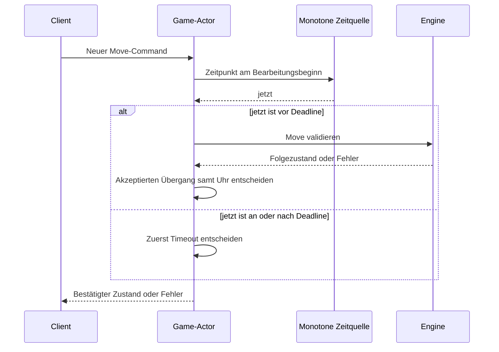

# Kapitel 15 — Deadlines und zeitgesteuerte Multiplayer-Partien

[Dokumentationsindex](../INDEX.md) · [Vorheriges Kapitel](14-chess-clock-engine.md) · [Nächstes Kapitel](16-reconnection.md)

## 1. Chapter Overview

Die deterministische Clock Engine wird jetzt in den Game-Actor integriert. Zwei Terminalclients spielen mit echten serverseitigen Deadlines. Der Server entscheidet Timeout auch dann, wenn kein Client einen weiteren Move sendet. Der beobachtbare Endzustand ist unabhängig davon, wann ein Timer-Task tatsächlich CPU-Zeit erhält.

Das zentrale Ergebnis ist eine einzige dokumentierte Ordnung für Move, Resign und Timeout. Kein Netzwerk-Thread und kein Client besitzt das Recht, eine Partie selbst durch Uhrablauf zu beenden.

## 2. Prerequisites

- Kapitel 13 und 14 abgeschlossen; Actor-Mutationen und Clock-Grenzfälle sind getrennt getestet.
- Vor Beginn Tokio Timer, `select`-Cancellation und Cooperative Scheduling lesen.
- [Clock-Architektur](../architecture/chess-clocks.md), [Concurrency](../architecture/concurrency.md) und [Clock-Tests](../testing/clock-tests.md) als gemeinsame Spezifikation verwenden.
- Virtuelle Zeit kontrolliert voranschreiten lassen können; keine Tests mit minutenlangen Sleeps.

## 3. Learning Objectives

- Den Unterschied zwischen Deadline und Timer-Wakeup erklären.
- Eine Race zwischen pünktlichem Move, spätem Move und Timeout-Nachricht deterministisch entscheiden.
- Stale Timer erkennen und wirkungslos machen.
- Zwischen gemessener Netzlatenz und einer verbindlichen Zeitentscheidung unterscheiden.

## 4. Concepts and Theory

### Deadline und Wakeup

Eine Deadline ist der fachlich späteste erlaubte Zeitpunkt; ein Wakeup ist lediglich die Aufforderung, den aktuellen Zustand wieder zu prüfen. Schedulerlast kann ein Wakeup verspäten. Kiban fragt daher stets die monotone Zeit ab und prüft die tatsächliche Deadline. Ein Timer-Callback darf nicht blind „Spiel verloren“ setzen. Dieses Modell passt für alle verzögert ausgeführten Fristen. [Tokio `sleep_until`](https://docs.rs/tokio/latest/tokio/time/fn.sleep_until.html) beschreibt den Timeradapter, nicht die Spielregel.

### Autoritative Reihenfolge

Event Ordering bedeutet hier die Reihenfolge verbindlicher fachlicher Entscheidungen innerhalb eines Actors. Für einen neuen mutierenden Command erfasst der Actor genau am Beginn seiner fachlichen Bearbeitung den monotonen Zeitpunkt. Ist dieser bereits größer oder gleich der aktuellen Deadline, entscheidet er zuerst Timeout; der Move wird nicht mehr angewendet. Ein frühes Netzwerkankommen oder Mailbox-Enqueue verspricht deshalb keine Rechtzeitigkeit. Diese einfache Regel ist eindeutig, benachteiligt aber bei Serverüberlast alle wartenden Commands; Queue-Metriken und Lastgrenzen sind wichtig. Die Regel ist im [Clock-Vertrag](../architecture/chess-clocks.md) verbindlich.

### Timer-Generation

Eine Timer-Generation ist eine Kennzeichnung des Clock-Zustands, für den ein Wakeup erzeugt wurde. Nach einem legalen Move ändern sich aktive Seite und Deadline; ein bereits zugestelltes altes Wakeup darf nichts mehr beenden. Kiban prüft Generation und aktuelle Frist, statt Cancellation als absolute Zustellgarantie zu verstehen. Der häufige Fehler ist, den alten Timer zwar abzubrechen, eine schon in der Queue befindliche Nachricht aber weiter gelten zu lassen. Das Konzept passt, sobald Fristen neu geplant werden; [Tokio Cancellation](https://tokio.rs/tokio/topics/shutdown) erläutert koordiniertes Beenden.

### Latenz und Fairness

Latenz ist verstrichene Kommunikationszeit, nicht automatisch ein Anspruch auf Zeitgutschrift. Kiban vertraut keinen Clientzeitstempeln und kompensiert im MVP keine Latenz. Sonst könnten manipulierte Uhren Züge zurückdatieren. Das ist transparent und sicher, aber kein perfekter geografischer Ausgleich. Eine spätere Kompensation benötigt eigene Grenzen, Messmethoden und Missbrauchstests. Dieses Thema ist bei Blitzpartien besonders relevant; der [Networking-Entwurf](../architecture/networking.md) dokumentiert die MVP-Grenze.

### Cancellation Safety

Cancellation Safety bedeutet, dass ein abgebrochener Wartepfad keinen halben fachlichen Übergang hinterlässt. Ein Timer darf abgebrochen werden; ein begonnener Zustandsübergang darf nicht mitten in der Übernahme verschwinden. Bis Kapitel 16 ist die Übernahme im Speicher; ab Kapitel 17 bestimmt der Commit die Dauerhaftigkeit. Der Fehler, einen gesamten Actor bei Socket-Ende abzubrechen, kann eine Partie zerstören. Geeignet ist Cancellation nur an klaren Besitz- und Commit-Grenzen. [Tokio `select`](https://docs.rs/tokio/latest/tokio/macro.select.html) beschreibt relevante Wartepfade.

## 5. Architectural Context

Der Actor integriert Clock State, Engine State und Lebenszyklus als ein Aggregat. Ein Timeradapter sendet Wakeups oder weckt den Actor; er besitzt keine Spielmutation. Erst nach dem erfolgreichen zweiten Join startet Rot. Listing, Subscribe und Reconnect starten keine neue Uhr.

## 6. Design Decisions

**Verbindlich:** Bearbeitungsbeginn im Actor ist der Zeitmaßstab. Eine Network-Receipt-Zeit würde zusätzliche Queue-Ordnungs- und vertrauenswürdige Eingangsgrenzen benötigen. Die gewählte Regel ist leichter beweisbar, verlangt aber kleine Mailboxes und kurze Actor-Arbeit. Bei nachweisbaren Fairnessproblemen muss die Entscheidung als neue ADR geprüft werden.

**Verbindlich:** Gleichheit mit Deadline zählt als Timeout. Ein tolerierter Grenzbereich wäre ohne zusätzlichen Vertrag mehrdeutig. Alle Adapter verwenden denselben Vergleich.

**Verbindlich:** Bereits vor Deadline begonnene Move-Verarbeitung wird anhand ihres einmal erfassten Zeitpunkts entschieden. Es erfolgt kein zweiter Zeitread nach Engine-Berechnung, der denselben Command nachträglich verspätet machen könnte. Der neue Clock-Anker bleibt dieser Entscheidungspunkt; Persistenzlatenz verbraucht dadurch später Budget der nun aktiven Seite.

**Verbindlich:** Timeout verliert im MVP für die aktive Seite unabhängig von westlichen Schachregeln zu „insufficient material“. Xiangqi-Endregeln und Uhrende sind getrennte Ergebnisgründe.

## 7. Implementation Tasks

- [ ] Dem Actor aus Kapitel 13 eine injizierbare monotone Zeitquelle geben. Prüfung: Domain-Tests importieren keine reale Systemzeit.
- [ ] Beim zweiten Join Clock-Aktivierung mit genau einem Anker durchführen. Prüfung: wartende Lobby verbraucht nie Zeit.
- [ ] Die aktuelle Deadline aus dem Clock Model übernehmen. Prüfung: keine parallel berechnete zweite Frist im WebSocket-Adapter.
- [ ] Nach Aktivierung einen Timeradapter auf diese Deadline ausrichten. Prüfung: auch ohne Clienttraffic entsteht ein Timeout.
- [ ] Timer-Wakeups mit der aktuellen Clock-Generation kennzeichnen. Prüfung: ein Wakeup der vorigen Seite kann keinen Verlust auslösen.
- [ ] Beim Beginn jedes neuen mutierenden Commands den Zeitpunkt einmal erfassen. Prüfung: ein Fake Clock zählt genau diesen fachlichen Zugriff.
- [ ] Vor Move und Resign den Ablauf prüfen. Prüfung: ein Command auf Deadline führt zuerst zum Timeout-Ergebnis.
- [ ] Einen rechtzeitigen legalen Move an die Engine geben und denselben Zeitpunkt für Verbrauch und Anker verwenden. Prüfung: kein Zeitgewinn durch Validierungsdauer.
- [ ] Bei illegalem Move den Anker beibehalten. Prüfung: wiederholte ungültige Eingaben pausieren die Uhr nicht.
- [ ] Nach akzeptiertem nichtterminalem Move Increment und Seitenwechsel gemäß Kapitel 14 übernehmen. Prüfung: nur die ziehende Seite erhält einmal Increment.
- [ ] Nach diesem Übergang die Timer-Generation erneuern und neue Deadline planen. Prüfung: alte Timer können keinen zweiten Übergang erzeugen.
- [ ] Terminale Engine-Ergebnisse und Aufgabe mit gestoppter Uhr verbinden. Prüfung: späteres Wakeup verändert die finale Version nicht.
- [ ] Timeout als einmaligen Game-Übergang mit Sieger und Endgrund modellieren. Prüfung: mehrere Wakeups erhöhen die Version nur einmal.
- [ ] Clock-Projektionen aus einem gemeinsamen Projektionszeitpunkt erstellen. Prüfung: beide Restzeiten im Snapshot gehören zu derselben Abfrage.
- [ ] Disconnect bewusst ohne Clock-Mutation behandeln. Prüfung: nach Verbindungsende kann die aktive Seite regulär auf Zeit verlieren.
- [ ] Move-vs-Timeout-Tests mit virtueller Zeit und kontrollierter Mailbox ergänzen. Prüfung: beide zulässigen Reihenfolgen liefern den definierten Endzustand.
- [ ] Latenzkompensation und Clientzeitstempel aus der Zeitentscheidung ausschließen. Prüfung: beliebige Clientzeitwerte ändern das Resultat nicht.
- [ ] Einen 1+0-Testlauf ohne weitere Moves bis zum Serverende beobachten. Prüfung: beide Terminalclients erhalten denselben Timeout-Sieger.
- [ ] Queue- und Timer-Latenz für spätere Observability als Messpunkte beschreiben. Prüfung: keine neue Telemetrie-Abhängigkeit ist für die fachlichen Tests nötig.

## 8. Public Interfaces and Contracts

Ein internes `ClockWakeup` verweist auf Game-ID, Generation und geplante Deadline. Es enthält keinen bereits entschiedenen Sieger. `ClockProjection` begleitet Snapshot und bestätigte `game_event`-Nachrichten; Clients erhalten Restzeiten am gemeinsamen Anker und rendern daraus eine Anzeige.

Der Bearbeitungszeitpunkt eines Commands ist kein Clientfeld. `request_id` und `expected_version` bleiben unverändert. Löst ein neuer Command zuerst den fälligen Timeout aus, erhält er das ACK-Ergebnis `timeout_before_command`; die Timeout-Version entsteht genau einmal, kein Move wird angewendet. Ab Kapitel 17 gehört auch dieses Ergebnis als Receipt zur abschließenden Transaktion. Nach Kapitel 16 wird zuerst ein vorhandenes Receipt erkannt; ein wiederholter bereits erfolgreicher Move wird nicht noch einmal durch einen inzwischen abgelaufenen Deadline-Pfad geschickt. Für neue Commands gilt weiterhin die aktuelle Ablaufprüfung.

## 9. Edge Cases

- Move traf im Netzwerk vor Deadline ein, wurde aber erst danach verarbeitet: Timeout gewinnt nach dem dokumentierten Vertrag.
- Rechtzeitiger Move beginnt vor Deadline, Engine endet danach: derselbe erfasste Zeitpunkt gilt.
- Alter Timer liegt bereits in der Mailbox: Generation und aktuelle Frist prüfen, dann ignorieren.
- Beide Budgets zeigen null in einer schlecht gerenderten UI: nur die aktive serverseitige Deadline entscheidet.
- Gegner gibt nach bereits abgelaufener aktiver Uhr auf: zuerst Timeout, kein Ergebniswechsel durch Resign.
- DB-Störung ist noch nicht implementiert; Kapitel 17 ersetzt einfache Speicherübernahme durch Commit-before-publish und einen Recovery-Pfad.

## 10. Testing Requirements

| Given | When | Then |
|---|---|---|
| 1+0, Clock bei t=0 gestartet | Kein Client sendet mehr | Bei Deadline genau ein Timeout |
| Deadline 60000 ms | Move-Verarbeitung beginnt bei 59999 ms | Legaler Move kann akzeptiert werden |
| Dieselbe Deadline | Verarbeitung beginnt bei 60000 ms | Timeout, Move wird nicht angewendet |
| Netzwerkankunft 59900 ms, Actorstart 60001 ms | Command bearbeiten | Timeout gemäß Bearbeitungsregel |
| Legaler Wechsel zu Schwarz | Alter Rot-Wakeup trifft ein | Keine Zustandsänderung |
| Laufende Uhr | Mehrere illegale Moves senden | Deadline bleibt unverändert |
| Terminaler legaler Move vor Deadline | Timer später auslösen | Kein zweites Ende und kein Increment |
| Zwei konkurrierende Endversuche | Kontrolliert beide Reihenfolgen ausführen | Genau ein terminaler Übergang je Geschichte |

Virtuelle Zeit ist ausdrücklich Teil des Testdesigns. Reale Sleeps prüfen höchstens den dünnen Timeradapter als Integrationstest, niemals die fachliche Grenzentscheidung.

## 11. Definition of Done

- [ ] Autoritative Deadline-Regel ist in Tests, Architektur und Protokoll identisch.
- [ ] Ohne Clientnachricht endet eine abgelaufene Partie.
- [ ] Stale Timer, Gleichheit und Scheduler-Verzögerung sind gezielt getestet.
- [ ] Illegaler Move, Disconnect und UI-Anzeige pausieren keine Uhr.
- [ ] Pro Partie existiert genau ein Endergebnis mit gestoppter Uhr.
- [ ] Zeitgesteuertes Terminalspiel ist ohne Godot demonstrierbar.

## 12. Common Pitfalls

Ein Timer gewinnt nicht deshalb, weil sein Future zuerst gepollt wurde. `select` ersetzt keine fachliche Deadline-Prüfung. Ein Netzwerkzeitstempel aus unkontrolliertem Adaptercode kann eine zweite Zeitautorität schaffen. Alte Timer zu löschen ist hilfreich, aber keine Begründung dafür, ihren Inhalt ungeprüft zu akzeptieren. Schließlich darf eine lange Engine-Berechnung den bereits erfassten rechtzeitigen Command nicht durch einen zweiten Zeitread willkürlich verlieren lassen.

## 13. Reflection Questions

1. Warum ist ein verspäteter Wakeup kein verspäteter fachlicher Timeout?
2. Welcher Nachteil folgt aus Bearbeitungsbeginn statt Netzwerkankunft als Zeitmaßstab?
3. Warum braucht ein abgebrochener Timer weiterhin eine Generation?
4. Welcher Zeitpunkt verankert den nächsten Zug nach erfolgreicher Verarbeitung?
5. Was müsste eine sichere Latenzkompensation zusätzlich beweisen?
6. Warum werden nach einem terminalen Übergang keine weiteren Clock-Events erzeugt?
7. Wie unterscheiden sich fachlicher Clock-Test und Timeradapter-Integrationstest?

## 14. Further Reading

- [Tokio `sleep_until`](https://docs.rs/tokio/latest/tokio/time/fn.sleep_until.html): Deadline-Wakeup und Laufzeitgrenzen verstehen.
- [Tokio `select`](https://docs.rs/tokio/latest/tokio/macro.select.html): Cancellation Safety und Poll-Reihenfolge vor Actorintegration prüfen.
- [Tokio Graceful Shutdown](https://tokio.rs/tokio/topics/shutdown): Timer und Actor-Lebenszyklen koordinieren.
- [Clock-Vertrag](../architecture/chess-clocks.md): jede getroffene Entscheidung gegen die gemeinsame Spezifikation prüfen.

## 15. Completion Record

| Feld | Eigener Eintrag |
|---|---|
| Abschlussdatum | |
| Entwurfsentscheidungen | |
| Herausforderungen | |
| Ausgeführte Tests und Ergebnisse | |
| Verbleibende technische Schulden | |
| Lernerfahrungen | |
