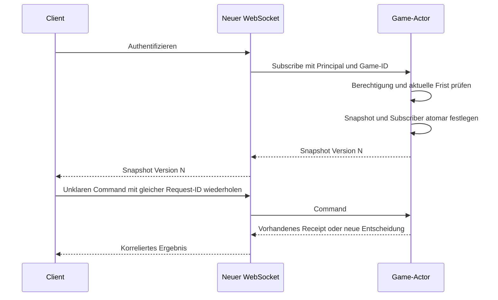

# Kapitel 16 — Reconnect, Idempotency und State-Versionen

[Dokumentationsindex](../INDEX.md) · [Vorheriges Kapitel](15-timed-matches.md) · [Nächstes Kapitel](17-persistence.md)

## 1. Chapter Overview

Eine unterbrochene Verbindung darf weder die Spieleridentität verlieren noch denselben Zug zweimal anwenden. Dieses Kapitel führt einen vollständigen Wiederaufnahmeablauf ein: authentifizieren, Partie abonnieren, Snapshot atomar mit dem Eventstream verbinden und unklare Commands anhand ihrer stabilen Request-ID abgleichen.

Das Ergebnis ist gegen Socketverlust zuverlässig, solange der Serverprozess lebt. Kapitel 17 macht Receipts und Spielzustand gemeinsam dauerhaft. Ein Neustart bleibt bis dahin ausdrücklich ein Verlust der temporären In-Memory-Partie.

## 2. Prerequisites

- Kapitel 10–15 abgeschlossen; Gast-Session, WebSocket-Lebenszyklus, Actor-Reihenfolge und Deadlines verstanden.
- Vor Beginn Unterschiede zwischen Identität, Session, Connection und Spielteilnahme als vier getrennte Begriffe notieren.
- [Reconnect-Architektur](../architecture/reconnection.md) und [State Synchronization](../protocol/state-synchronization.md) lesen.
- Einen Testclient mit absichtlich trennbarer Verbindung und gespeicherter Request-ID vorbereiten.

## 3. Learning Objectives

- Antwortverlust von fehlgeschlagener fachlicher Verarbeitung unterscheiden.
- Einen Request wiederholen, ohne seine Wirkung ein zweites Mal auszuführen.
- Snapshot und Eventabonnement ohne dazwischenliegende Zustandslücke verbinden.
- Veraltete, doppelte und lückenhafte Servernachrichten korrekt behandeln.
- Sessionablauf und Verbindungsabbruch ohne Identitätswechsel modellieren.

## 4. Concepts and Theory

### Idempotency und deduplizierte Commands

Idempotency bedeutet, dass Wiederholung derselben Operation dieselbe fachliche Wirkung behält. Für Move-Commands erreicht Kiban dies durch ein Receipt: Principal, Game-ID und Request-ID identifizieren den Versuch; ein Hash des kanonisierten fachlichen Payloads verhindert die Wiederverwendung mit anderem Inhalt. Ein Duplikat liefert das ursprüngliche Ergebnis. Ein neu generierter Identifier beim Retry wäre ein neuer Command. Diese Technik passt zu unklaren Netzwerkergebnissen; [RFC 9110](https://www.rfc-editor.org/rfc/rfc9110.html) erklärt den semantischen Grundgedanken, während [Kibans Vertrag](../protocol/state-synchronization.md) die zusätzliche Command-Garantie definiert.

### At-least-once statt magischer Exactly-once-Zustellung

Ein Client weiß nach Socketverlust nicht, ob der Server seinen Command nie gesehen oder bereits bestätigt hat. Er kann dieselbe Anfrage erneut senden. Das ist wiederholbare Zustellung mit deduplizierter fachlicher Wirkung, keine Exactly-once-Netzwerkzustellung. Der häufige Fehler ist, einen fehlenden ACK als sicher gescheiterten Zug zu behandeln. Dieses Modell ist bei jeder unzuverlässigen Verbindung angemessen; die [Recovery-Spezifikation](../database/recovery.md) zeigt die spätere persistente Ergänzung.

### Versionsordnung und Lücken

`state_version` ist ein monoton steigender Zähler pro Partie für bestätigte fachliche Übergänge. Ein neuer Command nennt die Version, auf der seine Absicht beruht. Ein Event bei bereits bekannter Version ist alt oder doppelt; ein Sprung über die erwartete nächste Version verlangt einen frischen Snapshot. Zeitstempel und WebSocket-Reihenfolge ersetzen dies über Reconnect hinweg nicht. Kiban sendet volle projizierte Zustände in `game_event`, prüft aber weiterhin die Kontinuität. Das passt zu kleinen Spielzuständen und vereinfacht Clientreducer. Siehe [Protokollversionierung](../protocol/versioning.md).

### Snapshot-Stream-Grenze

Eine konsistente Subscription registriert den Empfänger und bestimmt seinen Snapshot innerhalb desselben Actor-Schritts. Andernfalls könnte zwischen Snapshotlesen und Streamregistrierung ein Zug verloren gehen. Der Client erhält zunächst die Snapshot-Version und anschließend die geordneten folgenden Events. Nur „erst GET, dann WebSocket“ schafft diese Garantie nicht. Das Konzept ist nötig, sobald Zustandsabfragen mit Liveupdates verbunden werden; [Actor-Architektur](../architecture/actor-model.md) benennt den einzigen zuständigen Besitzer.

### Backoff und Connection Generation

Exponential Backoff vergrößert Wiederholungsabstände; Jitter verteilt sie zufällig, damit viele Clients nach einer Störung nicht gleichzeitig reconnecten. Eine lokale Connection Generation markiert außerdem, welche Socketinstanz aktuell ist. Ein später Callback des alten Sockets darf die neue Verbindung nicht schließen. Endlose sofortige Retries verschärfen Überlast. Diese Maßnahmen passen zum Wiederverbinden nach transienten Fehlern; bei ungültiger Session muss stattdessen eine bewusste Authentifizierungsentscheidung erfolgen. [Godot Networking](../architecture/godot-frontend.md) überträgt dies später auf UI-Zustände.

## 5. Architectural Context

Teilnahme gehört zum Game-Aggregat, Connection-ID zum Transport. Ein Disconnect entfernt nur das Abonnement. Der Actor hält laufende Clock und Mitgliedschaft weiter. Ein Reconnect verwendet denselben gültigen Gasttoken, niemals nur eine frei behauptete Guest-ID.

Ein Snapshot erzeugt keine Versionserhöhung. Falls beim Beobachten eine bereits fällige Deadline aufgelöst wird, ist nur der separate Timeout ein fachlicher Übergang.

## 6. Design Decisions

**Verbindlich:** Receipt-Lookup erfolgt nach Authentifizierung und grundsätzlicher Spielberechtigung, aber vor `expected_version` und der neuen Deadline-Entscheidung. Sonst würde ein erfolgreich wiederholter Move wegen seiner inzwischen veralteten Version abgewiesen oder nachträglich als Timeout behandelt.

**Verbindlich:** Ein Receipt gilt für `(game_id, principal_id, request_id)` und den zugehörigen Payload-Hash. Gleiches Tupel mit verändertem Inhalt ergibt `request_id_conflict`. Die gespeicherte Antwort bleibt das ursprüngliche Ergebnis, nicht der später aktuelle Spielzustand. Ein separater Snapshot zeigt den aktuellen Stand.

**Verbindlich:** Receipts akzeptierter Commands bleiben bis zur Aufbewahrungsgrenze der Partie erhalten. Ein winziger zeitbasierter Cache wäre einfacher, könnte aber einen späten Retry wieder als neue Wirkung behandeln. Frühe verworfene Transport-/Authentifizierungsfehler werden nicht als Spielreceipts gespeichert; der zentrale Vertrag legt den Umfang verbindlich fest.

**Verbindlich:** Eine zweite berechtigte Verbindung derselben Session darf beobachten. Beide besitzen dieselbe Spielerrolle; neue Moves konkurrieren weiterhin über Version und Actor-Reihenfolge. Ein erzwungener Single-Socket-Modus ist optional, wäre aber keine Ersatzlösung für Idempotency.

## 7. Implementation Tasks

- [ ] In der Application-Schicht Identität und Connection-Lebenszyklus getrennt halten. Nach Kapitel 15 prüfen: Disconnect verändert weder Sitzplatz noch Clock.
- [ ] Im Client pro Principal und Partie höchstens einen neuen ausstehenden Command samt unveränderlicher Request-ID halten. Prüfung: Wiederholung verwendet dieselbe ID und denselben Payload.
- [ ] Im Actor einen vorläufigen In-Memory-Receipt-Speicher einführen. Prüfung: erfolgreiche Commands sind anhand des vollständigen Schlüssels auffindbar.
- [ ] Den fachlichen Payload kanonisch für Hashvergleiche beschreiben. Prüfung: bedeutungsgleiche JSON-Feldreihenfolge ändert den Hash nicht.
- [ ] Den Receipt-Lookup vor Versionstest und neuer Zeitentscheidung platzieren. Prüfung: Retry eines alten Erfolgs liefert Erfolg trotz inzwischen höherer Version.
- [ ] Gleiche Request-ID mit anderem fachlichem Inhalt zurückweisen. Prüfung: weder Brett noch Clock ändern sich.
- [ ] Receipt und In-Memory-Übernahme als einen Actor-Schritt behandeln. Prüfung: nach akzeptiertem Zug kann kein Snapshot ohne dessen Receipt entstehen.
- [ ] Subscription-Autorisierung im Actor ausführen. Prüfung: bekannte Game-ID allein erlaubt kein privates Spielerabonnement.
- [ ] Snapshot-Erzeugung und Subscriber-Registrierung atomar verbinden. Prüfung: ein kontrolliert konkurrierender Move erscheint entweder im Snapshot oder als Folgeevent.
- [ ] Garantieren, dass der initiale Snapshot vor seinen Folgeevents im Ausgang liegt. Prüfung: Client sieht niemals Version N+1 vor seinem N-Snapshot.
- [ ] Den Client bei älteren Events unverändert lassen. Prüfung: doppeltes Event erzeugt keine zweite Animation oder Clock-Bonuswirkung.
- [ ] Bei Versionslücke Eingaben sperren und Resync anfordern. Prüfung: keine mutierenden Commands aus ungesichertem Zustand.
- [ ] Neue Snapshots vollständig ersetzen lassen. Prüfung: entfernte Figuren bleiben nicht aus einer alten Ansicht übrig.
- [ ] Connection Generation im Clientadapter führen. Prüfung: Close-Callback eines alten Sockets beendet den neuen nicht.
- [ ] Backoff mit begrenztem Maximum und Jitter dokumentieren. Prüfung: ungültige Session führt nicht zu endlos schnellen Wiederholungen.
- [ ] Sessionablauf und Widerruf auf Reconnect prüfen. Prüfung: ein ausgelaufener Token kann durch bekannte Guest-ID nicht ersetzt werden.
- [ ] Antwortverlust unmittelbar nach akzeptiertem Move injizieren. Prüfung: Wiederholung verändert Version und Uhr nicht erneut.
- [ ] Einen Reconnect nach bereits abgelaufener Uhr testen. Prüfung: aktueller terminaler Snapshot statt Fortsetzung des alten UI-Zustands.
- [ ] Das Receipt-Format für Kapitel 17 beschreiben. Prüfung: keine derzeitige Garantie behauptet Fortbestand über Prozessende.
- [ ] Den gesamten Wiederaufnahmeablauf zweimal mit getrennten Terminalclients demonstrieren. Prüfung: gleiche Partie, gleiche Rollen und identischer Endzustand.

## 8. Public Interfaces and Contracts

`CommandReceipt` enthält den vollständigen Deduplizierungsschlüssel, Payload-Hash, bestätigte Version und ursprüngliches Ergebnis. Der gespeicherte Hash umfasst Commandtyp, Game-ID, erwartete Version und fachliche Argumente; Transportmetadaten wie Connection-ID gehören nicht dazu. Die Principal-ID stammt aus der Authentifizierung.

`subscribe_game` und `resync` liefern einen vollständigen empfängerbezogenen Snapshot. `game_event` trägt einen vollständigen projizierten bestätigten Zustand und `state_version`. ACK und Event können in unterschiedlichem zeitlichem Abstand eintreffen; die Wirkung wird ausschließlich anhand von Version und Receipt zugeordnet. Maßgeblich sind [Nachrichtenkatalog](../protocol/websocket-messages.md) und [Fehler](../protocol/errors.md).

## 9. Edge Cases

- ACK ging verloren, Event kam an: Retry bestätigt dieselbe frühere Wirkung.
- ACK kam an, Event ging verloren: Snapshot stellt den aktuellen Zustand wieder her.
- Alter Socket liefert nach erfolgreichem Reconnect noch Daten: Generation verhindert unerwünschte Seiteneffekte.
- Derselbe Token ist auf zwei Clients aktiv: Version und Receipt begrenzen Mutationen, kein gegenseitiges Überschreiben.
- Retry nach Partieende: vorhandenes Receipt bleibt lesbar, neue Moves sind ungültig.
- Session ist widerrufen: vorhandenes Receipt ist keine alternative Authentifizierung.
- Queueverlust während Subscription: schließen und Snapshot neu aufbauen, keine heimliche Eventlücke.
- Serverprozess endet: in diesem Kapitel sind Spiel und Receipts verloren; erst Kapitel 17 liefert dauerhafte Wiederaufnahmeinformationen.

## 10. Testing Requirements

| Given | When | Then |
|---|---|---|
| Move akzeptiert, ACK unterdrückt | Identischen Command erneut senden | Ursprünglicher Erfolg, keine zweite Wirkung |
| Erfolg mit Version N | Retry nach weiteren Zügen | Receipt N statt `stale_version` |
| Verwendete Request-ID | Anderen Zielpunkt unter gleicher ID senden | `request_id_conflict`, unveränderter Zustand |
| Snapshot soll erstellt werden | Move genau an Subscription-Grenze auslösen | Move ist im Snapshot oder Folgeevent, niemals verloren |
| Client kennt Version N | Event N doppelt empfangen | Kein Zustandswechsel |
| Client kennt Version N | Event N+2 empfangen | Eingabe gesperrt und Resync |
| Verbindung getrennt, Clock läuft | Nach Deadline reconnecten | Terminaler Timeout-Snapshot |
| Neuer Socket ist offen | Alter Close-Callback läuft | Neuer Socket bleibt aktuell |
| Widerrufene Session | Mit alter Guest-ID reconnecten | Keine Authentifizierung und keine Spielprojektion |

Antwortverlust deterministisch am Versandadapter injizieren. Nicht den zufälligen Zeitpunkt eines Kabelziehens als einzigen Nachweis verwenden.

## 11. Definition of Done

- [ ] Reconnect erhält dieselbe Spielerrolle anhand derselben gültigen Session.
- [ ] Retry akzeptierter Commands ist vor Version und Deadline dedupliziert.
- [ ] Payload-Konflikte und Snapshot-Stream-Grenze sind gezielt getestet.
- [ ] Lücken sperren Eingaben bis zum vollständigen Resync.
- [ ] Disconnect pausiert weder Uhr noch verändert er das Ergebnis.
- [ ] In-Memory-Garantie und kommende persistente Grenze sind verständlich dokumentiert.

## 12. Common Pitfalls

Eine neue Request-ID beim Retry macht aus einer Wiederholung einen neuen Wunsch. Ein Receipt nur pro Spiel verwechselt verschiedene Spieler. Snapshotlesen vor Subscription kann genau den entscheidenden Zug verlieren. Ein ACK ist außerdem keine Aufforderung, dieselbe lokale Spiellogik erneut auszuführen: Der Client übernimmt projizierte Zustände. Ein Sessionwechsel darf nicht stillschweigend als Rückkehr desselben Gasts erscheinen.

## 13. Reflection Questions

1. Warum muss ein Duplikat vor `expected_version` geprüft werden?
2. Wie unterscheiden sich ursprüngliches Receipt und aktueller Snapshot?
3. Welche Garantie bietet die atomare Snapshot-Stream-Grenze?
4. Warum gehört Connection-ID nicht zum fachlichen Deduplizierungsschlüssel?
5. Was kann ein Client nach fehlendem ACK tatsächlich wissen?
6. Weshalb darf Sessionwiderruf auch den Zugriff auf frühere Receipts sperren?
7. Welchen neuen Fehler kann ein zu kurzer Receipt-Cache auslösen?

## 14. Further Reading

- [RFC 9110](https://www.rfc-editor.org/rfc/rfc9110.html): Idempotency als fachliche Wirkung verstehen, nicht als Zustellversprechen.
- [Tokio Channels](https://tokio.rs/tokio/tutorial/channels): atomare Subscription als Actor-Nachricht planen.
- [State Synchronization](../protocol/state-synchronization.md): Snapshot-, Event- und Receipt-Grenzen zusammen studieren.
- [Recovery](../database/recovery.md): den Unterschied zwischen reconnectfähigem Prozess und crashfähiger Persistenz vorbereiten.

## 15. Completion Record

| Feld | Eigener Eintrag |
|---|---|
| Abschlussdatum | |
| Entwurfsentscheidungen | |
| Herausforderungen | |
| Ausgeführte Tests und Ergebnisse | |
| Verbleibende technische Schulden | |
| Lernerfahrungen | |
