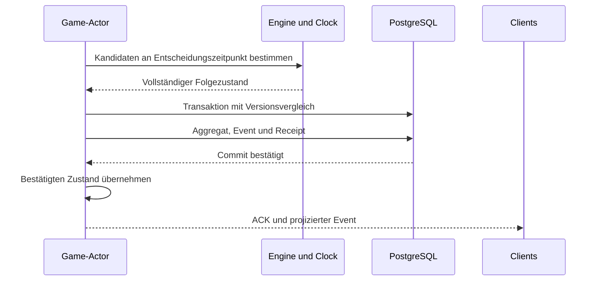

# Kapitel 17 — PostgreSQL, Transaktionen und Crash Recovery

[Dokumentationsindex](../INDEX.md) · [Vorheriges Kapitel](16-reconnection.md) · [Nächstes Kapitel](18-godot-structure.md)

## 1. Chapter Overview

Bisher bestätigt Kiban Änderungen im Arbeitsspeicher. Jetzt wird eine Bestätigung zur Zusage, dass ein Commit Spielzustand, fachlichen Event und Command-Receipt gemeinsam gespeichert hat. Abgeschlossene Partien bleiben abrufbar, Sessions überleben Neustarts und unklare Commit-Ergebnisse lassen sich anhand persistenter Receipts rekonstruieren.

Das Kapitel schließt M4. Laufende zeitgesteuerte Partien werden nach einem Prozessneustart ausdrücklich als `aborted` mit Grund `server_restart` beendet. Das MVP versucht nicht, prozessgebundene monotone Anker über eine Ausfallzeit hinweg fortzusetzen. Diese konservative Entscheidung schützt vor erfundenen Zeitständen und muss in der Benutzeroberfläche sichtbar sein.

## 2. Prerequisites

- Kapitel 01–16 abgeschlossen; In-Memory-Receipt, Actor-Ownership und Clock-Anker sind verstanden.
- Lokal erreichbare PostgreSQL-Instanz und Datenbankrolle mit minimalen Entwicklungsrechten; noch kein Produktionsdeployment erforderlich.
- Vor Umsetzung SQL-Grundlagen zu Primärschlüsseln, Fremdschlüsseln, Unique Constraints und Transaktionen lernen.
- [Schema](../database/schema.md), [Migrationsplan](../database/migrations-plan.md), [Transaktionen](../database/transactions.md) und [Recovery](../database/recovery.md) vollständig lesen.

## 3. Learning Objectives

- Einen akzeptierten Move als atomaren Commit über mehrere Tabellen beschreiben.
- Zwischen Engine-Folgezustand, committed Zustand und veröffentlichter Projektion unterscheiden.
- Bei unbekanntem Commit-Ergebnis anhand einer eindeutigen Receipt-ID rekonstruieren statt blind zu wiederholen.
- Restzeiten speichern, ohne einen `Instant` als dauerhaft wiederherstellbar auszugeben.
- Eine Restore- und Crash-Testmatrix mit klaren erwarteten Zuständen ausführen.

## 4. Concepts and Theory

### Relationales Schema und Constraints

Ein relationales Schema strukturiert dauerhafte Daten als Tabellen mit Beziehungen. Constraints erzwingen lokale Invarianten auch dann, wenn ein Fehler im Application-Layer auftritt. Kiban speichert Sessions, Partien, Teilnehmer, Übergänge, Zughistorie und Receipts mit eindeutigen Schlüsseln. Ein JSON-Snapshot allein ersetzt keine Eindeutigkeit von Receipt oder Teilnehmerrolle. Das passt zu konsistenten Beziehungen und gezielten History-Abfragen. [PostgreSQL Constraints](https://www.postgresql.org/docs/current/ddl-constraints.html) erläutert Primär-, Fremd- und Unique-Schlüssel.

### Transaktion und Commit

Eine Transaktion bündelt Änderungen so, dass sie vollständig oder gar nicht sichtbar werden. Commit macht die erfolgreiche Einheit verbindlich. Bei einem Move gehören neuer Game-Zustand, History/Event und Receipt in dieselbe Transaktion. Ein häufiger Fehler ist, zuerst die WebSocket-Antwort zu senden und danach zu speichern. Diese Reihenfolge verliert bestätigte Züge bei Absturz. Transaktionen sind hier angemessen, weil es eine Datenbank und eine begrenzte Aggregatänderung gibt. [PostgreSQL Transactions](https://www.postgresql.org/docs/current/tutorial-transactions.html) liefert das Grundmodell.

### Isolation und Optimistic Concurrency

Isolation beschreibt, wie parallele Transaktionen einander sehen. Ein versionsgebundener Update verändert eine Partie nur, wenn die gespeicherte Version der erwarteten entspricht. Der Actor ordnet reguläre Commands, der Datenbankvergleich schützt zusätzlich vor doppeltem Besitzer, Testfehlern und späteren administrativen Pfaden. Ein Actor allein ersetzt keine dauerhafte Eindeutigkeit. Read Committed mit Versionsbedingung und Constraints genügt für diese Aggregate; komplexe Mehrparteienvorgänge erfordern später neue Analyse. [PostgreSQL Isolation](https://www.postgresql.org/docs/current/transaction-iso.html) erklärt die Unterschiede.

### Snapshot, Eventlog und Zughistorie

Ein Snapshot ist ein vollständiger serialisierter Aggregatstand an einer Version. Das Eventlog dokumentiert bestätigte Übergänge; die Zughistorie speichert fachlich interpretierbare Spielzüge. Kiban verwendet gespeicherte aktuelle Aggregate plus append-only Übergänge für Audit und Replay, ohne vollständiges Event Sourcing vorauszusetzen. Ein älteres Snapshotformat benötigt eine Migration oder einen expliziten inkompatiblen Zustand. Diese Kombination passt zu kleinen Brettzuständen und einfacher Recovery. [Persistence Architecture](../architecture/persistence.md) beschreibt die Verantwortungsteilung.

### Unknown Commit Outcome

Wenn die Datenbankverbindung während Commit abbricht, kann der Server nicht wissen, ob der Commit bereits dauerhaft war. „Fehler empfangen“ bedeutet nicht sicher „Rollback“. Der Actor wechselt deshalb in `recovery_required`, akzeptiert keine weiteren Mutationen und liest nach Wiederherstellung das Receipt sowie die Game-Version. Blind erneut ausführen könnte einen Move doppelt anwenden. Dieses Konzept ist bei jedem Netzwerkzugriff auf eine Datenbank relevant. Der [Recovery-Vertrag](../database/recovery.md) bestimmt die anschließende Abbruchpolitik.

### Schema-Migration und SQLx

Eine Migration ist eine versionierte Veränderung des Datenbankschemas. SQLx vermittelt typisierten Datenzugriff und Migrationserfassung, erzeugt aber nicht die fachlichen Transaktionsgrenzen. Der Entwickler schreibt die Migrationen selbst; dieses Handbuch liefert nur deren Plan. Für Tests muss ein frischer Schemaaufbau reproduzierbar sein. Destruktive Änderungen ohne Datenübergang beschädigen gespeicherte Historien. Migrationen sind ab der ersten dauerhaften Version nötig. [SQLx Migrations](https://docs.rs/sqlx/latest/sqlx/migrate/index.html) beschreibt die Werkzeuge.

## 5. Architectural Context

Der Actor bleibt der einzige laufende fachliche Besitzer. Das Repository ist der dauerhafte Commit-Adapter, keine zweite Engine. Der Actor berechnet einen Kandidaten, speichert ihn atomar und übernimmt ihn erst nach bestätigtem Commit als bestätigten Zustand. ACK und Broadcast folgen danach.

Ein reiner Engine-Fehler benötigt keinen erfolgreichen Move-Commit. Erfolgreiche Create-/Join-/Endübergänge müssen ebenfalls konsistent persistiert werden; wartende Lobby und Aktivierung sind keine Ausnahmen.

## 6. Design Decisions

**Verbindlich:** PostgreSQL mit SQLx statt einer zweiten Dateipersistenz. Dateien wären lokal einfach, würden aber Eindeutigkeit, Transaktionen und History-Abfragen dem Entwickler aufbürden. Die Datenbank fügt Betrieb und lokale Testeinrichtung hinzu; sie passt zu Accounts und Ratings der späteren Kapitel.

**Verbindlich:** Commit-before-publish. Das erhöht Antwortlatenz gegenüber reinem Speicherbetrieb, verhindert aber verlorene bestätigte Züge. Der Clock-Anker bleibt der in Kapitel 15 erfasste Entscheidungszeitpunkt; Commit-Latenz ist kein heimlicher Pausebonus. Bei hohem Commit-Lag sind zunächst Betrieb und Lastgrenzen zu verbessern.

**Verbindlich:** Nach Prozessneustart werden zuvor aktive zeitgesteuerte Partien atomar als `aborted(server_restart)` beendet. Bereits committed Historie bleibt erhalten; diese Partien zählen nicht für Rating. Wall-Clock-Abzug über Downtime wäre einfach, könnte aber Serverausfälle als Spielerverlust verbuchen. Fortsetzung mit Pause wäre eine andere, missbrauchsrelevante Produktregel. Beide sind spätere Optionen mit neuer ADR.

**Verbindlich:** Bei Persistenzfehler wird nicht optimistisch weitergespielt. `recovery_required` sperrt Mutationen. Nach Klärung eines möglicherweise erfolgten Commits wird eine noch aktive betroffene Partie kontrolliert mit Grund `persistence_failure` gemäß [Recovery-Vertrag](../database/recovery.md) abgebrochen. Kein eingefrorener Clock-Zustand wird stillschweigend fortgesetzt. Der Status ist intern und kein neuer Spielersieg.

## 7. Implementation Tasks

- [ ] Vor Datenzugriff die Tabellen und Schlüssel aus dem Schema nachzeichnen. Prüfung: jede Beziehung besitzt eine klar beschriebene Lösch- und Aufbewahrungsregel.
- [ ] Eine lokale PostgreSQL-Testdatenbank von Entwicklungs- und Produktionsdaten trennen. Prüfung: destruktive Tests können nur den vorgesehenen Testnamen erreichen.
- [ ] Die vorgesehenen Migrationen selbst verfassen und versionieren. Prüfung: eine leere Datenbank erreicht reproduzierbar das aktuelle Schema.
- [ ] SQLx als erklärten Datenbankadapter im Server-/Infrastrukturteil einführen. Prüfung: `kiban-xiangqi` bleibt ohne SQLx baubar.
- [ ] Gastidentitäten und Tokenhashes dauerhaft speichern. Prüfung: derselbe gültige Token authentifiziert nach Serverneustart; der Klartext ist nicht in der Datenbank.
- [ ] Sessionablauf und Widerruf im persistenten Repository übernehmen. Prüfung: Neustart hebt einen Widerruf nicht auf.
- [ ] Create und Join als transaktionale Game-Übergänge speichern. Prüfung: parallele Join-Versuche können keinen zweiten Teilnehmer derselben Rolle erzeugen.
- [ ] Das aktuelle Aggregat mit Regel- und Snapshotformatversion serialisieren. Prüfung: unbekanntes Format wird explizit abgelehnt statt falsch gelesen.
- [ ] Für jeden Move einen vollständigen Kandidaten vor dem Commit bilden. Prüfung: ein Datenbankfehler verändert den bestätigten Actor-Zustand nicht vorzeitig.
- [ ] Den Update an die gespeicherte Vorgängerversion binden. Prüfung: null aktualisierte Zeilen führen zu Recovery/Konflikt, nicht blindem Überschreiben.
- [ ] Aggregat, Move-/Eventeintrag und erfolgreiches Receipt in eine Transaktion legen. Prüfung: absichtlicher Fehler nach jedem Teilschritt hinterlässt entweder alles oder nichts.
- [ ] Den Receipt-Schlüssel mit einem Unique Constraint sichern. Prüfung: konkurrierende identische Requests können nicht zwei bestätigte Wirkungen erzeugen.
- [ ] ACK und Broadcast erst nach bestätigtem Commit freigeben. Prüfung: künstlich verzögerter Commit erzeugt vorher keinen erfolgreichen Event.
- [ ] Broadcastfehler nach Commit als Zustellproblem behandeln. Prüfung: Reconnect liefert denselben committed Zug ohne Rollback.
- [ ] Bei unklarem Commit-Ausgang `recovery_required` setzen. Prüfung: nachfolgende Commands werden nicht auf ungewisser Basis entschieden.
- [ ] Nach Wiederherstellung Receipt und Game-Version neu lesen. Prüfung: tatsächlicher Commit wird erkannt, fehlender Commit nicht erfunden.
- [ ] Eine betroffene weiterhin aktive Partie nach der Recovery-Policy dauerhaft als `aborted(persistence_failure)` abbrechen. Prüfung: kein neues Zeitbudget und kein Rated Result entstehen.
- [ ] Beim Start aktive gespeicherte Spiele mit Grund `server_restart` abschließen. Prüfung: Wiederholung des Startup-Recovery erzeugt keinen zweiten Abschluss.
- [ ] Clock-Budgets und UTC-Auditzeit speichern, keine wiederverwendbaren `Instant`-Rohwerte. Prüfung: Snapshot bleibt unabhängig vom Prozessstart interpretierbar.
- [ ] Autorisierte History-Abfrage für Teilnehmer über HTTP ergänzen. Prüfung: abgeschlossene private Spiele bleiben für Fremde verborgen.
- [ ] Constraints und Indexnutzung für öffentliche Lobby und Teilnehmerhistorie prüfen. Prüfung: Abfrageplan verwendet bei repräsentativen Testdaten die vorgesehenen Zugriffspfade.
- [ ] Crash-Injection vor Commit, während Commit und nach Commit durchführen. Prüfung: nur committed Moves erscheinen in Snapshot und Historie.
- [ ] Eine gesicherte Testkopie wiederherstellen und Integrity-Checks ausführen. Prüfung: Versionen, Receipts und History-Endzustand stimmen überein.
- [ ] Den vollständigen M4-Ablauf mit zwei Terminalclients dokumentieren. Prüfung: Uhr, Reconnect, History und Neustartabbruch sind ohne Godot demonstrierbar.

## 8. Public Interfaces and Contracts

`GameRepository` erhält Vorgängerversion, Kandidat, Übergang und Receipt und liefert einen bestätigten Commit oder einen klassifizierten Fehler. Es erzeugt keine eigenen Spielregeln. `CommandReceipt` besitzt denselben Schlüssel wie in Kapitel 16 und bleibt bis zur Aufbewahrungsgrenze der Partie vorhanden.

Die Tabellenbeschreibungen in [schema.md](../database/schema.md) sind maßgeblich. Als zwingende Invarianten gelten: eindeutige `(game_id, state_version)` für Übergänge, eindeutige `(game_id, principal_id, request_id)` für akzeptierte Commandreceipts und eindeutige Teilnehmerrolle je Partie. Weitere Views und Indizes sind anhand konkreter Abfragen zu begründen.

`GET /api/v1/games/{game_id}` liefert eine autorisierte Projektion des aktuellen oder abgeschlossenen Zustands, niemals Sessionhashes, Einladungshashes oder interne Engine-Serialisierung. Die REST-Spezifikation bestimmt, wie Historie paginiert beziehungsweise zusätzlich abgerufen wird. Ratings sind noch nicht implementiert; Kapitel 28 nutzt einen eigenen eindeutigen Updatebeleg je Partie und Ratingpool.

## 9. Edge Cases

- Legalität erfolgreich, Persistenz fehlschlägt: kein Erfolgs-ACK, keine bestätigte Übernahme, Recovery-Sperre.
- Commit erfolgreich, Broadcast fehlschlägt: dauerhaft gültiger Move; Resync rekonstruiert ihn.
- Absturz vor Commit: keine bestätigte Wirkung; Startup-Recovery beendet die noch aktive Partie als `aborted(server_restart)`.
- Absturz nach Commit vor ACK: Receipt bestätigt die frühere Wirkung; Partie kann zusätzlich einen späteren Neustartabbruch besitzen.
- Connectionverlust während Commit: Ausgang ist ungewiss; zuerst nachlesen, nicht blind wiederholen.
- Zwei Actorinstanzen adressieren dasselbe Spiel: Versionsbedingung verhindert stilles Überschreiben und macht den Besitzfehler sichtbar.
- Alte Snapshotversion: Migration oder klarer nicht unterstützter Zustand, keine Interpretation nach aktuellem Layout.
- Datenbank nicht erreichbar beim Start: keine neuen vermeintlich dauerhaften Spiele im In-Memory-Fallback anbieten.

## 10. Testing Requirements

| Given | When | Then |
|---|---|---|
| Leere Testdatenbank | Alle Migrationen anwenden | Erwartete Tabellen und Constraints vorhanden |
| Legal berechneter Move | Eventinsert absichtlich scheitert | Kein neuer Game-Stand und kein Receipt committed |
| Transaktion wartet vor Commit | Clients beobachten | Kein Erfolgs-ACK und kein neuer bestätigter Zustand |
| Erfolgreicher Commit | Broadcast ausfällt | Reconnect zeigt committed Version |
| Antwortverlust nach Commit | Identischen Request wiederholen | Ursprüngliches Receipt, keine zweite Historyzeile |
| Connectionverlust während Commit | Verbindung wiederherstellen | Receipt bestimmt tatsächlichen Ausgang |
| Aktive zeitgesteuerte Partie | Prozess beenden und starten | `aborted(server_restart)`, Historie erhalten |
| Wiederholte Startup-Recovery | Dieselbe Datenbank erneut starten | Keine doppelte Abschlussversion |
| Persistenter Widerruf | Neustart durchführen | Token bleibt ungültig |
| Private abgeschlossene Partie | Fremder Gast fragt History an | Keine private Projektion |

Tests benötigen echte lokale PostgreSQL-Transaktionen. Ein In-Memory-Fake kann API-Verwendung testen, beweist aber weder Isolation noch Constraint- und Rollback-Verhalten. Fault Injection erfolgt an benannten Commit-Grenzen, nicht nur durch zufälliges Prozessbeenden.

## 11. Definition of Done

- [ ] Alle erfolgreichen mutierenden Übergänge werden vor Veröffentlichung committed.
- [ ] Game-Zustand, Event/History und Receipt können nicht auseinander committen.
- [ ] Sessions und akzeptierte Receipts überleben Neustart; Token bleiben gehasht.
- [ ] Unknown Commit Outcome, Broadcastausfall und Startup-Recovery sind nachgewiesen.
- [ ] Aktive Partien werden nach Neustart eindeutig abgebrochen und nicht geratet.
- [ ] Autorisierte abgeschlossene Historie ist über HTTP lesbar.
- [ ] [M4](../milestones/M4-timed-games.md) ist mit Terminalclients demonstriert.

## 12. Common Pitfalls

„Der Actor ist single-threaded“ schützt nicht gegen Absturz zwischen drei Datenbankstatements. „Commit meldete Fehler“ beweist bei verlorener Verbindung keinen Rollback. Ein Erfolgs-ACK vor Commit widerspricht dem neuen Zuverlässigkeitsvertrag. Raw-`Instant`-Werte sind keine durable Uhr. Schließlich darf ein Datenbankausfall nicht stillschweigend zum alten In-Memory-Modus führen, während Clients weiterhin dauerhafte Bestätigungen erwarten.

## 13. Reflection Questions

1. Welche Daten müssen zwingend gemeinsam mit einem Move committen?
2. Warum kann ein nach Commit gescheiterter Broadcast den Move nicht zurücknehmen?
3. Wie wird ein unbekannter Commit-Ausgang ohne zweite Zugwirkung geklärt?
4. Welche zusätzliche Sicherheit bietet die Versionsbedingung trotz Game-Actor?
5. Warum beendet das MVP aktive Partien nach Neustart statt Wall-Clock-Zeit abzuziehen?
6. Wodurch unterscheiden sich Eventlog und vollständiges Event Sourcing?
7. Welche Tests können nur mit einer echten Datenbank eine Aussage machen?
8. Welche zukünftige Invariante verhindert doppelte Ratingupdates?

## 14. Further Reading

- [PostgreSQL Transactions](https://www.postgresql.org/docs/current/tutorial-transactions.html): Atomizität zunächst an kleinen selbst geschriebenen Übungen verstehen.
- [PostgreSQL Isolation](https://www.postgresql.org/docs/current/transaction-iso.html): Read Committed und konkurrierende Updates auf die Actor-Grenze beziehen.
- [PostgreSQL Constraints](https://www.postgresql.org/docs/current/ddl-constraints.html): Schlüssel und Eindeutigkeiten vor Migrationsentwurf begründen.
- [SQLx Migrations](https://docs.rs/sqlx/latest/sqlx/migrate/index.html) und [SQLx Transaction](https://docs.rs/sqlx/latest/sqlx/struct.Transaction.html): Lebenszyklus und Rollback-Verhalten des Adapters studieren.
- [Recovery-Vertrag](../database/recovery.md): Crash-Matrix als verbindliche Abnahmespezifikation lesen.

## 15. Completion Record

| Feld | Eigener Eintrag |
|---|---|
| Abschlussdatum | |
| Entwurfsentscheidungen | |
| Herausforderungen | |
| Ausgeführte Tests und Ergebnisse | |
| Verbleibende technische Schulden | |
| Lernerfahrungen | |
