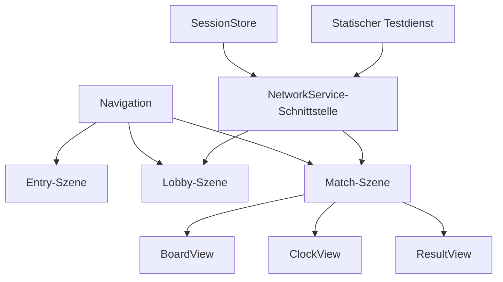

# Kapitel 18 — Godot-Szenen, Signals und UI-Architektur

[Dokumentationsindex](../INDEX.md) · [Vorheriges Kapitel](17-persistence.md) · [Nächstes Kapitel](19-board-rendering.md)

## 1. Chapter Overview

Die Backend-Lernstrecke ist bis M4 unabhängig von einer Grafikoberfläche demonstrierbar. Nun beginnt ein schlanker Godot-4-Client in GDScript. Dieses Kapitel legt Szenen, Zustandsbesitz und Kommunikationsgrenzen fest und macht die Navigation mit statischen Beispieldaten überprüfbar.

Der Entwickler erstellt das Godot-Projekt während seiner eigenen Umsetzung. Diese Dokumentation enthält weder Szenendateien noch Scripts. Ergebnis des Kapitels ist ein selbst gebautes navigierbares UI-Gerüst mit testbaren Komponenten, noch ohne echte Netzwerkverbindung.

## 2. Prerequisites

- Kapitel 01–17 abgeschlossen; besonders Projektionen, Request-Korrelation und Reconnect verstanden.
- Godot 4 stable manuell installieren und exakte Version im eigenen Entwicklungsprotokoll festhalten.
- Vor Umsetzung GDScript-Grundlagen, Node-Lebenszyklus, Szeneninstanzen und Signalverbindungen lernen.
- [Godot-Architektur](../architecture/godot-frontend.md) lesen; API- und Domain-State weiterhin ausschließlich aus den bisherigen Verträgen ableiten.

## 3. Learning Objectives

- Scene, Node, Resource, Signal und Autoload anhand ihrer Lebensdauer unterscheiden.
- UI-Zustand und autoritativen Spielzustand getrennt besitzen lassen.
- Eine einzelne Szene mit Testdaten starten, ohne einen laufenden Server vorauszusetzen.
- Navigation und Netzwerkservice über explizite Schnittstellen statt beliebige Node-Pfade verbinden.
- Wiederholte Szenenwechsel ohne doppelte Signalhandler oder verwaiste Requests durchführen.

## 4. Concepts and Theory

### Scenes und Nodes

Ein Node ist ein Objekt im Scene Tree mit definiertem Lebenszyklus; eine Scene ist eine wiederverwendbare Hierarchie von Nodes. Kiban nutzt getrennte Szenen für Einstieg, Lobby, Partie und Ergebnisdarstellung. Ein gigantischer Root-Node mit allen Zuständen erschwert isolierte Tests. Szenen sind geeignet, wenn UI-Bereiche eine eigene Aufgabe und Lebensdauer besitzen. [Godot Scenes and Nodes](https://docs.godotengine.org/en/stable/getting_started/step_by_step/nodes_and_scenes.html) vermittelt diese Grundlage vor der Architekturentscheidung.

### Signals

Ein Signal meldet ein Ereignis, ohne dass der Sender seinen Empfänger kennen muss. Ein Brett kann etwa eine Zugabsicht melden; der Controller entscheidet über die Weiterleitung. Der Renderer kennt deshalb keinen HTTP-Service. Doppelte Signalverbindungen können denselben Command mehrfach erzeugen; unbereinigte Verbindungen halten alte Empfängerpfade am Leben. Signals passen zu lokaler UI-Komposition, nicht als unsichtbarer globaler Eventbus für jede Änderung. [Godot Signals](https://docs.godotengine.org/en/stable/getting_started/step_by_step/signals.html) erklärt Verbindung und Lebenszyklus.

### Autoload und Lebensdauer

Ein Autoload wird unabhängig von Szenenwechseln geladen und eignet sich für wenige bewusst globale Dienste. Kiban hält dort Session-/Transportkoordination und gegebenenfalls Navigation. Brettauswahl, Hover und aktuelle Zuganimation gehören in die Match-Szene. Alles global zu speichern macht Einzeltests und neue Spielarten schwierig. Autoload ist geeignet, wenn eine Aufgabe tatsächlich szenenübergreifend lebt. [Godot Autoload](https://docs.godotengine.org/en/stable/tutorials/scripting/singletons_autoload.html) beschreibt die Engine-Lebensdauer und weist auf die Grenzen des Singleton-Begriffs hin.

### State-driven Rendering

State-driven Rendering erzeugt die Anzeige aus einem expliziten View State statt durch verstreute Einzelmutationen. Ein Snapshot ersetzt den bestätigten Match State; Auswahl und ausstehende Absicht sind davon getrennte lokale UI-Daten. Ein häufiger Fehler ist, beim Anklicken bereits die einzige Brettkopie zu verändern und später kompliziert zurückzurollen. Das Modell passt zu serverautoritativen Spielen und Replay. [Godot GUI Design](https://docs.godotengine.org/en/stable/tutorials/ui/index.html) liefert die Darstellungsmittel; [State Synchronization](../protocol/state-synchronization.md) liefert die Datenregeln.

### Ressourcen und Szeneninstanzen

Resources sind wiederverwendbare Datenobjekte, etwa Themes und Texturen. Geteilte veränderliche Resources können unbeabsichtigt mehrere Szenen gleichzeitig beeinflussen. Kiban behandelt grafische Assets als unveränderlich und erzeugt getrennten Match View State pro Ansicht. Diese Trennung passt zu wiederverwendbaren Brett- und Figurenansichten. [Godot Resources](https://docs.godotengine.org/en/stable/tutorials/scripting/resources.html) erklärt Referenzen und gemeinsame Nutzung.

### Container und Layoutbesitz

Ein Container bestimmt das Layout seiner Control-Kinder. Manuell gesetzte Positionen können beim nächsten Resize überschrieben werden. Kiban verwendet Container für Menüs und Seitenleisten; das Brett erhält einen abgegrenzten Zeichenbereich. Das passt zu Desktopfenstern unterschiedlicher Größe. Häufige Fehler sind starre Pixelkoordinaten für die ganze Oberfläche und konkurrierende Layoutbesitzer. [Using Containers](https://docs.godotengine.org/en/stable/tutorials/ui/gui_containers.html) beschreibt Größenflags und Layoutregeln.

## 5. Architectural Context

Die Oberfläche besteht aus Navigation, NetworkService, SessionStore und szenenlokalen Controllern. NetworkService ist zunächst ein austauschbarer Testdienst. Er liefert dieselben Datenformen, die Kapitel 20 aus HTTP/WebSocket dekodiert. Weder Szene noch Autoload enthält Xiangqi-Legalitätsprüfung.

Die Match-Szene besitzt ihre View-Daten und Interaktionssperren. Der SessionStore besitzt keine Kopie des autoritativen Bretts; er verwaltet ausschließlich lokale Identitätsmetadaten und die notwendige Sessionverfügbarkeit.

## 6. Design Decisions

**Verbindlich:** Godot 4 mit GDScript, ohne Rust-Extension im MVP. Eine gemeinsame Rust-Engine im Client könnte Offline-Regeln wiederverwenden, erhöht aber Build- und Exportkomplexität und verwischt anfangs die Autorität. Erst eine ausdrücklich geplante Offline-Funktion begründet diesen Zusatz.

**Verbindlich:** Wenige benannte Services statt eines globalen Eventbusses. Explizite Abhängigkeiten sind etwas aufwendiger zu verdrahten, machen Fehlerpfade aber nachvollziehbar. Bei großen UI-Modulen kann ein zusätzlicher lokaler Eventkanal sinnvoll werden.

**Verbindlich:** Szenen müssen mit statischen Testprojektionen startbar sein. Eine globale Pflichtverbindung zum Server wäre schneller zusammengeklickt, würde aber jede Layoutprüfung an Backendzustand koppeln. Der Testdienst wird in Kapitel 20 an derselben Grenze ersetzt.

**Optional:** Node2D oder Control für den eigentlichen Brettbereich ausprobieren. Die Entscheidung muss Koordinatenmapping und Resizing begründen; Menü- und Formularlayout bleibt Control-basiert.

## 7. Implementation Tasks

- [ ] Im selbst erstellten Godot-Projekt die exakte Engine-Version dokumentieren. Prüfung: ein zweiter Rechner kann dieselbe Version identifizieren.
- [ ] Eine Szenenübersicht mit Zustandsbesitz zeichnen. Nach den Konzepten prüfen: jedes veränderliche Datum hat genau einen Besitzer.
- [ ] Eine Entry-Szene für Sessionverfügbarkeit und Einstieg gestalten. Prüfung: Start ohne Netzwerk zeigt einen definierten neutralen Zustand.
- [ ] Eine Lobby-Szene mit Platz für Liste, Create und Einladung vorsehen. Prüfung: sie lässt sich direkt mit statischen Daten öffnen.
- [ ] Eine Match-Szene mit Board-, Clock-, Status- und Resultbereichen aufbauen. Prüfung: sie ist ohne NetworkService-Verbindung sichtbar.
- [ ] Die Navigation als explizite Übergänge beschreiben. Prüfung: Einstieg, Lobby und Partie sind ohne beliebige Node-Pfadsuche erreichbar.
- [ ] Einen SessionStore auf szenenübergreifend notwendige Identitätsmetadaten begrenzen. Prüfung: keine Hover- oder Brettdaten verbleiben nach Szenenende darin.
- [ ] Eine schmale NetworkService-Schnittstelle für spätere Requests und Zustandsmeldungen bestimmen. Prüfung: Szenen kennen keine Socketmethoden.
- [ ] Einen statischen Testdienst für Erfolg, leere Liste, Fehler und verzögerten Abschluss selbst verfassen. Prüfung: alle vier Zustände sind ohne Server auswählbar.
- [ ] Lokalen View State für Loading, Ready und Error unterscheiden. Prüfung: kein Button bleibt während Loading unklar mehrfach nutzbar.
- [ ] Signale vom Board an den Match-Controller planen. Prüfung: eine Zugabsicht enthält Koordinaten, aber keinen selbst berechneten Engine-Folgezustand.
- [ ] Signalverbindungen beim Szenenwechsel kontrollieren. Prüfung: zehnmaliges Öffnen erzeugt beim nächsten Klick genau eine Meldung.
- [ ] Themes und Figurenassets von veränderlichen Zustandsdaten trennen. Prüfung: zwei Match-Instanzen beeinflussen ihre Auswahl nicht gegenseitig.
- [ ] Container für Menü und Seitenbereich einsetzen. Prüfung: schmaler und breiter Viewport erzeugen keine unzugänglichen Bedienelemente.
- [ ] Fehlertexte von internen Transportdetails trennen. Prüfung: die Oberfläche zeigt keinen Token und keinen Raw-Stacktrace.
- [ ] Fokusfolge und Tastaturbedienung für Navigation definieren. Prüfung: die Hauptansichten sind ohne Maus erreichbar.
- [ ] Szenenlokale Aufräumregeln für Timer, Signals und ausstehende Requests notieren. Prüfung: ein verspäteter Testdienstcallback verändert keine freigegebene Szene.
- [ ] Jede Szene isoliert starten und einen kleinen manuellen Prüfkatalog aufzeichnen. Prüfung: keine Szene verlangt bereits die Implementierung aus Kapitel 21 oder 22.

## 8. Public Interfaces and Contracts

`NetworkService` meldet fachliche Ergebnisse und Verbindungszustände. `SessionStore` beantwortet, ob eine verwendbare Session vorhanden ist. `MatchController` nimmt Snapshot-/Eventprojektionen entgegen und besitzt bestätigten View State. `BoardView` zeigt Brettdaten und meldet Auswahlabsichten; `ClockView` zeigt Restzeit, entscheidet aber keine Ergebnisse.

Die Namen beschreiben Verantwortlichkeiten und sind keine fertigen GDScript-Typen. Signale müssen ihren Payload, Sender und zulässige Lebensdauer dokumentieren. Eine Szene darf nicht wegen bequemem Zugriff ein Token als Label oder als Inspector-Property speichern. Die spätere native und browserbasierte Tokenbehandlung folgt [Authentifizierung](../protocol/authentication.md).

## 9. Edge Cases

- Eine Szene wird geschlossen, bevor ein Testcallback endet: callback ignorieren oder abmelden.
- Zwei Instanzen teilen ein Resource-Objekt: nur unveränderliche Assets gemeinsam nutzen.
- Navigation wechselt während Loading: alten Requestkontext entkoppeln.
- Ein Button wird doppelt geklickt: UI-Sperre und spätere Server-Idempotency sind getrennte Schutzschichten.
- Ein schmaler Viewport drückt das Brett zusammen: Mindestgröße und scrollbare Nebendaten definieren.
- Session fehlt: kein lokaler erfundener Spieler wird als bestehender Gast ausgegeben.

## 10. Testing Requirements

| Given | When | Then |
|---|---|---|
| Statischer Testdienst | Lobby isoliert starten | Liste ohne Backend sichtbar |
| Match-Szene mit Snapshot | Szene isoliert starten | Brett- und Statusbereiche sind konsistent |
| Zehn Szenenwechsel | Ein Signal auslösen | Genau ein aktueller Handler reagiert |
| Ausstehender Callback | Szene vorher freigeben | Kein Zugriff auf ungültige Nodes |
| Zwei Match-Instanzen | Auswahl in einer ändern | Andere Auswahl bleibt unverändert |
| Loading-Zustand | Create erneut auslösen | Kein zweiter lokaler Request |
| Kleiner Viewport | Fenster verkleinern | Hauptaktionen bleiben zugänglich |
| Fehlende Session | Einstieg öffnen | Definierter Sessionzustand statt scheinbarer Teilnahme |

Statische Daten sind fest und versioniert; Screenshotvergleiche ergänzen, ersetzen aber keine Prüfung von Signals und Zustandsbesitz. Tests können zunächst als reproduzierbare manuelle Szenenprüfungen ausgeführt werden; Kapitel 23 integriert sie in die Gesamtstrategie.

## 11. Definition of Done

- [ ] Alle Hauptszenen sind isoliert mit Testdaten startbar.
- [ ] Zustandsbesitz und Servicegrenzen sind dokumentiert und sichtbar eingehalten.
- [ ] Wiederholte Navigation erzeugt keine doppelten Handler oder ungültigen Node-Zugriffe.
- [ ] Keine Szene implementiert Xiangqi-Regeln oder Timeout-Entscheidungen.
- [ ] Responsive Layout und Grundbedienung sind manuell geprüft.
- [ ] Der Testdienst kann in Kapitel 20 ohne Umbau der Ansichten ersetzt werden.

## 12. Common Pitfalls

Ein Autoload wird schnell zum globalen Speicher für alles. Das erschwert Einzeltests und lässt vergangene Partien in neue Ansichten hineinragen. Absolute Node-Pfade über Szenengrenzen brechen bei Umstrukturierung. Wiederholtes Signalverbinden erzeugt Doppelaktionen. Vom Container verwaltete Controls manuell zu positionieren führt zu scheinbar zufälligem Layoutspringen beim Resize.

## 13. Reflection Questions

1. Welche Lebensdauer rechtfertigt einen Autoload?
2. Warum sollte BoardView keine HTTP-Requests kennen?
3. Welche Daten sind bestätigt, welche nur lokaler Interaktionszustand?
4. Wann ist ein Signal klarer als ein direkter Methodenaufruf?
5. Welchen Test ermöglicht ein austauschbarer NetworkService?
6. Wie kann ein geteiltes Resource-Objekt zwei Match-Ansichten beeinflussen?
7. Warum ist ein funktionierender Szenenwechsel noch kein Nachweis sauberen Ressourcenabbaus?

## 14. Further Reading

- [Nodes and Scenes](https://docs.godotengine.org/en/stable/getting_started/step_by_step/nodes_and_scenes.html): Lebenszyklus und Szeneninstanzen praktisch erkunden.
- [Signals](https://docs.godotengine.org/en/stable/getting_started/step_by_step/signals.html): lokale Entkopplung und Verbindungsmanagement verstehen.
- [Autoload](https://docs.godotengine.org/en/stable/tutorials/scripting/singletons_autoload.html): ausschließlich dauerhafte Services daraus ableiten.
- [Resources](https://docs.godotengine.org/en/stable/tutorials/scripting/resources.html): gemeinsame Daten und Instanzzustand unterscheiden.
- [Using Containers](https://docs.godotengine.org/en/stable/tutorials/ui/gui_containers.html): Layoutbesitz und Größenflags vor manueller Positionierung lernen.

## 15. Completion Record

| Feld | Eigener Eintrag |
|---|---|
| Abschlussdatum | |
| Entwurfsentscheidungen | |
| Herausforderungen | |
| Ausgeführte Tests und Ergebnisse | |
| Verbleibende technische Schulden | |
| Lernerfahrungen | |
