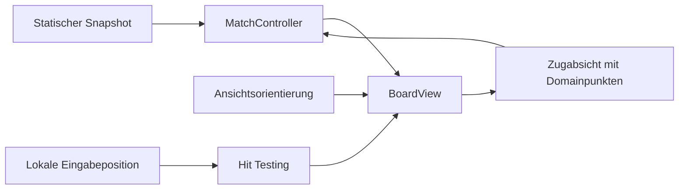

# Kapitel 19 — Xiangqi-Brett, Koordinaten und Eingabe

[Dokumentationsindex](../INDEX.md) · [Vorheriges Kapitel](18-godot-structure.md) · [Nächstes Kapitel](20-godot-networking.md)

## 1. Chapter Overview

Die BoardView stellt jetzt eine vollständige Xiangqi-Position dar und übersetzt Maus- beziehungsweise Touchpositionen in Domain-Koordinaten. Der Server wird dafür nicht benötigt: feste Snapshots aus Engine-Tests liefern reproduzierbare Darstellungen.

Am Ende sind Anfangsstellung, gespiegelte Ansicht, Auswahl, Zugabsicht und vollständiger Snapshotwechsel prüfbar. Der Client berechnet keine legalen Züge. Er übermittelt nur die ausgewählten Start- und Zielpunkte, wenn die übergeordneten UI-Voraussetzungen erfüllt sind.

## 2. Prerequisites

- Kapitel 04 und 18 abgeschlossen; 9×10 Schnittpunkte und Godot-Lebenszyklus verstanden.
- Vor Umsetzung lokale, Canvas-, Viewport- und Bildschirmkoordinaten auseinanderhalten.
- [Brettrepräsentation](04-board-representation.md), [Figurenbewegung](../rules/xiangqi-movement.md) und [Godot-Architektur](../architecture/godot-frontend.md) lesen.
- Feste Beispielprojektionen ohne Netzwerk bereitstellen; Assets müssen eine dokumentierte eigene oder zulässige Lizenz besitzen.

## 3. Learning Objectives

- Alle 90 Domain-Koordinaten verlustfrei in Brettpositionen und zurück abbilden.
- Ansichtsdrehung von einer Änderung des eigentlichen Spielzustands unterscheiden.
- Eingaben außerhalb des Brettbereichs kontrolliert verwerfen.
- Einen vollständigen Snapshot anwenden, ohne übrig gebliebene Figuren oder Auswahlreste zu behalten.
- Figuren und Status so darstellen, dass Farbe allein nicht die einzige Information trägt.

## 4. Concepts and Theory

### Schnittpunkte statt Felder

Xiangqi-Figuren stehen auf Schnittpunkten, nicht in den 8×9 Rechtecken zwischen Linien. Die Domain besitzt x=0…8 und y=0…9; x steigt aus roter Sicht nach rechts, y von der roten zur schwarzen Grundreihe. Eine Verwechslung verschiebt alle Figuren um einen halben Rasterabstand. Dieses Modell ist speziell für Xiangqi angemessen; Junqi verwendet später eine eigene Graphdarstellung. [Xiangqi-Bewegungsregeln](../rules/xiangqi-movement.md) verbinden Koordinaten mit Palast und Fluss.

### Koordinatentransformation

Eine Transformation ordnet Punkte aus einem Raum einem anderen zu. Kiban trennt Domainpunkt, lokales Brettlayout und Viewport-Eingabe. Die Eingabe muss zunächst in den lokalen Brettbereich übersetzt werden, bevor Raster und Orientierung berücksichtigt werden. Direktes Runden globaler Mauskoordinaten versagt nach Resize oder UI-Verschiebung. Dieses Verfahren passt zu jedem skalierbaren Brett. [Godot Canvas Transforms](https://docs.godotengine.org/en/stable/tutorials/2d/2d_transforms.html) erklärt die beteiligten Räume.

### Orientierung als Präsentation

Eine rote oder schwarze Ansicht verändert nur die Zuordnung zum Bildschirm, nicht die Domain-Koordinaten und nicht die Bedeutung von Vorwärtsbewegung. Für die schwarze Ansicht wird die Darstellung um 180 Grad gedreht; sämtliche Commands verwenden weiterhin dieselben kanonischen Koordinaten. Der Fehler, den Snapshot selbst zu spiegeln, erzeugt uneinheitliche Historien und Servercommands. Das Konzept passt bei Rollen mit unterschiedlicher Blickrichtung. [Koordinatenvertrag](04-board-representation.md) bleibt die fachliche Quelle.

### Hit Testing und Eingabetoleranz

Hit Testing entscheidet, ob eine Eingabeposition einem bedienbaren Ziel zugeordnet wird. Beim Schnittpunktbrett braucht es eine begrenzte Toleranz um den nächstgelegenen Punkt. Ein Klick weit außerhalb darf nicht durch Clamping auf die Randfigur springen. Kiban definiert den gültigen Bereich und eine maximale Entfernung explizit. Das ist bei Maus und Touch wichtig; die passende Toleranz wird mit realen Bildschirmgrößen geprüft. [Godot Input Events](https://docs.godotengine.org/en/stable/tutorials/inputs/inputevent.html) beschreibt den Eingabepfad.

### Bestätigter Zustand und Auswahlzustand

Der bestätigte Brettzustand stammt aus dem Server-Snapshot. Auswahl ist ein lokaler, verwerfbarer UI-Zustand. Eine Zugabsicht ist noch kein neuer bestätigter Zustand. Kiban hält diese Daten getrennt, sodass Ablehnung und Resync keinen komplizierten Board-Rollback benötigen. Die Technik passt zu jedem serverautoritativen Spiel. Ein Anfängerfehler ist, Figuren bei Zielklick endgültig umzusetzen. [State Synchronization](../protocol/state-synchronization.md) definiert, wann eine Änderung bestätigt ist.

### Darstellungskomplexität

Der Renderauftrag erhält maximal 90 Positionseinträge und erzeugt daraus Brett und Figuren. Eine vollständige Neuabbildung ist bei dieser kleinen festen Größe ausreichend; Laufzeit ist linear in der Zahl dargestellter Positionen und Speicher linear in der Zahl sichtbarer Figuren. Frühzeitiges Objektpooling erschwert Snapshotwechsel, ohne hier messbaren Nutzen zu versprechen. Diese Wahl passt zum MVP; erst Profiling rechtfertigt inkrementelle Optimierung. [Godot Performance](https://docs.godotengine.org/en/stable/tutorials/performance/index.html) erläutert Messung vor Optimierung.

## 5. Architectural Context

BoardView kennt ein Xiangqi-spezifisches Viewformat, seine Orientierung und lokale Auswahl. Der MatchController aus Kapitel 18 übergibt Daten und empfängt Zugabsichten. NetworkService wird erst Kapitel 20 angeschlossen. Die Rust-Engine ist ausschließlich Quelle für Testpositionen und fachliche Bedeutungen, keine im Frontend nachgebaute Regelbibliothek.

## 6. Design Decisions

**Verbindlich:** Rendering aus vollständigen Projektionen. Einzelne lokale „Figur entfernen“-Nachrichten wären zunächst kürzer, hinterließen aber bei Reconnect leicht Reste. Die kleine Brettgröße macht vollständiges Zustandsrendering ausreichend. Bei späteren sehr großen Spielen ist die Kostenfrage neu zu prüfen.

**Verbindlich:** Keine eigene Legal-Move-Engine im Client. Die UI kann die eigene Figur, den eigenen Zug und denselben Start-/Zielpunkt unterscheiden. Palast, Schach und Cannon-Screens entscheidet ausschließlich Rust. Lokale Regelhinweise wären eine zusätzliche optionale Hilfsschicht, dürften aber nie verbindliche Autorität erhalten.

**Verbindlich:** Figuren unterscheiden sich durch Form beziehungsweise Beschriftung und Seitenkennzeichen. Nur rote/schwarze Farbe ist bei geringer Sichtbarkeit oder Farbfehlsichtigkeit unzureichend. Vertraute chinesische Zeichen können ergänzt werden, benötigen aber eine lesbare Alternative und geeignete Fonts.

**Optional:** Zeichnen per CanvasItem gegenüber einzelnen Sprite-/Control-Instanzen untersuchen. Vorteile sind geringer Node-Aufwand beziehungsweise einfache Interaktion und Inspektion. Die Entscheidung beeinflusst keine Wire-Koordinaten.

## 7. Implementation Tasks

- [ ] Die kanonischen Achsen sichtbar in einer lokalen Testansicht beschriften. Nach Kapitel 04 prüfen: rote Grundreihe hat y=0.
- [ ] Einen rechteckigen Board-Bereich mit reserviertem Rand definieren. Prüfung: 9 horizontale Positionen und 10 vertikale Positionen passen ohne Beschneiden.
- [ ] Linien, Paläste und Fluss als reine Darstellung zeichnen. Prüfung: kein zusätzlicher Koordinatenabstand entsteht durch die Flussbeschriftung.
- [ ] Eine Domain-zu-Layout-Abbildung für rote Orientierung bestimmen. Prüfung: vier Ecken und Mitte liegen exakt auf Schnittpunkten.
- [ ] Die inverse Abbildung aus lokalen Eingaben beschreiben. Prüfung: alle 90 Punktzentren ergeben ihren ursprünglichen Domainpunkt.
- [ ] Ansichtsdrehung getrennt ergänzen. Prüfung: dieselbe Domainfigur erscheint bei schwarzer Orientierung an der gegenüberliegenden Bildschirmposition.
- [ ] Vor Hit Testing Viewport-Eingaben in lokalen Raum übersetzen. Prüfung: verschobene und skalierte BoardView trifft dieselben Domainpunkte.
- [ ] Eine maximale Klickdistanz definieren. Prüfung: weit außerhalb erzeugt keine Zugabsicht, auch nicht am Rand.
- [ ] Leere Schnittpunkte und Figuren aus statischem Snapshot rendern. Prüfung: Anfangsstellung zeigt genau die erwarteten 32 Figuren.
- [ ] Alle sieben Figurtypen je Seite unterscheidbar gestalten. Prüfung: eine beschriftete Legende ist ohne Farbwahrnehmung nutzbar.
- [ ] Eigene Auswahl als getrennten UI-Zustand halten. Prüfung: Auswahl verändert keine Snapshotdaten.
- [ ] Zweiten Punkt als Zugabsicht melden. Prüfung: Payload enthält kanonische Start-/Zielpunkte, keinen errechneten Folgezustand.
- [ ] Eingabe durch einen übergebenen Interaktionsstatus sperren. Prüfung: Gegnerzug, Resync und terminaler Zustand senden keine neue Absicht.
- [ ] Klick auf denselben Punkt und Wechsel der Auswahl definieren. Prüfung: reproduzierbare Bedienung ohne ungewollten Move.
- [ ] Vollständigen Snapshotwechsel durchführen. Prüfung: geschlagene Figuren und alte Highlights verschwinden zuverlässig.
- [ ] Letzten bestätigten Zug separat von aktueller Auswahl darstellen. Prüfung: Resync zeigt Historienhinweis ohne eine neue lokale Aktion auszulösen.
- [ ] Resize und Wechsel der Orientierung während Auswahl testen. Prüfung: Auswahl bleibt derselbe Domainpunkt oder wird ausdrücklich verworfen.
- [ ] Maus- und Touchpfade auf dieselbe fachliche Zugabsicht vereinheitlichen. Prüfung: ein Touch erzeugt nicht zusätzlich einen doppelten Mausklickcommand.
- [ ] Testansichten für Anfangsstellung, dünnes Endspiel und volle Snapshot-Ersetzung anlegen. Prüfung: alle sind ohne Server startbar.
- [ ] Den 90-Punkte-Roundtrip und Grenzen dokumentiert prüfen. Prüfung: keine Eingabe benötigt Kenntnis der späteren Netzwerkimplementierung.

## 8. Public Interfaces and Contracts

`BoardView` erhält eine Xiangqi-Projektion, Orientierung, Interaktionsstatus und optionale bestätigte Zugmarkierung. Sie meldet eine `MoveIntent` mit Start und Ziel. Beide Punkte verwenden ganze kanonische Koordinaten x=0…8, y=0…9. Ein UI-Pixelwert ist kein zulässiger Wire-Move.

`apply_snapshot` bedeutet vollständige Übernahme einer bestätigten Ansicht, nicht Zusammenführen mit lokalen Brettmutationen. Ein Statuswechsel darf lokale Auswahl verwerfen, verändert aber keine Serverversion. Die tatsächliche Command-Erzeugung inklusive `request_id` und `expected_version` bleibt beim Controller/NetworkService in den folgenden Kapiteln.

Der Mappingalgorithmus hat als Zweck die eindeutige Zuordnung zwischen Domain und Layout; Eingaben sind gültiger Punkt beziehungsweise lokale Eingabe, Ausgaben sind Pixelpunkt beziehungsweise optionaler Domainpunkt. Invarianten sind Orientierungskonsistenz und Roundtrip aller Punktzentren. Randfälle sind Toleranz, Resize und Transformationsketten. Jede einzelne Zuordnung benötigt konstante Zeit und konstanten Zusatzspeicher. Die vollständige Formel soll der Entwickler aus den 90 Roundtrip-Erwartungen selbst ableiten.

## 9. Edge Cases

- Klick in die Flussbeschriftung: nur gültige nahe Schnittpunkte zuordnen, keine zusätzliche Brettreihe erfinden.
- Stark verändertes Seitenverhältnis: Brettskala und Eingabe verwenden dieselbe Layoutgeometrie.
- Schwarze Ansicht: Bewegungsauswahl bleibt kanonisch, Labels passen sich verständlich an.
- Snapshot entfernt aktuell ausgewählte Figur: Auswahl verwerfen.
- Touch wird zusätzlich als Mausereignis emuliert: nur eine Zugabsicht erzeugen.
- Figurenasset fehlt: klarer lesbarer Ersatz statt unsichtbarer Figur.
- Ergebnis erscheint während Auswahl: Interaktion sofort sperren und Highlight bereinigen.

## 10. Testing Requirements

| Given | When | Then |
|---|---|---|
| Rote Orientierung | Alle 90 Punktzentren hin und zurück abbilden | Identischer Domainpunkt |
| Schwarze Orientierung | Dieselben 90 Roundtrips ausführen | Identische kanonische Koordinaten |
| Skalierte und verschobene BoardView | Einen bekannten Schnittpunkt klicken | Erwarteter Domainpunkt |
| Position weit außerhalb | Klicken | Keine Zugabsicht |
| Anfangssnapshot | Rendern | 32 Figuren, korrekte Seiten und Typen |
| Voller Snapshot, dann Endspielsnapshot | Neuen Snapshot anwenden | Keine übrig gebliebenen Figuren |
| Gegnerzug oder terminales Spiel | Start und Ziel klicken | Keine mutierende Absicht |
| Ausgewählte Figur verschwindet | Snapshot ersetzen | Auswahl wird ungültig und entfernt |
| Ein Touchereignis mit Maus-Emulation | Zwei Eingabepfade erreichen UI | Genau eine Absicht |

Die Punktzuordnung mit tabellarischen Erwartungsdaten prüfen. Visuelle Tests bei mehreren Auflösungen ergänzen diese funktionale Prüfung; sie beweisen allein keine korrekten Wire-Koordinaten.

## 11. Definition of Done

- [ ] Alle 90 Koordinaten roundtrippen in beiden Orientierungen.
- [ ] Brett, Fluss, Palast und alle Figuren sind lesbar dargestellt.
- [ ] Rendering funktioniert ausschließlich mit statischen Snapshots.
- [ ] Auswahl und Zugabsicht verändern keine bestätigten Brettdaten.
- [ ] Resize, Randklicks und Snapshotersetzung sind geprüft.
- [ ] BoardView enthält weder Netzwerkaufrufe noch autoritative Regeln.

## 12. Common Pitfalls

Eine 9×10-Domain als 9×10 Felder zu zeichnen erzeugt falsche Abstände. Globales Maus-Rounding funktioniert nur zufällig bei der ersten Fenstergröße. Domain-Koordinaten beim Orientierungswechsel zu verändern verfälscht Commands und Replay. Ein vollständiger neuer Snapshot, der nur neue Figuren hinzufügt, lässt alte Figuren stehen. Ein zu großes Clamping macht selbst Klicks außerhalb des Bretts zu gültigen Eingaben.

## 13. Reflection Questions

1. Warum hat ein Xiangqi-Brett 90 Positionen, aber weniger Rechtecke?
2. Welche Daten ändern sich beim Drehen der Ansicht?
3. Warum ist ein Roundtrip-Test stärker als eine optisch plausible Anfangsstellung?
4. Wo endet sinnvolle lokale Eingabeprüfung und beginnt autoritative Legalität?
5. Welche Auswahlzustände müssen nach Snapshotersetzung verschwinden?
6. Welcher Layoutbesitzer bestimmt die Hit-Testing-Geometrie?
7. Wann wäre inkrementelles Rendering eine begründete Optimierung?

## 14. Further Reading

- [Godot Canvas Transforms](https://docs.godotengine.org/en/stable/tutorials/2d/2d_transforms.html): Eingabe- und Ausgabekoordinaten derselben Transformationskette zuordnen.
- [Godot Input Events](https://docs.godotengine.org/en/stable/tutorials/inputs/inputevent.html): Maus, Touch und Ereignisweitergabe vor Hit Testing verstehen.
- [Godot Custom Drawing](https://docs.godotengine.org/en/stable/tutorials/2d/custom_drawing_in_2d.html): Board-Linien und statische Markierungen untersuchen.
- [Figurenbewegungsregeln](../rules/xiangqi-movement.md): Darstellungsmerkmale von fachlichen Legalitätsprüfungen unterscheiden.

## 15. Completion Record

| Feld | Eigener Eintrag |
|---|---|
| Abschlussdatum | |
| Entwurfsentscheidungen | |
| Herausforderungen | |
| Ausgeführte Tests und Ergebnisse | |
| Verbleibende technische Schulden | |
| Lernerfahrungen | |
