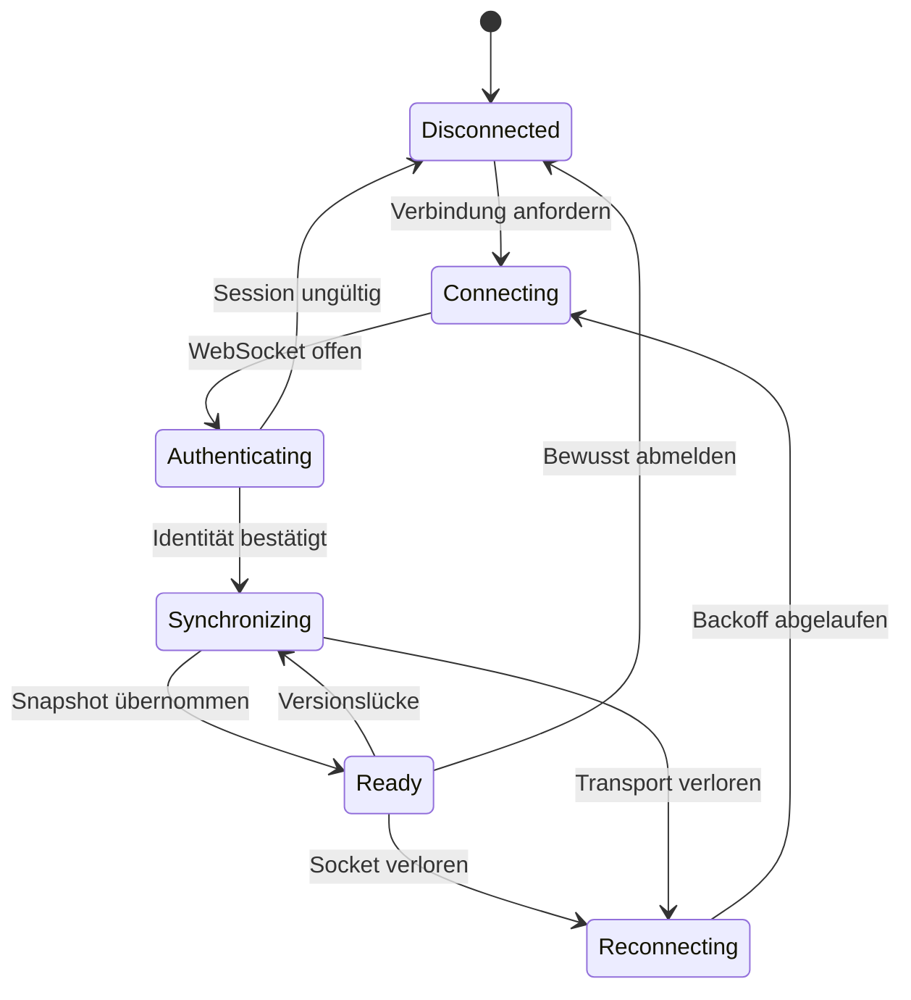

# Kapitel 20 — HTTP, WebSocketPeer und Wiederverbindung in Godot

[Dokumentationsindex](../INDEX.md) · [Vorheriges Kapitel](19-board-rendering.md) · [Nächstes Kapitel](21-lobby-ui.md)

## 1. Chapter Overview

Der statische NetworkService aus Kapitel 18 wird durch einen echten HTTP-/WebSocket-Adapter ersetzt. Die bisherigen Ansichten bleiben gegen dieselbe Servicegrenze programmiert. Das Kapitel endet mit einem diagnostischen Godot-Ablauf, der eine Session verwendet, einen autorisierten Snapshot empfängt und nach Socketverlust vollständig synchronisiert.

Noch sind Lobby- und Matchbedienung nicht fertig: Kapitel 21 und 22 bauen daraus den spielbaren Ablauf. Diese Trennung macht Netzwerkfehler untersuchbar, bevor sie zwischen Animationen und Menüs verschwinden.

## 2. Prerequisites

- Kapitel 09–19 abgeschlossen; laufender lokaler Backendstand aus M4 verfügbar.
- Vor Implementierung `HTTPRequest`, `WebSocketPeer`, GDScript-JSON und Node-Lebenszyklus studieren.
- [Authentifizierung](../protocol/authentication.md), [Nachrichten](../protocol/websocket-messages.md) und [State Synchronization](../protocol/state-synchronization.md) als verbindlichen Vertrag lesen.
- Statischer Testdienst bleibt verfügbar, damit Fehler im Netzwerkadapter nicht als Darstellungsfehler fehlgedeutet werden.

## 3. Learning Objectives

- HTTP-Transportfehler, Statuscode und fachlichen Fehler getrennt auswerten.
- `WebSocketPeer` regelmäßig pollen und Open, Closing sowie Closed korrekt behandeln.
- Eingehendes JSON vor Anwendung nach Schema, Zahlenbereich und Version prüfen.
- Nach Reconnect denselben Gast authentifizieren, Snapshot übernehmen und unklare Commands mit derselben Request-ID abgleichen.
- Native Sessiongeheimnisse und browserbasierte Cookies nach unterschiedlichen Sicherheitsgrenzen behandeln.

## 4. Concepts and Theory

### HTTPRequest und asynchroner Abschluss

`HTTPRequest` ist ein Node, der einen HTTP-Vorgang startet und dessen Ergebnis später meldet. Ein erfolgreicher Startaufruf bedeutet noch keine erfolgreiche HTTP-Antwort. Transportresultat, HTTP-Status und JSON-Inhalt müssen separat geprüft werden. Kiban trennt etwa nicht erreichbaren Server, 401 und einen gültigen 200-Snapshot. Ein Node darf nicht gleichzeitig für mehrere unabhängige Requests verwendet werden. Diese Technik passt zu Sessions, Lobby und History. [Godot HTTPRequest](https://docs.godotengine.org/en/stable/classes/class_httprequest.html) dokumentiert Signale und Parallelitätsgrenzen.

### WebSocketPeer und Polling

`WebSocketPeer` benötigt nach dem Verbindungsstart regelmäßige `poll`-Aufrufe, um Zustand und Nachrichten fortzuschreiben. Auch Closing muss weiter gepollt werden, damit der Close-Handschlag abgeschlossen werden kann. Kiban bindet dies an die Lebensdauer des NetworkService, nicht an einen kurzfristigen Board-Node. Ein Socket ohne Polling wirkt häufig verbunden, empfängt aber nichts. Das Modell passt zu Godots Engine-Loop. [WebSocketPeer](https://docs.godotengine.org/en/stable/classes/class_websocketpeer.html) beschreibt Ready States, Paketabfrage und Textframes.

### Decoder und lokale Validierung

JSON ist ein Austauschformat, kein garantierter Domain-Typ. Der Protokollbereich für ganzzahlige Versionen ist 0 bis 2^53−1, damit auch die Godot-/Browsergrenzen verlustfrei bleiben. Der Decoder prüft Objektform, Pflichtfelder, erlaubte Typen, Ganzzahligkeit und die zentral festgelegten Zahlenbereiche. Besonders Versionen und Millisekunden dürfen durch Fließkommakonvertierung nicht stillschweigend ihre Bedeutung verlieren. IDs bleiben Strings; Zahlen müssen innerhalb der interoperablen Protokollgrenzen liegen. Ein Fehler wäre, jedes erfolgreiche JSON-Parsing sofort als vertrauenswürdigen Snapshot zu rendern. Lokale Validierung ist bei jeder externen Eingabe angemessen; [Godot JSON](https://docs.godotengine.org/en/stable/classes/class_json.html) beschreibt ihre konkreten Konvertierungen.

### Client State Machine

Eine Client State Machine unterscheidet Disconnected, Connecting, Authenticating, Synchronizing, Ready und Reconnecting. Eine offene TCP-/WebSocket-Verbindung ist noch nicht spielbereit. Erst gültige Identität und vollständiger Snapshot erlauben Moves. Diese Zustände verhindern, dass alte Brettdaten nach Reconnect sofort für neue Commands verwendet werden. Ein einzelnes `connected`-Boolean wäre dafür zu schwach. Das Modell passt zu mehrstufigen Sitzungen; [Reconnect-Architektur](../architecture/reconnection.md) definiert die fachliche Reihenfolge.

### Sessiongeheimnisse in Native und Web

Ein Native-Client kann einen opaken Token bewusst in einem lokalen Sessionstore halten; dauerhafte Speicherung gehört möglichst in einen OS-geschützten Secret Store. Fehlt ein sicherer Store, bleibt der Token ausschließlich für die laufende Sitzung im Speicher. Eine gewöhnliche Datei ist kein verschlüsselter Tresor und wird nicht als Fallback verwendet. Ein Browserclient verwendet die vom Server gesetzte HttpOnly-/Secure-/SameSite-Cookie-Session und erhält keinen Token für JavaScript. Einladungen gehören weder in Sessionheader noch in Logs. Das passt zu unterschiedlichen Plattformgrenzen. [OWASP Session Management](https://cheatsheetseries.owasp.org/cheatsheets/Session_Management_Cheat_Sheet.html) erläutert Cookieattribute und Tokenrisiken.

### Retry und fachliche Ungewissheit

Ein Timeout ist zunächst eine lokale Beobachtung, keine sichere Aussage über fehlende Serverwirkung. Nach einem unklaren Move hält der Client die ursprüngliche Request-ID und den Payload, reconnectet und fragt den Zustand ab beziehungsweise wiederholt nach dem Receipt-Vertrag. Create und andere POSTs dürfen nicht pauschal als neue Requests wiederholt werden. Diese Unterscheidung passt zu jeder Operation mit möglichem Commit. [Kapitel 16](16-reconnection.md) liefert die bereits eingeführte Idempotency-Theorie; hier wird sie in den Godot-Lebenszyklus übersetzt.

## 5. Architectural Context

NetworkService besitzt HTTP-Requestkontexte, Socket, Connection Generation und Verbindungs-State-Machine. Er dekodiert zu validierten DTOs und meldet sie an die Controller. MatchController besitzt bestätigten View State. Die BoardView kennt weiterhin keinen Socket und keine Token.

Der Service kann bereits mit einer diagnostischen Szene arbeiten, die State und Snapshotversion anzeigt. Die spätere Lobby-UI ist deshalb keine Voraussetzung dieses Kapitels.

## 6. Design Decisions

**Verbindlich:** HTTP für Session, Lobby und History; WebSocket für Liveabonnement und Spielcommands. Alles über einen einzigen Socket wäre machbar, würde Browser- und Terminaldiagnose sowie HTTP-Fehlersemantik unnötig erschweren. Doppelte mutierende Wege für denselben Move werden vermieden.

**Verbindlich:** Native Authentifizierung verwendet die erste `authenticate`-Nachricht mit Token; Browser verwenden die bereits beim Upgrade verifizierbare Cookie-Session und eine entsprechende Nachricht ohne Token. Geheimnisse erscheinen nie in der WebSocket-URL. Die konkreten Umschläge bestimmt der [Authentifizierungsvertrag](../protocol/authentication.md).

**Verbindlich:** Ein vollständiger Snapshot ersetzt den bestätigten Clientzustand atomar. `game_event` trägt ebenfalls einen vollen projizierten Zustand; der Client prüft zuerst Version und Datenform. Das ist bei kleinen Brettern einfacher als mehrere fehleranfällige Deltareducer. Bei großen Zuständen wäre Bandbreite neu zu messen.

**Verbindlich:** Nach Socketverlust sind mutierende Eingaben gesperrt, bis Authentifizierung und Resync abgeschlossen sind. Lokale Offlinezüge wären eine andere Produktfunktion und hätten keine serverseitige Zeitgarantie.

## 7. Implementation Tasks

- [ ] Die NetworkService-Schnittstelle aus Kapitel 18 gegen alle benötigten REST- und WS-Verträge abgleichen. Prüfung: Ansichten müssen für den Adaptertausch nicht umgebaut werden.
- [ ] Base-URL und Umgebung lokal konfigurierbar machen. Prüfung: Produktions-HTTPS ist vom lokalen HTTP-Test getrennt und keine Secrets stehen in Projektdateien.
- [ ] HTTP-Requestkontexte mit Request-ID und Lebensdauer führen. Prüfung: zwei parallele Abfragen werden nicht anhand ihres Abschlusszeitpunkts verwechselt.
- [ ] Pro gleichzeitigem HTTP-Vorgang einen zulässigen `HTTPRequest`-Nutzungspfad wählen. Prüfung: keine konkurrierenden Aufrufe auf demselben belegten Node.
- [ ] Transportfehler vor Statuscode und Body auswerten. Prüfung: DNS-/Verbindungsfehler wird nicht als JSON-Fehler angezeigt.
- [ ] Statusklassen und stabile API-Fehlercodes abbilden. Prüfung: 401 führt zur Sessionentscheidung, 409 zu Zustandsabgleich, 5xx zu begrenztem Retryhinweis.
- [ ] Native Gastsession über `/api/v1/guest-sessions` beziehen und Token ausschließlich im zuständigen Store halten. Prüfung: kein UI-Signal und kein Log trägt den Klartexttoken.
- [ ] Browser-Cookiefluss getrennt gegen dieselbe Origin planen. Prüfung: kein Token wird für JavaScript aus einer HttpOnly-Session herausgelesen.
- [ ] Einen `WebSocketPeer` im langlebigen Service erstellen und regelmäßig pollen. Prüfung: diagnostische Szene empfängt Nachrichten auch nach Wechsel der Board-Szene.
- [ ] Open, Closing und Closed explizit behandeln. Prüfung: Closing wird bis zum Abschluss weiter gepollt und nicht vorschnell als aktiver Spielzustand verwendet.
- [ ] Die richtige Authentifizierungsnachricht erst nach Open senden. Prüfung: davor wird kein `subscribe_game` gesendet.
- [ ] Eingehende Textnachrichten nach Größenlimit und JSON-Form prüfen. Prüfung: ungültiges Objekt führt zu kontrolliertem Protokollfehler, nicht Teilzustand.
- [ ] IDs, Zahlen und Pflichtfelder in validierte Client-DTOs überführen. Prüfung: nichtganzzahlige oder außerhalb der Grenze liegende Versionen werden abgelehnt.
- [ ] Nach Authentifizierung das Spiel abonnieren und auf vollständigen Snapshot warten. Prüfung: Ready wird vorher nie erreicht.
- [ ] Snapshot atomar an den Controller übergeben. Prüfung: Board, Zugrecht, Uhr und Ergebnis stammen aus derselben Version.
- [ ] Volle `game_event`-Projektionen mit der erwarteten Folgeversion anwenden. Prüfung: Duplikat ignorieren, Lücke sperren und `resync` anfordern.
- [ ] Pro Principal und Partie höchstens einen ausstehenden mutierenden Command mit unveränderlicher Request-ID halten. Prüfung: Antwortverlust erzeugt keinen neuen Versuch mit anderer ID.
- [ ] Connection Generation vor jedem Callback prüfen. Prüfung: verspäteter alter Close verändert die neue Verbindung nicht.
- [ ] Exponential Backoff mit begrenztem Maximum und Jitter umsetzen. Prüfung: viele simulierte Reconnects verteilen sich; 401 läuft nicht in einer Endlosschleife.
- [ ] Beim Szenenende nur szenenlokale Abonnements lösen. Prüfung: globale Transportverbindung bleibt bei normaler Navigation bewusst erhalten oder endet nach dokumentierter Policy.
- [ ] Bewusstes Logout über `/api/v1/session/revoke` und lokale Bereinigung vorsehen. Prüfung: alter Token funktioniert nicht und wird nicht versehentlich erneut gesendet.
- [ ] Diagnostischen Snapshot- und Reconnect-Ablauf gegen den lokalen Backendstand ausführen. Prüfung: dieselbe Game-ID und Spielerrolle bleiben nach Socketverlust erhalten.
- [ ] Native und gegebenenfalls Webexport getrennt prüfen. Prüfung: TLS-/Origin-/Cookiefehler sind reproduzierbar, Zertifikatsprüfung bleibt aktiv.

## 8. Public Interfaces and Contracts

`NetworkService` bietet Sessionbezug, Lobbyoperationen, Subscription und Versand validierter Game-Commands an. `ConnectionStatus` beschreibt den lokalen Kommunikationszustand. `SnapshotReceived`, `GameStateReceived` und `CommandCompleted` sind fachliche Meldungen an Controller, keine direkten Boardmutationen.

Der Native-Token wird nur am vorgesehenen Authentifizierungspfad verwendet. Browserauthentifizierung hängt vom Cookie- und Originvertrag ab; Browser erlauben nicht beliebige native Handshakeheader. Game-/Request-IDs sind Strings. `expected_version`, `state_version` und Millisekundenwerte halten die Zahlenbereiche des [Wire-Vertrags](../protocol/websocket-messages.md) ein. Clock-Daten verwenden `remaining_ms` mit `red` und `black`, `active_side` und `sampled_at_server_ms`. Letzterer Wert ist UTC-Diagnose und keine vertrauenswürdige Quelle für einen Client-Timeout.

Pro Principal und Partie hält der Client höchstens eine neue Mutation offen; der Server muss dennoch Mehrgeräte-Races korrekt abweisen. `command_ack` bestätigt das ursprüngliche Command-Ergebnis. `game_event` liefert den projizierten Stand einer bestätigten Version. Der Client muss entweder Reihenfolge tolerieren: ein Event kann vor der zugehörigen lokalen ACK-Verarbeitung sichtbar werden. Pending State wird über Request-ID und Version aufgelöst, niemals durch blindes nochmaliges Anwenden einer lokalen Spielfunktion.

## 9. Edge Cases

- HTTP-Start ist erfolgreich, Antwort wird 500: getrennte Fehlerpfade, kein vermeintlicher Erfolg.
- HTTP-Antwort geht nach erfolgreichem Create verloren: keinen pauschalen neuen Create ohne den zentralen Wiederholungsvertrag auslösen.
- WS ist offen, Authentifizierung scheitert: nicht Ready, keine Spielprojektion.
- Zwei Snapshots aus alter und neuer Connection treffen ein: nur aktuelle Generation anwenden.
- Server sendet ungültige oder inkompatible Daten: Eingaben sperren, diagnostischen Fehler ohne Geheimnisse melden.
- Browser blockiert Mixed Content bei HTTPS-Seite und `ws://`: korrekt `wss://` konfigurieren.
- Netzwerk fällt bei laufender Uhr aus: Anzeige als unsicher kennzeichnen; Uhr läuft serverseitig weiter.
- Native Dateispeicherung ist manipulierbar: Tokenverlust beziehungsweise -diebstahl ist ein Sessionproblem, kein Grund für selbst behauptete Identität.
- Scene Tree ist pausiert: bewusst prüfen, ob der langlebige NetworkService weiter pollt; keine unbemerkte Verbindungspause.

## 10. Testing Requirements

| Given | When | Then |
|---|---|---|
| Lokaler Server erreichbar | Gastsession beziehen und WS öffnen | Authentifizierte Verbindung, dann Snapshot |
| HTTP-Transport scheitert | Anfrage abschließen | Transportfehler ohne JSON-Interpretation |
| Gültiger Transport, HTTP 401 | Antwort empfangen | Sessionzustand ungültig, kein blinder Retry |
| Offener WS ohne Auth-Erfolg | Controller versucht Move | Kein Versand |
| Version N bestätigt | Event N empfangen | Keine doppelte Zustandsanwendung |
| Version N bestätigt | Event N+2 empfangen | Mutationen gesperrt, Resync |
| Neuer Socket Ready | Alter Callback liefert Snapshot | Snapshot wird ignoriert |
| ACK eines akzeptierten Moves geht verloren | Reconnect und identischen Retry ausführen | Eine serverseitige Wirkung, Pending State endet |
| JSON-Version ist nicht ganzzahlig | Decoder aufrufen | Keine Teilanwendung |
| Laufende Partie | Socket trennen und später reconnecten | Aktueller Serverstand einschließlich möglichem Timeout |
| Logout erfolgreich | Alten Token erneut verwenden | Zugriff verweigert |

Decoder mit festen JSON-Fixtures testen; Transport mit kontrolliertem lokalen Server oder Testadapter. Mindestens einen echten Backend-Reconnect zusätzlich nachweisen. Die spätere E2E-Suite in Kapitel 23 automatisiert den kompletten Spielablauf, ist aber keine Voraussetzung für diesen Adaptertest.

## 11. Definition of Done

- [ ] HTTP-Transport-, Status- und Domain-Fehler sind getrennt behandelt.
- [ ] Socket wird korrekt gepollt, authentifiziert und sauber geschlossen.
- [ ] Ungültige Daten können keinen teilweise angewendeten Match State erzeugen.
- [ ] Reconnect erhält Identität und Rolle und verlangt vor Moves einen Snapshot.
- [ ] Retry nutzt vorhandene Request-ID; alte Connection-Callbacks bleiben wirkungslos.
- [ ] Native Geheimnisse und Browsercookies erscheinen weder in URLs noch Logs.
- [ ] Eine diagnostische Godot-Szene zeigt echte Snapshotversionen vom Backend; Lobby- und Match-UX bleiben die nächsten Schritte.

## 12. Common Pitfalls

`HTTPRequest.request` bestätigt nur den Start, nicht den fachlichen Erfolg. Ein `WebSocketPeer` ohne regelmäßiges Polling ist kein funktionsfähiger Transport. Ein Raw-Dictionary direkt an die Ansicht durchzureichen verteilt Schemaannahmen über das ganze Projekt. Ein Retry mit neuer Request-ID kann Doppelwirkungen erzeugen. Native Header- und Tokenkonzepte unverändert auf den Browser zu übertragen scheitert an dessen Sicherheitsgrenzen. Zertifikatsprüfung abzuschalten verdeckt schließlich eine falsche TLS-Konfiguration und ist keine akzeptable Reparatur.

## 13. Reflection Questions

1. Welche drei Fehlerstufen hat eine HTTP-Anfrage?
2. Warum ist ein offener WebSocket noch kein spielbereiter Zustand?
3. Welcher Node besitzt das Polling während eines Szenenwechsels?
4. Warum prüft ein reiner Anzeigeclient dennoch eingehende Zahlenbereiche?
5. Was unterscheidet Native-Tokenhandling vom browserbasierten Cookiefluss?
6. Welche Daten braucht der Client nach verlorenem ACK für einen sicheren Retry?
7. Wie verhindert Connection Generation einen Fehler durch verspätete Callbacks?
8. Warum darf eine lokal bei null angekommene Uhr beim Reconnect keinen Sieger festlegen?

## 14. Further Reading

- [Godot HTTPRequest](https://docs.godotengine.org/en/stable/classes/class_httprequest.html): Completion-Signal, Result und parallele Nutzung studieren.
- [Godot WebSocket Tutorial](https://docs.godotengine.org/en/stable/tutorials/networking/websocket.html) und [WebSocketPeer](https://docs.godotengine.org/en/stable/classes/class_websocketpeer.html): Polling und Ready States vor der Integration praktisch untersuchen.
- [Godot JSON](https://docs.godotengine.org/en/stable/classes/class_json.html): Konvertierungen und Parserfehler gegen eigene Fixtures testen.
- [OWASP Session Management](https://cheatsheetseries.owasp.org/cheatsheets/Session_Management_Cheat_Sheet.html): Cookieattribute und lokale Geheimnisse nach Plattform unterscheiden.
- [State Synchronization](../protocol/state-synchronization.md): Versionen, Pending Commands und vollständige Resynchronisierung als einen Ablauf prüfen.

## 15. Completion Record

| Feld | Eigener Eintrag |
|---|---|
| Abschlussdatum | |
| Entwurfsentscheidungen | |
| Herausforderungen | |
| Ausgeführte Tests und Ergebnisse | |
| Verbleibende technische Schulden | |
| Lernerfahrungen | |
