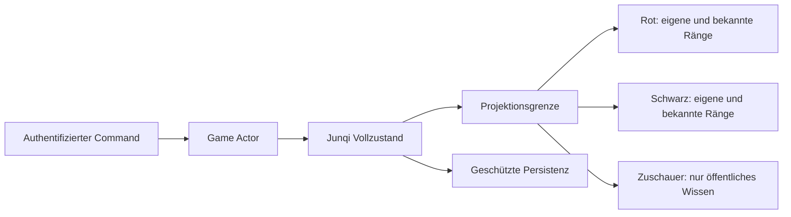

# Kapitel 30 — Junqi, Hidden Information und Multi-Game-Grenzen

[Dokumentationsindex](../INDEX.md) · [Projektfortschritt](../checklists/project-progress.md)

## 1. Chapter Overview

Du beweist, dass Kiban eine Plattform und keine umbenannte Xiangqi-Anwendung ist. Du ergänzt einen zweiten deterministischen Regelkern mit anderen Koordinaten, Aufstellungsphase, verdeckten Identitäten und empfängerabhängigen Zuständen. Authentication, Lobby, Actorlaufzeit, Persistenz und Transport werden wiederverwendet; ein Xiangqi-Brett wird nicht zum universellen Spielbrett verbogen.

Das konkrete Lernprofil heißt `kiban-junqi-open-v1`. „open“ bedeutet offen veröffentlichte Spezifikation, ausdrücklich keine offenen Ränge. Es ist eine selbst definierte, ungewertete Zweipersonen-Lehrvariante mit verdeckten Rängen, ohne Spieluhr. Sie behauptet weder chinesische Verbandskonformität noch Kompatibilität zu einer bestimmten kommerziellen Junqi-Version. Ihre vollständigen Regeln stehen hier und in [Junqi-Varianten](../rules/junqi-variants.md).

## 2. Prerequisites

- Kapitel 01–29 abgeschlossen, insbesondere reine Enginegrenzen und serverseitige Projektionen.
- Graphbegriffe Knoten/Kante/Pfad und Breitensuche vor dem Railroad-Teil auffrischen.
- [Multi-Game-Architektur](../architecture/multigame.md), [Variantenentscheidungen](../rules/junqi-variants.md) und [Regeltestpositionen](../rules/rule-test-positions.md) lesen.
- Das bestehende Xiangqi-MVP und seine Regressionstests bleiben lauffähig. Junqi wird zuerst als reine Engine und Terminaladapter getestet; Godot folgt danach.

## 3. Learning Objectives

- Der Entwickler kann unterscheiden, welche Infrastruktur spielneutral ist und welche Zustände ausdrücklich variantenspezifisch bleiben.
- Er kann Junqi-Aufstellung, Railway-Erreichbarkeit und Kampfergebnis anhand der festgelegten Variante erklären und testen.
- Er kann zwei verschiedene geheime Zustände mit identischer erlaubter Sicht als gleiche Player-DTOs ausgeben.
- Er kann nachweisen, dass REST, WS, Reconnect, Replay, Fehler und Logs keine unberechtigten Ränge verraten.
- Er kann ein zweites Spiel integrieren, ohne Authentication, Lobbys oder WebSockettransport zu duplizieren.

## 4. Concepts and Theory

### Variant Contract statt vermeintlichem Universalregelwerk

**Definition:** Ein Variant Contract legt Brettgraph, Phasen, Figuren, Bewegung, Kampf und Sichtbarkeit eindeutig fest. **Motivation:** Junqi umfasst unterschiedliche Spielerzahlen und Informationsmodelle; eine abstrakte Bezeichnung genügt nicht. **Einsatz:** Jede Partie speichert `game_kind=junqi` und `ruleset_id=kiban-junqi-open-v1` unveränderlich. **Fehler:** Regeln von verschiedenen Varianten still mischen. **Geeignet:** Jedes neue Spiel und jede Regeländerung. **Vertiefung:** [Variantenkatalog](../rules/junqi-variants.md).

### Hidden Information und Knowledge State

**Definition:** Der autoritative Zustand enthält alle Figurenidentitäten; ein Knowledge State beschreibt, welche Identitäten ein Empfänger kennen darf. **Motivation:** Das UI darf Geheimnisse nicht nur optisch verstecken. **Einsatz:** Eigene Ränge sind bekannt, gegnerische zunächst unbekannt; an Kampf beteiligte Identitäten werden dauerhaft öffentlich, Tod eines Commanders enthüllt seine Flagge. **Fehler:** Gefallene Figuren, Fehlertexte oder Replay erhalten versehentlich Vollzustand. **Geeignet:** Verdeckte Spiele. **Vertiefung:** OWASP Authorization und [Projektionsmodell](../architecture/multigame.md).

### Graph Movement und Railway Reachability

**Definition:** Ein Brettgraph beschreibt erlaubte Verbindungen unabhängig von Bildschirmgeometrie. **Motivation:** Junqi enthält Straßen, Camps und längere Railwayzüge, die kein Xiangqi-Movement ausdrückt. **Einsatz:** Ein Engineer darf auf zusammenhängenden freien Railwaykanten abbiegen; andere bewegliche Figuren fahren nur entlang einer geraden Railwaylinie. **Fehler:** Pixelnachbarschaft oder Diagonalen des Zeichenbildes als Regeln verwenden. **Geeignet:** Dieses feste Brett und spätere graphbasierte Varianten. **Vertiefung:** Eigene Graphinvarianten vor Implementierung beweisen und die Rust-Collections-Dokumentation für Besuchsmengen lesen.

### Simultaneous Setup und Ready Barrier

**Definition:** Beide Spieler legen unabhängig geheim auf; `ready` sperrt die eigene Aufstellung, Aktivierung erfolgt erst nach beiden Ready-Transitions. **Motivation:** Öffentliche Teilaufstellungen könnten dem Gegner einen unfairen Informationsvorteil geben. **Einsatz:** Server validiert vollständige eigene Aufstellung vor `ready_deployment`; Gegner sieht nur Bereitschaft, nie Ränge. **Fehler:** Ein zweites Setup nach Ready verändern oder zwei Aktivierungen bei parallelem Ready auslösen. **Geeignet:** Hidden-Deployment-Spiele. **Vertiefung:** [Actor Model](../architecture/actor-model.md).

### Information Noninterference

**Definition:** Unterschiede ausschließlich in geheimen Daten dürfen nicht in erlaubten Ausgaben sichtbar werden. **Motivation:** Nicht nur Felder, auch Reihenfolge, IDs und Fehlerdetails können Geheimnisse kodieren. **Einsatz:** Zwei Zustände mit vertauschten unbekannten Gegnerrängen erzeugen identische öffentliche Ansichten. **Fehler:** intern nach Rang sortierte Figurenlisten oder IDs, die den Rang enthalten. **Geeignet:** Projektion, Replay, Validierungsfehler und Observability. **Vertiefung:** [Securitytests](../testing/security-tests.md).

## 5. Architectural Context

Ein neuer geplanter Crate `kiban-junqi` besitzt Graph, Deployment, Kampf und Knowledge State. `kiban-xiangqi` bleibt unabhängig. `kiban-application` vermittelt über eine explizite Spieltypgrenze Commands und Outcome, ohne beide Interna in ein gemeinsames Feldarray zu zwingen. Das initiale Plattform-Dispatch darf ein bewusstes Enum mit getrennten Zuständen sein; ein dynamisches Plugin-System ist nicht erforderlich.

Jeder Commit erzeugt empfängerbezogene Projektionen aus demselben Zustand. Ein global einmal serialisiertes internes `game_event` darf nicht an alle weitergereicht werden. Persistierte interne Events sind nur Serverdaten; Historie projiziert sie erneut für die jeweilige Berechtigung.

## 6. Design Decisions

**Verbindlich:** Die Zweipersonen-Lehrvariante statt Vierpersonen-Team-Junqi. Teamkommunikation, Partnerwissen und Kollusion würden das erste Hidden-Information-Lernziel stark vergrößern. Die vereinfachte Variante ist vollständig testbar, aber kein Ersatz für Turnierregeln. Ein anderes Informationsmodell bekommt eine neue Regelprofil-ID.

**Verbindlich: Brett und Graph.** Felder `(x,y)` mit x=0..4 und y=0..11, Rot unten bei y=0, Schwarz oben bei y=11. Straßen verbinden alle orthogonalen Nachbarn. Zusätzliche diagonale Straßen verbinden genau diagonal benachbarte Felder, wenn mindestens eines ein Camp ist. Rote Camps: (1,2), (3,2), (2,3), (1,4), (3,4); schwarze Camps entstehen durch y→11−y. Rote HQ: (1,0), (3,0); schwarze HQ gespiegelt. Railwaykanten verbinden orthogonal benachbarte Felder auf derselben ausgewiesenen Linie: ganze Zeilen y=1,5,6,10 und Spalten x=0,4 für y=1..10. Es gibt keine sonstigen Railwaykanten. Straßen und Railway dürfen denselben Feldnachbarn verbinden.

**Verbindlich: Aufstellung.** Rot belegt alle 25 Nicht-Camp-Felder der Zeilen 0..5, Schwarz alle 25 Nicht-Camp-Felder der Zeilen 6..11. Ein HQ enthält die Flagge; das andere darf eine beliebige andere Figur enthalten. Jede Figur im HQ ist unbeweglich, unabhängig von ihrem Rang. Mines liegen nur in den hintersten zwei Reihen (Rot0/1, Schwarz10/11); Bombs nicht auf der Frontreihe Rot5/Schwarz6. Camps bleiben anfangs leer. Nach Ready ist die eigene Aufstellung unveränderlich. Vor beiden Ready ist Cancel erlaubt und führt `cancelled` ohne Wertung herbei; Red beginnt nach genau einer gemeinsamen Aktivierung.

**Verbindlich: Bewegung.** Flags und Mines sind unbeweglich; HQ-Belegung ebenfalls. Ein normaler Roadzug geht genau eine Straßenkante, einschließlich erlaubter Campdiagonale. Ein Railwayzug benutzt ausschließlich Railwaykanten: Engineer darf an Junctions abbiegen, andere bewegliche Figuren bleiben auf einer geraden Zeile oder Spalte. Zwischenfelder müssen leer sein; eigene Figuren blockieren und können nicht geschlagen werden; erste gegnerische Figur darf ausschließlich als Ziel angegriffen werden. Ein besetztes Camp kann niemals angegriffen werden, auch nicht durch Railway oder Bomb. Leere Camps sind betretbar. Man darf die Bewegungsarten nicht in einem Zug kombinieren.

**Verbindlich: Figuren und Kampf.** Jeder Spieler besitzt 25 Figuren: Commander Rang1×1, General Rang2×1, Division Rang3×2, Brigade Rang4×2, Regiment Rang5×2, Battalion Rang6×2, Company Rang7×3, Platoon Rang8×3, Engineer Rang9×3, Mine×3, Bomb×2 und Flag×1. Kleinere Rangzahl gewinnt gegen größere; gleiche Ränge entfernen beide. Bombbeteiligung entfernt beide Figuren unabhängig vom anderen Rang oder Mine. Engineer besiegt eine Mine und besetzt ihr Feld; jede andere normale angreifende Rangfigur verliert gegen Mine, Mine bleibt. Flagge ist von jeder beweglichen Figur schlagbar; falls Angreifer Bomb ist, wird auch sie entfernt. Jede Flaggeneroberung beendet sofort mit Sieg. Beim Kampf werden beide Identitäten und das Ergebnis öffentlich, inklusive entfernter Figuren. Überlebende bleiben dauerhaft identifiziert. Stirbt Commander, wird zusätzlich die eigene Flaggenposition öffentlich.

**Verbindlich: Ende und Wissen.** Flaggeneroberung hat Vorrang, danach keine legale Bewegung beim nächsten Spieler bedeutet dessen Niederlage. Andernfalls führt der 300. abgeschlossene Halbzug zu Draw; der Zähler wird nicht durch Capture zurückgesetzt. Keine weitere automatische Repetitionregel. Resignation bleibt möglich. Das Pilotprofil ist untimed und unrated. Gegnerische unveröffentlichte Ränge bleiben auch nach Ergebnis und im Replay geheim; Zuschauer erhalten nur öffentliches Wissen, niemals die Vereinigung beider privaten Playeransichten. Ein späterer vollständiger Reveal benötigt ein neues explizites Regelprofil.

## 7. Implementation Tasks

- [ ] 1. Schreibe die Variantenentscheidung und alle genannten Koordinaten als überprüfbare Regelmatrix in die Regelunterlagen. Prüfe 60 Felder, 10 Camps, 4 HQ und 25 Deploymentfelder pro Seite rechnerisch; kein Parser soll fehlende Regeln erraten.
- [ ] 2. Ergänze `game_kind`-Dispatch und einen separaten Junqi-Kern. Führe die gesamte Xiangqi-Testsuite unverändert aus; keine Xiangqi-Palace- oder Riverdaten dürfen in Junqi-Strukturen landen.
- [ ] 3. Modelliere Knoten und getrennte Road-/Railwaykanten. Prüfe Symmetrie, keine Selbstkanten und korrekte gespiegelte Lager; zähle die tatsächlichen Kanten und halte die Zählwerte als Regression fest.
- [ ] 4. Modelliere Figuridentität unabhängig von Geheimhaltung und Position. Piece-IDs bleiben zufällig beziehungsweise rangneutral stabil; vertauschte unbekannte Ränge dürfen keine ID- oder Sortierinformation verraten.
- [ ] 5. Ergänze Deploymentvalidierung mit 25 eindeutigen Figuren und Feldern. Prüfe Counts, Flag-HQ, Mine-Reihen, Bomb-Frontverbot und freie Camps separat; Fehler an den eigenen Auftraggeber dürfen dessen Daten, nicht gegnerische Daten erklären.
- [ ] 6. Implementiere `submit_deployment` als vollständigen privaten Ersatz vor eigenem Ready. Wiederhole dieselbe ID idempotent; geänderte Payload mit derselben ID erzeugt Konflikt. Gegner erhält ausschließlich öffentlichen Setupstatus.
- [ ] 7. Implementiere `ready_deployment` über den Actor. Nur gültige vollständige eigene Aufstellung wird locked; zwei gleichzeitige Ready-Kommandos aktivieren genau einmal mit Rot am Zug.
- [ ] 8. Ergänze Cancel vor beidseitiger Ready-Barriere. Nach Aktivierung muss derselbe Auftrag den aktiven Zustand respektieren und darf nicht rückwirkend abbrechen; teste die Reihenfolge am Actor.
- [ ] 9. Ergänze Ein-Kanten-Roadbewegung. Prüfe orthogonale Wege, Campdiagonalen, eigenes Ziel, unbewegliche Mine/Flag/HQ und geschützte Campbelegung mit kleinen Teilstellungen.
- [ ] 10. Ergänze gerade Railwaybewegung für normale bewegliche Figuren. Belege freie Zwischenfelder, Verbot des Abbiegens und Ende am ersten Gegner; eine Roadkante am Anfang oder Ende darf keine unzulässige Kombination schaffen.
- [ ] 11. Ergänze Railway-Erreichbarkeit für Engineer. Zweck ist die Menge erreichbarer freier Ziele sowie erster angreifbarer Gegner; Eingabe ist fester Graph mit Belegung, Ausgabe sind mögliche Ziele. Invariante: besuchte Felder nie mehrfach expandieren, keine Figur überspringen. Grenze ist O(V+E), hier V=60; teste Abbiegen, Loop, Blockade und geschütztes Camp.
- [ ] 12. Implementiere eine reine Kampftabelle vor Gesamtspielintegration. Prüfe alle Rangpaare, Gleichstand, Engineer/Mine, andere Rangfigur/Mine, Bomb/Mine und Bomb/Flag; jeder Ausgang hat eindeutige Überlebende und Zielbelegung.
- [ ] 13. Verbinde Kampf mit Knowledge-Transitions. Beide Kampfränge werden öffentlich, Commander-Verlust enthüllt Flag; prüfe, dass unbekannte unbeteiligte Figuren identisch verborgen bleiben.
- [ ] 14. Ergänze Endprüfung in fester Reihenfolge: Flaggeneroberung, kein legaler Zug des Folgespielers, dann Halbzug300-Draw. Prüfe Konflikt am letzten Halbzug; Aufgabe und Cancel bleiben verschiedene Ergebnisse.
- [ ] 15. Implementiere getrennte `PlayerView` und `PublicView` aus dem Vollzustand. Gegner unbekannt wird mit erlaubtem Besitzer, Piece-ID und Position ohne Rang ausgegeben; eigene Ränge bleiben privat. Teste synthetisch zwei geheim unterschiedliche, öffentlich identische Zustände.
- [ ] 16. Erweitere `make_move` um variantenspezifische Payloadvalidierung. Gleiche Envelopefelder und Authentifizierung bleiben erhalten; fremde Spieltypdaten werden ohne Mutation abgelehnt.
- [ ] 17. Erweitere persistierte Aggregate, Events und Snapshots um versionierte Junqidaten. Commitgrenze und Receiptlogik bleiben unverändert; Replay und REST projizieren jedes historische Stadium erneut für den berechtigten Empfänger.
- [ ] 18. Prüfe Reconnect während Setup und laufendem Spiel. Eigener Snapshot enthält eigene Aufstellung und erlaubtes Wissen; Gegner-/Zuschauersnapshot enthält niemals die private Aufstellung, auch nach Serverrestart.
- [ ] 19. Baue erst nach bestandener Terminalabnahme eine Junqi-BoardView mit Roads, Camps, HQ und Rails. Separate Renderer dürfen denselben Network-Service verwenden; Godot berechnet keine verdeckten Kämpfe autoritativ.
- [ ] 20. Ergänze Godot-Aufstellungsoberfläche, Ready-Bestätigung und Unknown-Piece-Darstellung. Lokales Drag-and-drop arbeitet nur an eigener Aufstellung; nach Ready bleibt es gesperrt.
- [ ] 21. Führe eine vollständige Partie mit zwei Spielern und Zuschauer durch. Prüfe Flaggensieg, Resignation, No-Move-Verlust und 300-Ply-Draw mit Terminalfixtures; kontrolliere alle Responses und Logs auf verborgene Ränge.
- [ ] 22. Führe sämtliche bestehenden Xiangqi-MVP-, Account- und Protokolltests erneut aus. Dokumentiere Multi-Game-Grenzen und Erweiterungspunkte für Shogi/Go als Entscheidungen, ohne weitere Spiele zu implementieren.

## 8. Public Interfaces and Contracts

| Schnittstelle / Zustand | Verantwortung und Fehler |
|---|---|
| `JunqiState` | vollständige Figuren, Deploymentstatus, aktiver Sitz, öffentlicher Knowledge State und Halbzugzahl; niemals direkt serialisieren |
| `submit_deployment` | authentifizierter eigener Sitz, vollständige25-Figuren-Aufstellung, `request_id`, `expected_version`; Fehler bei Phase, Counts oder Position |
| `ready_deployment` | eigene gültige Aufstellung sperren; gemeinsame Aktivierung genau einmal |
| `make_move` | bestehendes Envelope, Junqi-Quell-/Zielfeld; Reihenfolge Authorization, Phase, Clockpolicy deaktiviert, Bewegung, Kampf, Ergebnis, Persistenz |
| `PlayerView` | eigene Ränge plus öffentlich bekannte gegnerische Ränge; private Setupdaten nur an Eigentümer |
| `PublicView` | öffentliche Positionen und bereits bekannte Kampfinformationen, kein privater Rang |
| `game_event` | derselbe bestätigte `state_version`, aber empfängerbezogene vollständige Projektion |
| Persistenz/Replay | internes Vollwissen nur serverseitig; jeder Leseweg projiziert rollen- und zeitpunktgerecht |

Deploymentantworten und Commits unterliegen derselben Receiptregel: Duplicateprüfung vor Versionsprüfung. Bei Restart werden bereits aktive Junqi-Partien ebenfalls `aborted(server_restart)`; unbestätigte private Änderungen werden nie aus Clientcache als Serverwahrheit übernommen.

## 9. Edge Cases

- 25 Figuren auf nur20 vermeintlichen Feldern: Deshalb gehören in diesem Profil sechs Heimatreihen einschließlich Frontbahn zur Aufstellung.
- Bomb greift Flag am Halbzug300 an: Flag fällt, Angreifer ebenfalls; Sieg vor Draw.
- Commander und gegnerische Bomb entfernen sich gemeinsam: Commanderflagge wird öffentlich, andere Ränge bleiben geheim.
- Engineer erreicht ein Ziel über mehrere Wege: ein Ziel erscheint einmal, keine unendliche Suche.
- Ein gegnerischer Campbesetzer blockiert eine vermeintliche Railwayroute: er ist nicht schlagbar und nicht überspringbar.
- Ein beweglicher Rang sitzt im HQ: er hat in dieser Variante keine Bewegung, auch wenn sein Rang normalerweise mobil ist.
- Zweiter Ready und Cancel laufen gleichzeitig: Actorreihenfolge entscheidet `cancelled` oder genau eine Aktivierung.
- Fehler nennt gegnerischen Rang: selbst ohne Snapshot wäre das ein Informationsleck.
- Partie endet: keine Vollfreigabe unbekannter Figuren, auch nicht im heruntergeladenen Replay.
- Zuschauer sieht beide Spieleransichten vereinigt: Dies würde alle Ränge verraten; PublicView ist allein die öffentliche Wissensmenge.

## 10. Testing Requirements

| Given | When | Then |
|---|---|---|
| Vollständige gültige Aufstellung | eigener Ready | eigene Aufstellung locked; Gegner sieht nur Readyflag |
| Zwei Readyaufträge | gleichzeitig verarbeitet | genau eine Aktivierung, Rot beginnt |
| Eigenes Ready bereits committed | neue Aufstellung gesendet | Phasefehler ohne Änderung |
| Mine in roter Frontreihe5 | Deploymentvalidierung | Ablehnung vor Aktivierung |
| Rangfigur auf freier gerader Rail | Zug über freie Zwischenfelder | legal; bei Zwischenblockade illegal |
| Engineer an Railwayjunction | freier geknickter Railpfad | legal; für normale Rangfigur derselbe Zielpfad illegal |
| Besetztes gegnerisches Camp | beliebiger Captureversuch | illegal ohne Enthüllung des unbekannten Rangs |
| Engineer gegen Mine | legaler Capture | Mine entfernt, Engineer bleibt, beide Identitäten öffentlich |
| Normaler Rang gegen Mine | legaler Capture | Angreifer entfernt, Mine bleibt, beide bekannt |
| Bomb gegen Flag auf Halbzug300 | legaler Capture | beide entfernt, Flaggensieg statt Draw |
| Commander stirbt | Kampf committed | eigene Flag öffentlich, unbeteiligte geheime Ränge unverändert |
| Folgespieler ohne legalen Zug | vorheriger Zug beendet | No-Move-Verlust vor Halbzugdraw |
| Zwei Zustände unterscheiden nur geheime Gegnerränge | PublicView erzeugt | identische Ausgabe einschließlich Reihenfolge und Feldstruktur |
| Partie endet mit unbekannten Rängen | Replay und Reconnect | weiterhin keine unbekannten Identitäten im Response |
| Zugcommit vor Broadcastcrash | Server startet erneut | Zug einmal erhalten, aktive Partie aborted und unrated |

Kampftests verwenden eine vollständige Paarmatrix; Graph- und Sichtbarkeitstests sind reine deterministische Tests. Protokolltests vergleichen rote, schwarze und öffentliche JSON-Projektion desselben bestätigten Vollzustands.

## 11. Definition of Done

- [ ] Das gewählte eigene Regelprofil ist vollständig und als nicht turnierkonform gekennzeichnet.
- [ ] Graph, Aufstellung, Bewegung und Kampftabelle haben separate reine Tests.
- [ ] Spieler- und Zuschauerprojektionen bestehen Noninterference-Tests einschließlich Fehler, Logs und Replay.
- [ ] Ready-/Cancel-Races, Persistenz, Duplicate Requests und Reconnect sind integriert geprüft.
- [ ] Eine Terminal- und eine Godot-Partie demonstrieren echte verdeckte Informationen und korrektes Ergebnis.
- [ ] Das ursprüngliche Xiangqi-MVP bleibt unverändert funktionsfähig; keine Auth-/Lobby-/Transportduplikation ist entstanden.
- [ ] Variantenversion, Einschränkungen untimed/unrated und spätere Erweiterungsentscheidungen sind dokumentiert.

## 12. Common Pitfalls

„Wir schicken alle Ränge, blenden sie aber aus“ verletzt das Sicherheitsmodell bereits beim ersten Snapshot. Dasselbe gilt für interne Eventlogs im Replaydownload und Rangnamen in Fehlerantworten. Projektion muss vor jeder Serialisierung stattfinden.

Eine universelle Board-Struktur kann scheinbar Wiederverwendung schaffen und später beide Regelkerne mit Sonderfällen belasten. Die stabile gemeinsame Grenze ist das Spielkommando, Outcome und View-Vertrag; Bewegung, Brett und Wissen bleiben variantenspezifisch.

Der Name Junqi beweist keine Standardkonformität. Gerade Campdiagonalen, Railwayknoten und Bomb-/Minefälle müssen im gewählten Profil explizit bleiben. Eine neue Variante wird nicht durch versteckte Bedingungen in laufende alte Partien eingeführt.

## 13. Reflection Questions

1. Welche Infrastruktur lässt sich übernehmen, obwohl Xiangqi und Junqi völlig andere Zustandsmodelle benötigen?
2. Warum ist PublicView keine Vereinigung beider privaten PlayerViews?
3. Welche Informationen könnten selbst rangneutrale JSON-Felder durch Sortierung oder IDs verraten?
4. Wie unterscheidet sich die Engineer-Erreichbarkeit von einer normalen geraden Railwaybewegung?
5. Welche Vorteile hat eine feste Ready-Barriere gegenüber öffentlichen Teilaufstellungen?
6. Warum muss ein Replay den damaligen Wissensstand statt des heutigen Vollwissens darstellen?
7. Welche Regel- und Protokolländerungen würde Vierpersonen-Team-Junqi zusätzlich verlangen?
8. Weshalb braucht eine neue Combat- oder Revealregel eine neue `ruleset_id`?

## 14. Further Reading

- [Junqi-Variantenspezifikation](../rules/junqi-variants.md): normative Quelle für dieses eigene Profil; vor Implementierung jeden Unterschied zu anderen Varianten notieren.
- [Rust: Collections](https://doc.rust-lang.org/std/collections/index.html): Mengen und Queues für begrenzte Graphsuche anhand ihrer Eigenschaften auswählen.
- [Serde: Enum Representations](https://serde.rs/enum-representations.html): explizite Spieltypgrenzen und DTOs studieren; interne Vollzustände nicht versehentlich ableitbar veröffentlichen.
- [OWASP Authorization](https://cheatsheetseries.owasp.org/cheatsheets/Authorization_Cheat_Sheet.html): Zugriffskontrolle auf jeden Datenpfad und jede Projektion übertragen.
- [Regeltestpositionen](../rules/rule-test-positions.md): Combat-, Graph- und Knowledge-Fixtures vor Graphik umsetzen.
- [World Xiangqi Federation](https://www.wxf-xiangqi.org/): als Gegenbeispiel einer spielbezogenen Regelautorität betrachten; diese Quelle bestätigt ausdrücklich keine Junqi-Variante. Für eine spätere verbandsspezifische Junqi-Adaption ist eine konkret verifizierte eigene Primärquelle zwingend.

## 15. Completion Record

- Abschlussdatum: ____________________
- Getroffene Designentscheidungen und Begründungen: ____________________
- Aufgetretene Schwierigkeiten und ihre Ursachen: ____________________
- Durchgeführte Tests und überprüfbare Ergebnisse: ____________________
- Verbleibende technische Schulden mit Priorität: ____________________
- Gelernte Zusammenhänge und nächster Lernschritt: ____________________
