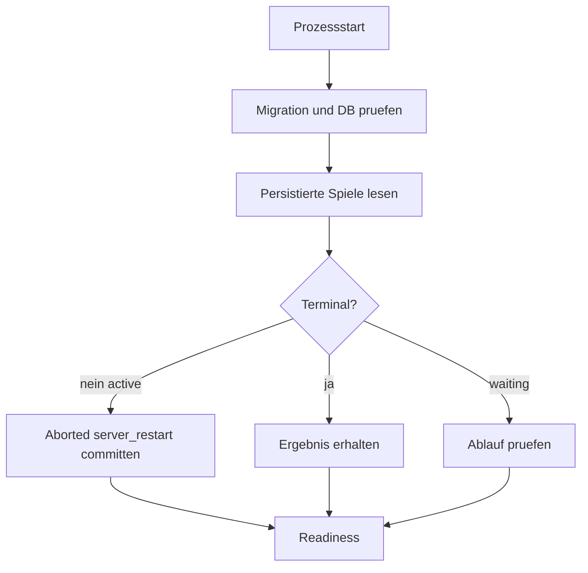

# Crash Recovery

[Dokumentationsindex](../INDEX.md) · [Architekturvertrag](../architecture/overview.md)

## Verbindliche Restart-Policy

Monotone Zeit lässt sich nicht über Prozesslebenszeiten konservieren. Kiban rekonstruiert deshalb aktive Zeitpartien nicht aus UTC-Differenzen. Nach Neustart werden alle vorgefundenen active Spiele (einschließlich intern als recovery_required gesperrter Actors) in einer idempotenten Transaktion pro Spiel aborted(server_restart), ohne Rating. Bereits finished/cancelled/aborted bleiben unverändert; waiting-Spiele werden anhand persistierter24h-Gültigkeit geladen oder cancelled. Erst nach dieser Recovery wird Readiness positiv und neue Aktivierung erlaubt.

## Persistenzfehler ohne Prozessrestart

Der Actor sperrt Mutationen als recovery_required und zeigt keinen Erfolg vor sicherem Commit. Abgleich prüft Receipt, Gameversion und Eventkette. Ist die Mutation committed, erhalten Retry-Clients das ursprüngliche Receipt; ist das Spiel dadurch bereits terminal, bleibt das Ergebnis. Ist es noch aktiv, wird es anschließend neutral persistence_failure abgebrochen, weil eine zuverlässige Fortsetzung der Uhr nicht zugesichert ist. Ist kein Commit vorhanden, wird aus dem letzten dauerhaften Snapshot ebenfalls ein neutraler Abbruch committed. Solange DB nicht verfügbar ist, bleibt es gesperrt und wird bei Neustart von obiger Policy erfasst.

## Historie und Integrität

Jede Eventversion muss genau einmal existieren, Snapshotversion mit letzter Eventversion übereinstimmen und jeder Move auf sein Event verweisen. Defekte Aggregate in Quarantäne statt still reparieren oder trotzdem ausliefern. Snapshot ist Wiederherstellungspunkt, History Audit-/Replaymaterial; nicht aus wenigen letzten Zügen einen unbekannten Vollzustand erraten.

## Backup und Wiederherstellung

Tägliches verschlüsseltes Backup mit7 täglichen und4 wöchentlichen Ständen als Ausgangsplan. Schlüssel getrennt sichern, Restore auf isoliertem Host testen, Benutzerrechte und Schema mitprüfen. RPO24h/RTO2h sind zu messende Übungsziele; bestätigte Züge seit letztem Backup können beim vollständigen DB-Verlust verloren gehen. Das unterscheidet sich von Prozesscrash bei intakter DB. Backups enthalten auch geheime Junqi-Ränge und personenbezogene Daten. Restore niemals in ungeschützt öffentliches Staging mit echten Tokens.

Manueller Drill: Zug bestätigen, Server hart stoppen, neu starten, gleiche Session verwenden, aborted mit vollständiger bestätigter History lesen; Retry derselben request_id darf keine weitere Figur bewegen. Drill zweimal durchführen, zweiter Neustart darf keinen zweiten Abbruch hinzufügen.
