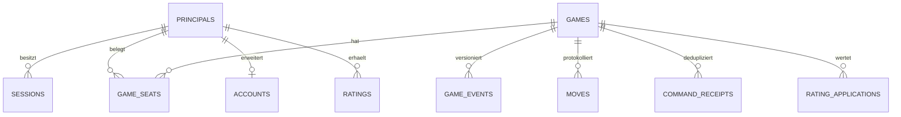

# Relationales Schema

[Dokumentationsindex](../INDEX.md) · [Architekturvertrag](../architecture/overview.md)

## Entitäten und Schlüssel

Keine ausführbaren Migrationen: die folgende Tabelle ist ein Entwurfsvertrag. IDs sind opak, Zeitpunkte UTC timestamptz, Versionen nichtnegative bigint mit Protokollobergrenze2^53−1. Geheimnisse gehören nie in unverschlüsseltes JSONB.

| Entität | Wesentliche Felder | Constraints und Indexzweck |
|---|---|---|
| principals | id, display_name, created_at, kind | stabile Identität; Anzeigename nicht unique |
| sessions | id, principal_id, token_hash, expires_at, revoked_at | token_hash unique; FK Principal; Ablaufindex |
| games | id, kind, ruleset_id, status, visibility, version, snapshot, created_at, finished_at | Status/Result konsistent; Index öffentliche waiting Spiele |
| game_seats | game_id, seat, principal_id | PK(game_id,seat), unique(game_id,principal_id) |
| invitations | game_id, code_hash, expires_at, consumed_at | Hash unique, FK Game, niemals öffentliche Liste |
| game_events | game_id, version, event_kind, event_payload, committed_at | PK(game_id,version), append-only |
| moves | game_id, ply, event_version, action, position_hash | PK(game_id,ply), FK Event, eindeutige Eventreferenz |
| command_receipts | game_id, principal_id, request_id, payload_hash, result, accepted_version | unique Scope, FK Eventversion |
| creation_receipts | principal_id, request_id, operation, payload_hash, encrypted_response, expires_at | unique Scope, verschlüsselte Einladungantwort |
| accounts | id, principal_id, login_key, password_hash | Principal unique; normalisierter login_key unique |
| rating_pools | id, game_kind, ruleset_id, time_bucket | Pooldefinition unique und unveränderlich |
| ratings | principal_id, pool_id, value, games_count | PK(Principal,Pool) |
| rating_applications | game_id, pool_id, result_version | unique(Game,Pool); verhindert Doppelwertung |

Accounts und Ratings werden erst27/28 eingeführt. JSONB-Snapshot enthält ein schema_version-Feld und genau das interne spielabhängige Aggregat, nicht nur öffentliche Views. Junqi-Snapshots sind vertraulich und werden nie direkt aus SQL als API-Response verwendet. Überprüfbare häufige Filter verbleiben in typisierten relationalen Spalten; kein Suchfilter auf unkontrolliertem JSON.

## Integrität und Datenschutz

Snapshot.version entspricht games.version und höchster Eventversion; Entstehung des Spiels ist Version1 mit created-Event, Aktivierung Version2. Waiting Join kann dadurch gleichzeitig Sitzbelegung und Spielbeginn repräsentieren, ohne zwei Zwischenversionen zu publizieren. Züge zählen separat ply ab1; Version und Zugnummer sind verschieden.

Ein Spielaggregat inklusive aller relevanten History-/Receipt-Daten wird zusammen nach180Tagen gelöscht oder vorab in definiertes Archiv überführt. Receipts nicht früher löschen. Accountlöschung erfordert Pseudonymisierung historischer Anzeigenamen und dokumentierten Backup-Nachlauf. Fremdschlüssel und Unique Constraints sind letzte Integritätsbarriere, kein Ersatz für Actor-Autorisierung.

## Erweiterungstabellen und feste Präzision

- account_recovery_codes: account_id,code_hash,created_at,used_at,generation; Hash unique, Verbrauch mit Passwort-/Sessionänderung in einer Transaktion. Regeneration invalidiert vorige Generation.
- matchmaking_tickets: ticket_id,principal_id,pool_id,initial_ms,increment_ms,status,queued_at,game_id,cancel_reason. Partieller Unique Constraint auf Principal bei status=queued; paired benötigt game_id und darf nicht zugleich cancelled sein. Zwei Tickets plus Game/Seats in einer Transaktion paaren.
- account_operation_receipts: principal_id,operation,request_id,payload_hash,outcome; enthält nie Passwörter oder Klartext-Recoverycodes. Bereits erfolgtes Upgrade nach verlorenem Response wird über Login aufgeklärt.
- rating_applications ergänzt old/new ratings beider Principals und algorithm_version. ratings.value verwendet sechs Dezimalstellen mit dokumentiertem numerischem Wertebereich; kein unkontrolliertes Double/NaN. Eine Änderung einmal runden, Gegenseite exakt negiert; beide alten Werte gemeinsam lesen.

TimeControl-Felder heißen im Wire und in der Domain initial_ms und increment_ms. Anzeigenotation3+2 ist nur UI; sie entspricht180000/2000. Spielergebnis, Ratingfähigkeit und Pool werden beim Spielbeginn fixiert. Ungetaktetes Junqi verwendet clock=null und kein Xiangqi-Zeitpreset.
